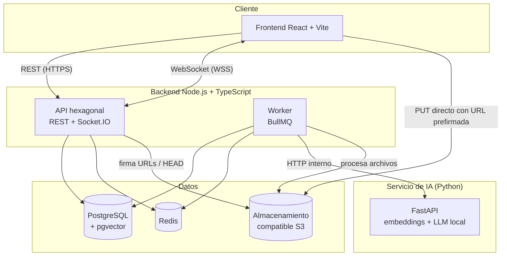
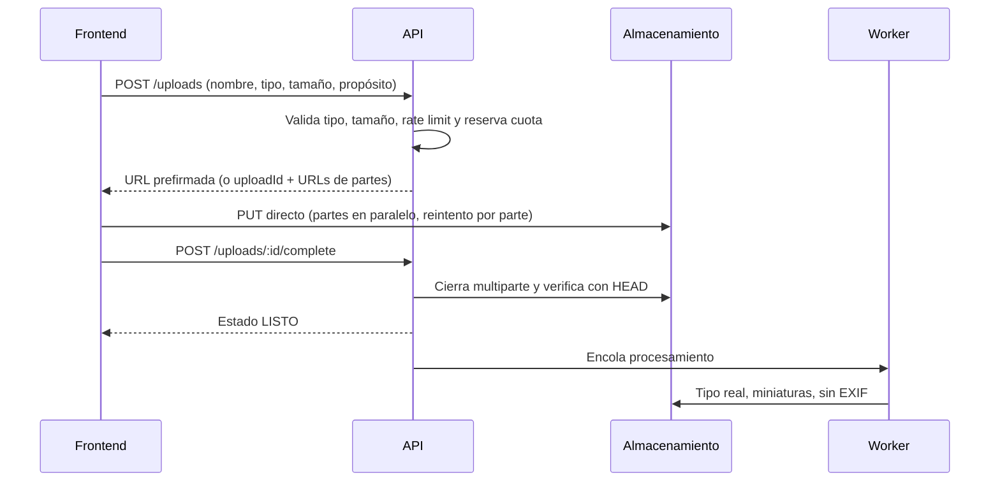

# ImpulsaU — Especificación técnica

> **Plataforma:** ImpulsaU
> **Tipo:** Proyecto universitario
> **Versión del documento:** 0.3 (borrador de planificación)
> **Fecha:** 28 de septiembre de 2026
> **Demo:** octubre de 2026 (fecha exacta por confirmar) · **Entrega final:** principios de noviembre de 2026


> **⚠ Aviso de vigencia (actualizado 1 oct 2026):** la infraestructura final usa **Supabase** (base, archivos y autenticación) y no Azure; ver la sección 20 de la especificación técnica del stack (versión 2.0).
>
> **Aviso de vigencia (30 sep 2026):** este documento conserva la visión, las reglas de negocio y los casos de uso, que siguen vigentes. Las siguientes secciones quedaron **reemplazadas** por documentos posteriores y deben leerse allí:
> - Stack, IA (ahora en TypeScript, no Python), arquitectura del backend (NestJS por módulos con dos salidas), sistema de diseño y paleta (negro, blanco y menta), infraestructura, despliegue, CI/CD y desarrollo con agentes → **Especificación técnica del stack**.
> - Modelo de datos → **Modelo de datos**.
> - Pruebas extremo a extremo → **Pruebas E2E con Playwright**.
> - Requisito de ingreso: el único requisito es **no tener experiencia laboral** (estudiantes y egresados), con un solo rol "Talento"; actor Docente, conexión por interés mutuo y salida al conseguir el primer empleo (definidos después de la versión original de este documento).

---

## Índice

1. [Visión y propuesta de valor](#1-visión-y-propuesta-de-valor)
2. [Reglas de negocio fundamentales](#2-reglas-de-negocio-fundamentales)
3. [Actores](#3-actores)
4. [Alcance y priorización](#4-alcance-y-priorización)
5. [Casos de uso](#5-casos-de-uso)
6. [Arquitectura](#6-arquitectura)
7. [Conexiones esperadas](#7-conexiones-esperadas)
8. [Agente de IA propio](#8-agente-de-ia-propio)
9. [Modelo de datos](#9-modelo-de-datos)
10. [Idempotencia y concurrencia](#10-idempotencia-y-concurrencia)
11. [Interacciones con Redis (likes y contadores)](#11-interacciones-con-redis-likes-y-contadores)
12. [Subida de archivos](#12-subida-de-archivos)
13. [Infraestructura y despliegue](#13-infraestructura-y-despliegue)
14. [Seguridad y privacidad](#14-seguridad-y-privacidad)
15. [Requerimientos no funcionales](#15-requerimientos-no-funcionales)
16. [Desarrollo con agentes y contratos](#16-desarrollo-con-agentes-y-contratos)
17. [Cronograma](#17-cronograma)
18. [Riesgos](#18-riesgos)
19. [Decisiones pendientes](#19-decisiones-pendientes)

---

## 1. Visión y propuesta de valor

**ImpulsaU** es una plataforma que **conecta directamente a personas sin experiencia laboral con empresas que contratan talento de entrada**, usando como carta de presentación los proyectos que realizaron durante su formación, respaldados por sus docentes.

### Por qué ImpulsaU no es un "LinkedIn 2.0"

LinkedIn premia lo que ya se tiene: cargos, años de experiencia y contactos. Esta plataforma invierte la lógica: **la moneda es la evidencia de lo que la persona sabe hacer**, y la plataforma es un **trampolín hacia el primer empleo**, no un lugar para quedarse.

| LinkedIn | ImpulsaU |
|---|---|
| Sección de experiencia laboral | No existe; el perfil es un portafolio de proyectos |
| Habilidades declaradas | Habilidades respaldadas por proyectos concretos |
| Recomendaciones entre contactos | Avales de docentes verificados, ligados a una materia |
| Vacantes con "X años de experiencia" | Solo vacantes de entrada (pasantías, primer empleo, trainee) |
| Cualquiera escribe a cualquiera | Conversación solo tras interés mutuo |
| Perfil permanente | El perfil "se gradúa" al conseguir el primer empleo |
| Feed de publicaciones generales | Feed exclusivo de proyectos |

### Métrica principal de éxito

**Tiempo desde el registro hasta el primer empleo** y porcentaje de talentos que lo consiguen.

---

## 2. Reglas de negocio fundamentales

| ID | Regla |
|---|---|
| RN-01 | **Requisito único de ingreso:** no tener experiencia laboral formal (empleo con contrato o planilla en el área de su formación). |
| RN-02 | **No cuentan como experiencia** y pueden mostrarse como proyectos: prácticas profesionales, pasantías académicas, horas sociales, voluntariado, proyectos académicos y trabajos freelance esporádicos. |
| RN-03 | Edad mínima de registro: **18 años**. |
| RN-04 | El registro exige una **declaración de cero experiencia** aceptando la definición de RN-01 y RN-02. |
| RN-05 | Al conseguir el primer empleo, el perfil pasa a **"primer empleo conseguido"**: sale de las búsquedas y queda como caso de éxito. |
| RN-06 | Las empresas solo pueden publicar **vacantes de entrada**. Una vacante que exija experiencia previa no se publica. |
| RN-07 | Solo **empresas verificadas** pueden publicar vacantes y mostrar interés en talentos. |
| RN-08 | Una conversación solo se abre cuando existe **interés mutuo** (una parte muestra interés y la otra acepta). |
| RN-09 | Solo se registran empresas que contratan para sí mismas. Si se permiten agencias, deben declarar para qué empresa reclutan. |
| RN-10 | Un docente se verifica mediante **correo institucional** de un dominio aprobado. |
| RN-11 | Las habilidades se eligen de un **catálogo normalizado**; no se aceptan como texto libre. |
| RN-12 | Una habilidad sin proyecto que la respalde se muestra como **"declarada"**; con proyecto, como **"demostrada"**. |
| RN-13 | El talento decide qué campos de su perfil son públicos. |

---

## 3. Actores

| Actor | Descripción |
|---|---|
| **Visitante** | Sin sesión. Ve proyectos, perfiles públicos y vacantes. |
| **Talento** | Persona sin experiencia laboral. Estado académico: estudiante (con ciclo) o egresado (con año de egreso). Publica proyectos, se postula, usa el agente. |
| **Empresa** | Organización que contrata directamente. Busca talento, publica vacantes, usa el agente. |
| **Docente** | Profesor verificado por correo institucional. Avala proyectos de talentos. |
| **Administrador** | Verifica empresas, modera contenido, administra catálogos. |
| **Sistema** | Procesos automáticos: workers, sincronizaciones, limpiezas. |

---

## 4. Alcance y priorización

El alcance se ajusta a un plazo de ~6 semanas, con apoyo de agentes de IA para desarrollo.

| Nivel | Contenido |
|---|---|
| **P1 — Núcleo (obligatorio)** | Autenticación; perfiles de talento y empresa; proyectos con imágenes y enlaces; feed; likes por Redis; búsqueda con filtros y búsqueda semántica; vacantes y postulaciones; agente de IA (intenciones básicas); interés mutuo y mensajería en tiempo real |
| **P2 — Importante** | Comentarios; notificaciones; avales de docentes; verificación de empresas; panel de administración básico; salida por primer empleo |
| **P3 — Recuperable con IA de desarrollo** | Subida multiparte; patrón outbox; repost y compartir con Open Graph; retroalimentación obligatoria al descartar; listas de candidatos; moderación completa |
| **Trabajo futuro (solo diseño)** | Retos de empresas; estadísticas de perfil; invitación de docentes por correo; video alojado en la plataforma; ranking de populares |

---

## 5. Casos de uso

Prioridad: **P1** núcleo, **P2** importante, **P3** recuperable, **F** futuro.

La **fecha objetivo** es el día en que el caso de uso debe estar terminado, probado e integrado (no solo programado). Todas las fechas son de 2026.

### M1. Autenticación

| ID | Caso de uso | Actor | Prioridad | Fecha objetivo |
|---|---|---|---|---|
| CU-01 | Registrarse como Talento (estado académico, fecha de nacimiento, declaración de cero experiencia) | Visitante | P1 | 4 oct |
| CU-02 | Registrarse como Empresa | Visitante | P1 | 4 oct |
| CU-03 | Registrarse como Docente con correo institucional | Visitante | P2 | 1 nov |
| CU-04 | Verificar correo electrónico | Todos | P2 | 1 nov |
| CU-05 | Iniciar sesión | Todos | P1 | 4 oct |
| CU-06 | Cerrar sesión (este dispositivo o todos) | Autenticado | P1 | 4 oct |
| CU-07 | Renovar sesión automáticamente | Sistema | P1 | 4 oct |
| CU-08 | Recuperar contraseña | Todos | P2 | 1 nov |

### M2. Perfiles y búsqueda

| ID | Caso de uso | Actor | Prioridad | Fecha objetivo |
|---|---|---|---|---|
| CU-09 | Editar perfil de talento (formación, habilidades, CV, enlaces) | Talento | P1 | 11 oct |
| CU-10 | Editar perfil de empresa | Empresa | P1 | 11 oct |
| CU-11 | Ver perfil público | Todos | P1 | 11 oct |
| CU-12 | Buscar talentos con filtros (carrera, institución, estado académico, habilidades, ubicación) | Empresa | P1 | 18 oct |
| CU-13 | Configurar privacidad del perfil | Talento | P2 | 1 nov |
| CU-14 | Ver indicador de perfil completo | Talento | P2 | 1 nov |
| CU-15 | Marcar "conseguí mi primer empleo" | Talento | P2 | 1 nov |
| CU-16 | Seguir a un talento o empresa | Autenticado | P3 | 1 nov (si hay margen) |

### M3. Proyectos

| ID | Caso de uso | Actor | Prioridad | Fecha objetivo |
|---|---|---|---|---|
| CU-17 | Publicar proyecto (título, descripción, tecnologías, materia, imágenes, enlaces) | Talento | P1 | 11 oct |
| CU-18 | Editar o eliminar proyecto propio | Talento | P1 | 11 oct |
| CU-19 | Ver detalle de proyecto | Todos | P1 | 11 oct |
| CU-20 | Explorar feed de proyectos | Todos | P1 | 11 oct |
| CU-21 | Agregar colaboradores y declarar contribuciones | Talento | P2 | 1 nov |

### M4. Interacción social

| ID | Caso de uso | Actor | Prioridad | Fecha objetivo |
|---|---|---|---|---|
| CU-22 | Dar y quitar like | Autenticado | P1 | 11 oct |
| CU-23 | Comentar y responder (un nivel) | Autenticado | P2 | 1 nov |
| CU-24 | Editar o eliminar comentario propio | Autor | P2 | 1 nov |
| CU-25 | Reportar contenido o perfil no elegible | Autenticado | P2 | 1 nov |
| CU-26 | Repostear proyecto (simple o con comentario) | Autenticado | P3 | 1 nov (si hay margen) |
| CU-27 | Compartir enlace externo con vista previa | Todos | P3 | 1 nov (si hay margen) |
| CU-28 | Compartir proyecto por mensaje interno | Autenticado | P3 | 1 nov (si hay margen) |

### M5. Conexión directa y mensajería

| ID | Caso de uso | Actor | Prioridad | Fecha objetivo |
|---|---|---|---|---|
| CU-29 | Mostrar interés en un talento (con mensaje breve) | Empresa verificada | P1 | 25 oct |
| CU-30 | Mostrar interés en una empresa | Talento | P1 | 25 oct |
| CU-31 | Aceptar o declinar un interés recibido | Talento, Empresa | P1 | 25 oct |
| CU-32 | Enviar y recibir mensajes en tiempo real | Participantes | P1 | 25 oct |
| CU-33 | Ver historial de conversación paginado | Participantes | P1 | 25 oct |
| CU-34 | Ver "escribiendo" y "leído" | Participantes | P2 | 1 nov |
| CU-35 | Bloquear o reportar usuario | Autenticado | P2 | 1 nov |

### M6. Agente de IA

| ID | Caso de uso | Actor | Prioridad | Fecha objetivo |
|---|---|---|---|---|
| CU-36 | Consultar al agente sobre su perfil y brechas | Talento | P1 | 25 oct |
| CU-37 | Buscar candidatos en lenguaje natural | Empresa | P1 | 25 oct |
| CU-38 | Ver historial de consultas al agente | Talento, Empresa | P2 | 1 nov |
| CU-39 | Calificar respuesta del agente | Talento, Empresa | P2 | 1 nov |

### M7. Vacantes y postulaciones

| ID | Caso de uso | Actor | Prioridad | Fecha objetivo |
|---|---|---|---|---|
| CU-40 | Publicar vacante de entrada | Empresa verificada | P1 | 18 oct |
| CU-41 | Editar, pausar o cerrar vacante | Empresa | P1 | 18 oct |
| CU-42 | Explorar y buscar vacantes | Todos | P1 | 18 oct |
| CU-43 | Postularse adjuntando proyectos | Talento | P1 | 18 oct |
| CU-44 | Revisar postulaciones y cambiar estado | Empresa | P1 | 18 oct |
| CU-45 | Seguimiento de mis postulaciones | Talento | P1 | 18 oct |
| CU-46 | Retroalimentación obligatoria al descartar | Empresa | P3 | 1 nov (si hay margen) |

### M8. Notificaciones

| ID | Caso de uso | Actor | Prioridad | Fecha objetivo |
|---|---|---|---|---|
| CU-47 | Recibir notificaciones en tiempo real (likes, comentarios, intereses, mensajes, postulaciones, avales) | Autenticado | P2 | 1 nov |
| CU-48 | Ver bandeja y marcar como leídas | Autenticado | P2 | 1 nov |

### M9. Avales de docentes

| ID | Caso de uso | Actor | Prioridad | Fecha objetivo |
|---|---|---|---|---|
| CU-49 | Solicitar aval de un proyecto a un docente (materia y periodo) | Talento | P2 | 1 nov |
| CU-50 | Aprobar o rechazar aval con comentario | Docente | P2 | 1 nov |
| CU-51 | Revocar aval | Docente | P2 | 1 nov |
| CU-52 | Invitar por correo a un docente no registrado | Talento | F | Trabajo futuro |

### M10. Empresas y administración

| ID | Caso de uso | Actor | Prioridad | Fecha objetivo |
|---|---|---|---|---|
| CU-53 | Solicitar verificación de empresa | Empresa | P2 | 1 nov |
| CU-54 | Aprobar o rechazar verificación | Administrador | P2 | 1 nov |
| CU-55 | Revisar reportes y ocultar contenido | Administrador | P2 | 1 nov |
| CU-56 | Suspender o reactivar cuentas | Administrador | P2 | 1 nov |
| CU-57 | Administrar catálogos (habilidades, carreras, instituciones, dominios) | Administrador | P2 | 1 nov |
| CU-58 | Crear listas de candidatos con notas privadas | Empresa | P3 | 1 nov (si hay margen) |
| CU-59 | Publicar retos para talentos | Empresa | F | Trabajo futuro |

### 5.1 Flujos detallados de los casos críticos

#### CU-01 · Registrarse como Talento

- **Precondición:** el visitante no tiene cuenta.
- **Flujo principal:**
  1. Ingresa nombre, correo, contraseña, fecha de nacimiento y estado académico.
  2. Acepta la declaración de cero experiencia laboral y los términos.
  3. El sistema valida edad ≥ 18, formato de datos y correo no registrado.
  4. Crea la cuenta con estado `PENDIENTE_VERIFICACION` y envía correo de verificación.
  5. Inicia sesión automáticamente y redirige a completar perfil.
- **Alternos:** correo ya registrado → mensaje genérico (no revelar existencia de cuentas); menor de edad → registro rechazado.
- **Idempotencia:** `Idempotency-Key` en la petición; restricción única sobre el correo.

#### CU-17 · Publicar proyecto

- **Precondición:** talento autenticado.
- **Flujo principal:**
  1. Completa título, descripción, tecnologías (del catálogo), materia y enlaces.
  2. Por cada imagen, el frontend solicita una intención de subida y sube directo al almacenamiento (ver sección 12).
  3. Envía el proyecto con los ids de los archivos confirmados.
  4. El sistema valida, guarda y encola el cálculo del embedding.
  5. El proyecto aparece en el feed y en el perfil.
- **Alternos:** archivo no confirmado → rechazo con detalle; cuota excedida → rechazo antes de subir.
- **Idempotencia:** `Idempotency-Key`; el job de embedding usa `jobId` determinista.

#### CU-22 · Dar like

- **Flujo principal:**
  1. El frontend marca el like de inmediato (UI optimista) y envía `PUT /projects/:id/like`.
  2. La API ejecuta el script Lua en Redis (sección 11) y responde con el total.
  3. El worker sincroniza con Postgres por lotes y genera la notificación.
- **Alternos:** error → el frontend revierte el estado visual.
- **Idempotencia:** `SADD` en Redis y restricción única en Postgres.

#### CU-29 a CU-31 · Interés mutuo y apertura de conversación

- **Flujo principal:**
  1. La empresa verificada marca interés en un talento con un mensaje breve.
  2. El talento recibe notificación y acepta.
  3. El sistema crea la conversación (única por par empresa–talento) y notifica a ambos.
  4. Ambos pueden chatear en tiempo real.
- **Alternos:** el talento declina → la empresa recibe aviso neutro; ambos marcan interés a la vez → se crea una sola conversación (`ON CONFLICT`).

#### CU-36 / CU-37 · Consultar al agente

- **Flujo principal:**
  1. El usuario escribe su pregunta; el frontend envía `POST /agent/queries`.
  2. La API valida el límite de uso, encola la consulta y responde `202` con `queryId`.
  3. El worker pide al servicio de IA interpretar la pregunta (JSON de intención).
  4. El worker ejecuta las herramientas correspondientes contra la base de datos, respetando permisos y privacidad.
  5. El worker pide al servicio de IA redactar la respuesta con los datos obtenidos.
  6. La API emite `agent:response` por WebSocket; el frontend reemplaza el skeleton por la respuesta.
- **Alternos:** cola llena → `429` con mensaje amable; intención fuera de alcance → respuesta explicando qué puede hacer el agente; tiempo agotado → mensaje de reintento.

#### CU-43 / CU-44 · Postulación y cambio de estado

- **Flujo principal:**
  1. El talento se postula adjuntando proyectos; se valida que la vacante esté abierta en la misma transacción.
  2. La empresa cambia el estado (`RECIBIDA → EN_REVISION → ENTREVISTA → SELECCIONADA | DESCARTADA`).
  3. Cada cambio notifica al talento. Al quedar `SELECCIONADA`, se le pide confirmar el primer empleo (CU-15).
- **Concurrencia:** bloqueo optimista con columna `version`; `409` si otro reclutador cambió antes.
- **Idempotencia:** restricción única (talento, vacante).

---

## 6. Arquitectura

### 6.1 Vista general



### 6.2 Stack tecnológico

| Capa | Tecnología | Estado |
|---|---|---|
| Frontend | React + Vite + TypeScript, Tailwind | Decidido |
| Backend | Node.js + TypeScript, arquitectura hexagonal | Decidido |
| Framework HTTP | Fastify (sugerido) o Express | Por confirmar |
| Tiempo real | Socket.IO con adaptador de Redis | Decidido |
| ORM / consultas | Drizzle ORM (recomendado sobre Prisma por control de SQL, bloqueos y pgvector) | Por confirmar |
| Validación y contratos | Zod | Decidido |
| Base de datos | PostgreSQL + pgvector | Decidido |
| Caché, colas, contadores | Redis + BullMQ | Decidido |
| IA | Python + FastAPI + llama-cpp-python + modelo de embeddings | Decidido |
| Almacenamiento | Compatible S3 (MinIO en local) | Proveedor por confirmar |
| Subidas en frontend | Uppy (plugin S3) | Sugerido |

### 6.3 Arquitectura hexagonal (API y worker)

```
apps/api/src
├── domain/            # Entidades, value objects, reglas, eventos de dominio. Sin dependencias externas.
├── application/       # Casos de uso (uno por CU) y puertos (interfaces).
│   ├── use-cases/
│   └── ports/
├── infrastructure/    # Adaptadores: Drizzle, Redis, S3, servicio IA, correo, colas.
└── interfaces/        # Entrada: controladores HTTP, gateway de Socket.IO, middlewares.
```

**Regla de dependencias:** `interfaces → application → domain`, e `infrastructure → application`. El dominio no importa nada de infraestructura. Se verifica automáticamente en CI con `dependency-cruiser`.

### 6.4 Puertos principales

| Puerto | Responsabilidad | Adaptador |
|---|---|---|
| `UnidadDeTrabajo` | Ejecutar operaciones dentro de una transacción | Drizzle |
| `RepositorioTalentos`, `RepositorioEmpresas`, `RepositorioProyectos`, `RepositorioVacantes`, `RepositorioPostulaciones`, `RepositorioConversaciones` | Persistencia de cada agregado | Drizzle |
| `RepositorioReacciones` | Likes y contadores | Redis (Lua) |
| `BuscadorTalentos` | Búsqueda híbrida (filtros + similitud) | Drizzle + SQL pgvector |
| `ModeloIA` | Embeddings, interpretación y redacción | HTTP al servicio Python |
| `Almacenamiento` | URLs prefirmadas, multiparte, verificación | S3 |
| `ColaTrabajos` | Encolar jobs | BullMQ |
| `PublicadorEventos` | Publicar eventos de dominio | Outbox / BullMQ |
| `NotificadorTiempoReal` | Emitir eventos a usuarios | Socket.IO |
| `ServicioHash`, `ServicioTokens` | Contraseñas y JWT | Argon2, jose |
| `LimitadorTasa`, `RegistroIdempotencia` | Rate limiting y llaves de idempotencia | Redis |
| `EnviadorCorreo` | Correos transaccionales | SMTP |

---

## 7. Conexiones esperadas

### 7.1 Mapa de conexiones

| Origen | Destino | Protocolo | Autenticación | Propósito |
|---|---|---|---|---|
| Frontend | API | REST sobre HTTPS | JWT de acceso (Bearer) + refresh en cookie `httpOnly` | Operaciones CRUD, búsquedas, autenticación |
| Frontend | API | WebSocket (WSS) con Socket.IO | JWT en el handshake | Mensajes, notificaciones, respuestas del agente |
| Frontend | Almacenamiento | HTTPS `PUT` | URL prefirmada con expiración corta | Subida directa de archivos |
| Frontend | Almacenamiento/CDN | HTTPS `GET` | Público o URL firmada | Lectura de imágenes y archivos |
| API | PostgreSQL | TCP con TLS | Credenciales (cadena con pooling) | Persistencia |
| API | Redis | TCP con TLS | Token/contraseña | Caché, contadores, rate limit, idempotencia, adaptador Socket.IO |
| API | Almacenamiento | HTTPS (API S3) | Access key/secret | Firmar URLs, verificar objetos |
| Worker | PostgreSQL | TCP con TLS | Credenciales | Sincronizaciones, embeddings, notificaciones |
| Worker | Redis | TCP con TLS | Token/contraseña | Consumir colas y streams |
| Worker | Servicio IA | HTTPS interno | Token de servicio compartido | Embeddings, interpretación, redacción |
| Worker | Almacenamiento | HTTPS (API S3) | Access key/secret | Miniaturas, limpieza de metadatos, borrado de huérfanos |
| API | Correo | SMTP/HTTPS | Credenciales del proveedor | Verificación y recuperación |

**Reglas:** el servicio de IA **nunca** accede a la base de datos ni es llamado desde el frontend; toda llamada entre servicios tiene timeout y reintentos solo si la operación es idempotente.

### 7.2 Endpoints REST (prefijo `/api/v1`)

#### Autenticación
| Método | Ruta | Descripción |
|---|---|---|
| POST | `/auth/register` | Registro (talento, empresa, docente) |
| POST | `/auth/login` | Inicio de sesión |
| POST | `/auth/refresh` | Renovar token de acceso |
| POST | `/auth/logout` | Cerrar sesión actual |
| POST | `/auth/logout-all` | Cerrar todas las sesiones |
| POST | `/auth/verify-email` | Verificar correo |
| POST | `/auth/forgot-password` | Solicitar recuperación |
| POST | `/auth/reset-password` | Restablecer contraseña |
| GET | `/me` | Usuario actual |

#### Perfiles y catálogos
| Método | Ruta | Descripción |
|---|---|---|
| GET | `/talents` | Búsqueda con filtros (paginación por cursor) |
| GET | `/talents/:id` | Perfil público de talento |
| PATCH | `/me/talent-profile` | Editar perfil de talento |
| PUT | `/me/privacy` | Configuración de privacidad |
| POST | `/me/first-job` | Marcar primer empleo conseguido |
| GET | `/companies/:id` | Perfil de empresa |
| PATCH | `/me/company-profile` | Editar perfil de empresa |
| POST | `/companies/verification-requests` | Solicitar verificación |
| GET | `/skills?q=` | Autocompletado de habilidades |
| GET | `/catalogs/careers`, `/catalogs/institutions` | Catálogos |
| GET | `/search/talents` | Búsqueda híbrida (texto libre + filtros) |

#### Proyectos e interacción
| Método | Ruta | Descripción |
|---|---|---|
| POST | `/projects` | Crear proyecto |
| GET | `/projects/:id` | Detalle |
| PATCH | `/projects/:id` | Editar (encabezado `If-Match` con versión) |
| DELETE | `/projects/:id` | Eliminar |
| GET | `/feed` | Feed paginado por cursor |
| PUT / DELETE | `/projects/:id/like` | Dar / quitar like |
| PUT / DELETE | `/projects/:id/repost` | Repostear / deshacer |
| POST | `/projects/:id/shares` | Registrar compartido |
| GET / POST | `/projects/:id/comments` | Listar / crear comentarios |
| PATCH / DELETE | `/comments/:id` | Editar / eliminar comentario |
| POST | `/projects/:id/endorsement-requests` | Solicitar aval |
| GET | `/p/:id` | HTML con Open Graph para compartir (fuera del prefijo) |

#### Conexión y mensajería
| Método | Ruta | Descripción |
|---|---|---|
| PUT | `/talents/:id/interest` | Empresa muestra interés |
| PUT | `/companies/:id/interest` | Talento muestra interés |
| POST | `/interests/:id/accept` | Aceptar interés |
| POST | `/interests/:id/decline` | Declinar interés |
| GET | `/conversations` | Lista con no leídos |
| GET | `/conversations/:id/messages?beforeSeq=` | Historial paginado |
| POST | `/conversations/:id/messages` | Alternativa REST para enviar (si falla el socket) |

#### Vacantes
| Método | Ruta | Descripción |
|---|---|---|
| GET / POST | `/vacancies` | Listar / crear vacante |
| GET / PATCH | `/vacancies/:id` | Detalle / editar, pausar, cerrar |
| POST | `/vacancies/:id/applications` | Postularse |
| GET | `/vacancies/:id/applications` | Postulaciones (empresa) |
| PATCH | `/applications/:id/status` | Cambiar estado (`If-Match`) |
| GET | `/me/applications` | Mis postulaciones |

#### Agente, archivos, notificaciones, avales y administración
| Método | Ruta | Descripción |
|---|---|---|
| POST | `/agent/queries` | Enviar consulta (responde `202` con `queryId`) |
| GET | `/agent/queries/:id` | Estado/resultado (respaldo del socket) |
| GET | `/agent/history` | Historial de consultas |
| POST | `/agent/queries/:id/feedback` | Calificar respuesta |
| POST | `/uploads` | Crear intención de subida |
| POST | `/uploads/:id/parts` | URLs de partes (multiparte) |
| POST | `/uploads/:id/complete` | Confirmar subida |
| GET | `/files/:id/url` | URL firmada de lectura (archivos privados) |
| GET | `/notifications` | Bandeja |
| POST | `/notifications/read` | Marcar leídas hasta un id |
| GET | `/me/endorsement-requests` | Solicitudes de aval (docente) |
| POST | `/endorsement-requests/:id/approve` · `/reject` | Resolver solicitud |
| DELETE | `/endorsements/:id` | Revocar aval |
| POST | `/reports` | Reportar contenido o perfil |
| GET / PATCH | `/admin/reports`, `/admin/reports/:id` | Moderación |
| PATCH | `/admin/companies/:id/verification` | Verificar empresa |
| PATCH | `/admin/users/:id/status` | Suspender / reactivar |

**Convenciones:** todas las creaciones aceptan `Idempotency-Key`; las ediciones concurrentes usan `If-Match`; los errores siguen un formato único `{ code, message, details }`; los códigos relevantes son `409` (conflicto de versión), `422` (llave de idempotencia reutilizada con otro cuerpo) y `429` (límite de tasa o cola del agente llena).

### 7.3 Eventos WebSocket

**Salas:** `user:{id}` (todo lo personal) y `conversation:{id}` (participantes).

| Dirección | Evento | Payload | Notas |
|---|---|---|---|
| Cliente → Servidor | `message:send` | `{ conversationId, clientMessageId, body }` | Con acknowledgment; idempotente por `clientMessageId` |
| Cliente → Servidor | `message:read` | `{ conversationId, seq }` | Solo avanza (`GREATEST`) |
| Cliente → Servidor | `typing:start` / `typing:stop` | `{ conversationId }` | Sin persistencia |
| Cliente → Servidor | `conversation:sync` | `{ conversationId, afterSeq }` | Recuperar mensajes tras reconexión |
| Servidor → Cliente | `message:new` | `{ conversationId, seq, clientMessageId, senderId, body, createdAt }` | |
| Servidor → Cliente | `message:read` | `{ conversationId, userId, seq }` | |
| Servidor → Cliente | `typing` | `{ conversationId, userId, active }` | |
| Servidor → Cliente | `notification:new` | `{ id, type, data, createdAt }` | |
| Servidor → Cliente | `interest:accepted` | `{ interestId, conversationId }` | |
| Servidor → Cliente | `agent:response` | `{ queryId, status, answer, sources }` | `status`: `done` o `error` |

### 7.4 Servicio de IA (interno)

| Método | Ruta | Entrada | Salida |
|---|---|---|---|
| POST | `/v1/embed` | `{ texts: string[] }` | `{ vectors: number[][] }` (384 dimensiones) |
| POST | `/v1/parse` | `{ query, role }` | `{ intent, filters, semanticQuery, confidence }` |
| POST | `/v1/generate` | `{ intent, role, data }` | `{ answer }` |
| GET | `/health` | — | Estado y modelo cargado |

Autenticación con token de servicio en un encabezado; el servicio rechaza cualquier petición sin él.

### 7.5 Colas y trabajos (BullMQ)

| Cola | Disparador | Concurrencia | `jobId` | Descripción |
|---|---|---|---|---|
| `embeddings` | Crear/editar proyecto, perfil o vacante | 2 | `emb:{tipo}:{id}:v{version}` | Calcula y guarda el embedding si la versión es más nueva |
| `agent-queries` | `POST /agent/queries` | 1 | `agent:{queryId}` | Interpretación, herramientas y redacción |
| `notifications` | Eventos de dominio | 4 | `notif:{eventoId}` | Crea y emite notificaciones |
| `uploads-process` | Subida confirmada | 2 | `upl:{uploadId}` | Tipo real, miniaturas, limpieza de EXIF |
| `reactions-sync` | Repetible cada 10 s | 1 | fijo | Sincroniza likes y contadores de Redis a Postgres |
| `outbox-relay` | Repetible cada 2 s | 1 | fijo | Publica eventos de la tabla outbox |
| `cleanup` | Repetible cada hora | 1 | fijo | Subidas huérfanas, cuotas, llaves expiradas |

### 7.6 Llaves de Redis

| Llave | Tipo | Expiración | Uso |
|---|---|---|---|
| `reacciones:likes:{proyectoId}` | SET | — | Usuarios que dieron like |
| `stats:{proyectoId}` | HASH | — | Contadores (likes, reposts, compartidos, vistas) |
| `stream:reacciones` | STREAM | Recorte por longitud | Cambios pendientes de sincronizar |
| `sucios:proyectos` | SET | — | Proyectos con contadores por sincronizar |
| `visita:{empresaId}:{talentoId}:{fecha}` | STRING | 24 h | Deduplicar visitas a perfiles |
| `idem:{usuarioId}:{ruta}:{llave}` | STRING | 24 h | Registro de idempotencia |
| `rl:{alcance}:{id}` | STRING | Ventana | Rate limiting |
| `refresh:{usuarioId}:{tokenId}` | STRING | Vida del token | Sesiones revocables |
| `cache:*` | Varios | Corta | Caché de lecturas (perfiles, feed) |
| `lock:*` | STRING | Segundos | Candados contra estampida |
| `bull:*` | Varios | — | Internas de BullMQ |

---

## 8. Agente de IA propio

### 8.1 Principio de diseño

Sin APIs externas y con CPU gratuita, **el LLM no hace todo el trabajo**: interpreta la pregunta y redacta la respuesta. Los datos y cálculos los resuelven piezas deterministas.

| Capacidad | Resuelve | Tecnología |
|---|---|---|
| Consultas estructuradas | Filtros exactos (carrera, habilidades, estado) | Capa semántica → consultas parametrizadas |
| Búsqueda semántica (RAG) | Similitud de significado en proyectos, perfiles y vacantes | Embeddings multilingües (p. ej. `multilingual-e5-small`) + pgvector |
| Análisis de brechas | Qué habilidades faltan frente a vacantes reales | Cálculo de conjuntos y frecuencias |
| Interpretación | Pregunta → JSON de intención | LLM pequeño cuantizado (1.5B–3B, GGUF) con gramática JSON |
| Redacción | Datos → respuesta en lenguaje natural | Mismo LLM, o plantillas como plan B |

### 8.2 Capa semántica

Diccionario que traduce conceptos del negocio a campos reales, para que el modelo nunca invente columnas ni genere SQL libre:

| Concepto | Campo / fuente | Operadores permitidos |
|---|---|---|
| carrera | `talentos.carrera_id` (catálogo) | igual, en lista |
| habilidad | `talento_habilidades` (catálogo) | contiene todas, contiene alguna |
| estado académico | `talentos.estado_academico` | igual |
| año de egreso | `talentos.anio_egreso` | rango |
| institución | `talentos.institucion_id` | igual, en lista |
| ubicación | `talentos.departamento` | igual |
| proyectos avalados | `avales` | existe, cantidad mínima |

### 8.3 Intenciones iniciales

| Intención | Rol | Herramientas que ejecuta |
|---|---|---|
| `analizar_perfil` | Talento | Obtener perfil, completitud, habilidades demostradas vs declaradas |
| `evaluar_para_puesto` | Talento | Buscar vacantes similares, calcular brechas |
| `sugerir_siguiente_proyecto` | Talento | Brechas + habilidades más pedidas |
| `buscar_candidatos` | Empresa | Filtros estructurados + búsqueda semántica + ranking combinado |
| `resumir_candidato` | Empresa | Obtener perfil público y proyectos |
| `fuera_de_alcance` | Ambos | Explicar qué puede hacer el agente |

### 8.4 Reglas del agente

- Solo accede a datos que el usuario tiene permiso de ver y respeta la privacidad de cada perfil.
- Nunca usa ni infiere datos como género o edad para rankear candidatos.
- Las respuestas citan las fuentes usadas (vacantes, proyectos).
- Límite de consultas por usuario y por día.
- Evaluación con un conjunto de 30–50 preguntas de prueba: acierto de intención, relevancia de resultados y calificaciones de usuarios (CU-39).

---

## 9. Modelo de datos

### 9.1 Entidades principales

| Entidad | Campos relevantes | Restricciones e índices clave |
|---|---|---|
| `usuarios` | correo, hash, rol, estado, fecha de nacimiento | Único: correo |
| `talentos` | usuario, carrera, institución, estado académico, año de egreso/ciclo, privacidad, primer empleo, almacenamiento usado, `version` | Índices por filtros de búsqueda |
| `empresas` | usuario, nombre, sector, verificada | — |
| `docentes` | usuario, institución, dominio de correo | — |
| `habilidades` | nombre normalizado | Único: nombre; GIN `pg_trgm` |
| `talento_habilidades` | talento, habilidad | Único: (talento, habilidad) |
| `proyectos` | autor, título, descripción, materia, enlaces, contadores desnormalizados, `version`, `version_contenido` | Índice (creado_en, id); GIN `pg_trgm` en título |
| `proyecto_colaboradores` | proyecto, talento, contribución, confirmada | Único: (proyecto, talento) |
| `likes` | usuario, proyecto | Único: (usuario, proyecto) |
| `reposts` | usuario, proyecto, comentario | Único: (usuario, proyecto) |
| `comentarios` | proyecto, autor, padre, cuerpo | Índice (proyecto, creado_en) |
| `embeddings` | tipo, entidad, vector(384), `version_contenido` | Índice HNSW; único: (tipo, entidad) |
| `vacantes` | empresa, título, modalidad, estado, habilidades | Índice por estado y fecha |
| `postulaciones` | talento, vacante, estado, motivo de descarte, `version` | Único: (talento, vacante) |
| `intereses` | origen, destino, dirección, estado | Único: (empresa, talento, dirección) |
| `conversaciones` | empresa, talento, `ultima_secuencia` | Único: (empresa, talento) |
| `mensajes` | conversación, secuencia, remitente, cuerpo, `client_message_id` | Único: (conversación, secuencia); único: `client_message_id` |
| `lecturas` | conversación, usuario, última secuencia leída | Único: (conversación, usuario) |
| `notificaciones` | usuario, tipo, datos, leída | Índice (usuario, creado_en) |
| `avales` | proyecto, docente, materia, periodo, estado | Único: (proyecto, docente) |
| `uploads` | dueño, clave, propósito, tamaño, estado, visibilidad | Índice (estado, creado_en) |
| `reportes` | reportante, objetivo, motivo, estado | — |
| `outbox` | tipo de evento, payload, procesado | Índice parcial en no procesados |
| `eventos_procesados` | id del evento, consumidor | Único: (evento, consumidor) |
| `consultas_agente` | usuario, pregunta, intención, respuesta, calificación | Índice (usuario, creado_en) |

### 9.2 Catálogos iniciales (seed idempotente)

Habilidades, carreras, instituciones, departamentos de El Salvador y dominios de correo institucional aprobados.

---

## 10. Idempotencia y concurrencia

### 10.1 Idempotencia

| Operación | Mecanismo |
|---|---|
| Like, repost, seguir, interés, guardar en lista | `PUT` / `DELETE` (nunca toggle) + restricción única |
| Crear proyecto, comentario, postulación, subida | `Idempotency-Key` registrada en Redis con `SET NX` (24 h) |
| Enviar mensaje | `clientMessageId` único + acknowledgment del socket |
| Confirmar subida | Transición de estado que tolera repetición |
| Jobs | `jobId` determinista |
| Eventos y notificaciones | Outbox + tabla de eventos procesados |
| Sincronización de contadores | Escritura de valores absolutos, no deltas |

**Middleware de idempotencia:** llave nueva → se registra "en proceso" y se ejecuta; en proceso → `409`; completada → se devuelve la respuesta guardada; misma llave con otro cuerpo → `422`.

### 10.2 Condiciones de carrera y soluciones

| Escenario | Solución |
|---|---|
| Likes simultáneos | Script Lua atómico en Redis (sección 11) |
| Interés mutuo simultáneo | Conversación única por par + `ON CONFLICT DO NOTHING` |
| Dos reclutadores cambian una postulación | Bloqueo optimista (`version`) + condición sobre estado actual |
| Colaboradores editan un proyecto | Bloqueo optimista + `If-Match` |
| Postularse mientras se cierra la vacante | Inserción condicional o `SELECT … FOR UPDATE` sobre la vacante |
| Subidas simultáneas exceden la cuota | Reserva atómica de cuota con `UPDATE … WHERE usado + tamaño <= límite` |
| Orden de mensajes | Secuencia por conversación asignada por el servidor |
| Acuses de lectura desordenados | `GREATEST(ultima_leida, nueva)` |
| Embedding viejo sobrescribe uno nuevo | Actualizar solo si la versión del job es mayor |
| Workers leen la misma fila del outbox | `FOR UPDATE SKIP LOCKED` |
| Caché con datos viejos | Invalidar tras escribir, expiraciones cortas, llaves con versión |
| Rate limit con carrera | Operaciones atómicas en Redis (Lua o `MULTI`) |
| Renovación de token en varias pestañas | Renovación única compartida en el frontend + margen de gracia en backend |

**Principios:** transacciones cortas; nada de IA, correo ni almacenamiento dentro de una transacción; aislamiento `READ COMMITTED` por defecto con condiciones explícitas.

### 10.3 Carga de datos

- Paginación por cursor (keyset) en feeds, mensajes, búsquedas y notificaciones.
- Sin N+1: joins para autor y "¿di like?", contadores desnormalizados.
- Índices: HNSW (pgvector), GIN `pg_trgm`, compuestos para paginación.
- Protección contra estampida de caché con candados `SET NX`.
- Pool de conexiones pequeño por proceso y cadena con pooling del proveedor.
- Datos de demo: 200–500 talentos, proyectos y vacantes sintéticos; embeddings por lotes.

---

## 11. Interacciones con Redis (likes y contadores)

Los likes y contadores **no** hacen `UPDATE … + 1` por interacción. Redis es la ruta rápida y Postgres recibe escrituras por lotes.

**Por Redis:** likes, contadores de reposts y compartidos, vistas, visitas a perfiles, no leídos.
**Directo a Postgres:** postulaciones, intereses, conversaciones, mensajes, avales, proyectos, cuotas.

### 11.1 Dar like (script Lua atómico)

```lua
-- KEYS: 1=set de likes, 2=hash de stats, 3=stream, 4=set de sucios
-- ARGV: 1=usuarioId, 2=proyectoId, 3=timestamp
local agregado = redis.call('SADD', KEYS[1], ARGV[1])
if agregado == 1 then
  local total = redis.call('HINCRBY', KEYS[2], 'likes', 1)
  redis.call('XADD', KEYS[3], '*', 'op', 'like', 'u', ARGV[1], 'p', ARGV[2], 'ts', ARGV[3])
  redis.call('SADD', KEYS[4], ARGV[2])
  return {1, total}
end
return {0, tonumber(redis.call('HGET', KEYS[2], 'likes') or '0')}
```

### 11.2 Sincronización (cada 5–10 s)

1. **Relaciones:** leer el stream por lotes (`XREADGROUP`), colapsar por (usuario, proyecto) quedándose con la última operación, un `INSERT … ON CONFLICT DO NOTHING` y un `DELETE` por lote, y `XACK` tras el commit.
2. **Contadores:** tomar ids de `sucios:proyectos`, leer valores de Redis y escribirlos en **una sola sentencia** con valores absolutos.
3. **Reconstrucción:** si falta una llave, se reconstruye desde Postgres con candado.

### 11.3 Estructuras adicionales

- Vistas únicas: HyperLogLog (`PFADD`).
- Visitas de empresas: `SET … NX EX 86400` por empresa, talento y día.
- Populares de la semana (futuro): sorted set con `ZINCRBY`.

---

## 12. Subida de archivos

El backend **nunca recibe los bytes**: autoriza, firma y registra.



| Tipo | Formatos | Máximo | Cantidad | Bucket |
|---|---|---|---|---|
| Imágenes de proyecto | JPG, PNG, WebP | 5 MB | 10 por proyecto | Público |
| Video de proyecto | Enlace de YouTube (MVP) | — | 1 | — |
| CV | PDF | 5 MB | 1 | Privado |
| Adjuntos de proyecto | PDF, ZIP | 50 MB | 3 | Público |
| Documentos de verificación | PDF, JPG, PNG | 10 MB | 5 | Privado |

- Archivos menores a 10 MB: una sola URL `PUT`. Mayores: multiparte (P3).
- Clave generada por el servidor (UUID), nunca el nombre original.
- Cuota por usuario (p. ej. 500 MB) reservada atómicamente.
- Limpieza de subidas `PENDIENTE` de más de 24 h y regla de ciclo de vida para multipartes incompletas.

---

## 13. Infraestructura y despliegue

**Presupuesto:** solo el dominio. Todo lo demás en planes gratuitos.

> Los planes gratuitos cambian con frecuencia. Verificar límites vigentes (RAM, horas, almacenamiento, comandos, conexiones, requisito de tarjeta) antes de desplegar.

### 13.1 Plataformas

| Componente | Plataforma sugerida | Consideraciones |
|---|---|---|
| Frontend | Vercel o Netlify | Dominio principal (`tudominio.com`) |
| API + Socket.IO | Render (free) o Koyeb | Debe ser servicio persistente (no serverless) por WebSocket; se duerme tras inactividad. Subdominio `api.tudominio.com` |
| Worker | Mismo proveedor que la API | Puede correr en el mismo proceso en el MVP si el plan gratuito limita servicios |
| Servicio IA | Hugging Face Spaces (CPU básico, Docker) | Más RAM disponible en plan gratuito; proteger con token de servicio |
| PostgreSQL + pgvector | Neon o Supabase | Usar cadena con pooling para la app y conexión directa para migraciones |
| Redis | Upstash | Límite de comandos: usar Lua, pipelines y lotes |
| Almacenamiento | Cloudflare R2, Backblaze B2 o Supabase Storage | Compatible S3; bucket público y privado |
| Correo | Plan gratuito de proveedor SMTP transaccional | Solo verificación y recuperación |

### 13.2 Entorno local

Docker Compose con: PostgreSQL + pgvector, Redis, MinIO (S3 local), API, worker y servicio de IA. Los agentes de desarrollo y el equipo trabajan contra este entorno; se despliega desde la semana 1 para detectar problemas de plataforma temprano.

### 13.3 Variables de entorno

| Variable | Servicio | Descripción |
|---|---|---|
| `DATABASE_URL` | API, worker | Conexión con pooling |
| `DATABASE_URL_DIRECT` | Migraciones | Conexión directa |
| `REDIS_URL` | API, worker | Conexión Redis con TLS |
| `JWT_ACCESS_SECRET`, `JWT_REFRESH_SECRET` | API | Firmas de tokens |
| `S3_ENDPOINT`, `S3_ACCESS_KEY`, `S3_SECRET_KEY`, `S3_BUCKET_PUBLIC`, `S3_BUCKET_PRIVATE` | API, worker | Almacenamiento |
| `AI_SERVICE_URL`, `AI_SERVICE_TOKEN` | Worker, servicio IA | Comunicación interna |
| `CORS_ORIGIN`, `APP_URL` | API | Dominio del frontend |
| `SMTP_*` | API | Correo |
| `VITE_API_URL`, `VITE_WS_URL` | Frontend | Endpoints públicos |

### 13.4 Arranque en frío

Los servicios gratuitos se duermen. Antes de la demo y la defensa: despertar API, servicio IA y base de datos unos minutos antes y ejecutar una consulta de calentamiento al agente.

---

## 14. Seguridad y privacidad

- Contraseñas con Argon2; JWT de acceso corto (~15 min); refresh en cookie `httpOnly`, `Secure`, `SameSite`, con rotación y revocación en Redis.
- Validación de toda entrada con Zod; CORS restringido al dominio.
- Rate limiting en login, registro, mensajería, subidas y agente.
- Permisos por rol verificados en los casos de uso; el agente usa los mismos permisos.
- Buckets separados: público (proyectos) y privado (CV, documentos), con URLs firmadas de corta duración.
- Eliminación de metadatos EXIF (ubicación GPS) en imágenes.
- Edad mínima de 18 años; conversación solo tras interés mutuo; solo empresas verificadas contactan.
- El talento controla la visibilidad de sus datos y puede eliminar su cuenta.
- El ranking de candidatos no usa ni infiere género ni edad.
- Registro de uso de herramientas de IA en el desarrollo según la política de la universidad.

---

## 15. Requerimientos no funcionales

| ID | Categoría | Requerimiento |
|---|---|---|
| RNF-01 | Seguridad | Hash de contraseñas, JWT con refresh revocable, CORS restringido, validación con Zod |
| RNF-02 | Seguridad | Rate limiting por IP y usuario con Redis |
| RNF-03 | Privacidad | Control de visibilidad y eliminación de cuenta |
| RNF-04 | Rendimiento | Endpoints REST < 500 ms (excepto IA, asíncrona) |
| RNF-05 | Rendimiento | Toda lista paginada por cursor |
| RNF-06 | UX | Skeleton loaders con las dimensiones del contenido real |
| RNF-07 | UX | Responsive, móvil primero, modo claro y oscuro |
| RNF-08 | Accesibilidad | Contraste, navegación por teclado, textos alternativos |
| RNF-09 | Tiempo real | Reconexión automática y sincronización de mensajes perdidos |
| RNF-10 | Mantenibilidad | Hexagonal verificada en CI; pruebas unitarias por caso de uso |
| RNF-11 | Disponibilidad | Funcionar en planes gratuitos tolerando arranque en frío |
| RNF-12 | Observabilidad | Logs estructurados en API, worker y servicio IA |
| RNF-13 | Archivos | Ningún byte pasa por el backend; URLs prefirmadas con expiración corta |
| RNF-14 | Archivos | Multiparte con reintento y reanudación para archivos > 10 MB |
| RNF-15 | Archivos | Validación de tipo real y cuota por usuario |
| RNF-16 | Archivos | Miniaturas y eliminación de EXIF en segundo plano |
| RNF-17 | Archivos | Archivos sensibles solo con URLs firmadas temporales |
| RNF-18 | Archivos | Limpieza automática de subidas huérfanas |
| RNF-19 | Consistencia | Operaciones idempotentes según sección 10.1 |
| RNF-20 | Consistencia | Contadores sincronizados a Postgres en ≤ 10 s |
| RNF-21 | IA | Respuesta del agente en ≤ 30 s con cola normal; `429` si la cola está llena |

---

## 16. Desarrollo con agentes y contratos

### 16.1 Estructura del monorepo

```
/apps
  /web          → frontend React        (agente Front)
  /api          → API Node hexagonal    (agente Backend)
  /worker       → jobs BullMQ           (agente Backend)
/services
  /ai           → servicio Python       (agente IA)
/packages
  /contracts    → esquemas Zod, eventos WS, jobs, OpenAPI del servicio IA
  /db           → esquema Drizzle y migraciones (agente BD)
```

### 16.2 Contratos

| Contrato | Fuente de verdad | Consumidores |
|---|---|---|
| REST | Esquemas Zod → tipos + OpenAPI generada | Front, Backend |
| WebSocket | Mapa tipado `ClientToServerEvents` / `ServerToClientEvents` | Front, Backend |
| Base de datos | Esquema Drizzle + migraciones | Backend (solo en adaptadores) |
| Servicio IA | OpenAPI de FastAPI/Pydantic → tipos TS | Backend (worker) |
| Jobs y eventos | Nombres y payloads versionados (`ProyectoLikeado.v1`) | Backend, worker |

### 16.3 Agentes

| Agente | Dueño de | Solo lee | Reglas clave |
|---|---|---|---|
| BD | `packages/db` | contracts | Restricciones únicas, índices, columnas `version`; nunca edita migraciones aplicadas |
| Backend | `apps/api`, `apps/worker` | contracts, db | Hexagonal estricta, `PUT`/`DELETE`, `Idempotency-Key`, likes por puerto de reacciones, transacciones cortas, prueba de concurrencia por CU |
| Front | `apps/web` | contracts | Cliente tipado generado, skeletons, UI optimista, genera `Idempotency-Key` y `clientMessageId` |
| IA | `services/ai` | contracts | Sin estado, sin acceso a BD, salidas con gramática JSON |

### 16.4 Flujo por caso de uso

1. Contrato propuesto en PR a `packages/contracts`, aprobado por la persona arquitecta.
2. Migración del agente BD si aplica.
3. Backend implementa; Front construye contra servidor simulado (MSW) generado del contrato.
4. Integración real y prueba de extremo a extremo.

Si un agente necesita algo fuera del contrato, **no improvisa**: solicita un cambio de contrato.

### 16.5 Controles en CI

- Tipado y lint en todo el monorepo.
- Pruebas de contrato (respuestas reales validadas contra esquemas Zod).
- `dependency-cruiser`: el dominio no puede importar infraestructura.
- Detección de cambios incompatibles en OpenAPI.
- CODEOWNERS en `packages/contracts` y `packages/db`.
- Pruebas de concurrencia (peticiones paralelas) y pruebas de carga con k6.

### 16.6 Rol de las personas

Cada integrante supervisa un agente y revisa sus PRs; una persona actúa como arquitecta. Los agentes proponen; las personas deciden y hacen merge. Nadie hace merge de código que no pueda explicar.

---

## 17. Cronograma

| Semana | Fechas | Objetivo | Entregable |
|---|---|---|---|
| 1 | 28 sep – 4 oct | Monorepo, Docker Compose, contratos de autenticación, esquema Drizzle, autenticación, despliegue "hola mundo" en todas las plataformas. **En paralelo:** prueba del LLM en Hugging Face Spaces | Login funcionando en producción; informe de rendimiento del modelo |
| 2 | 5 – 11 oct | Perfiles, proyectos con subida de imágenes, feed con skeletons, likes por Redis | Publicar y ver proyectos |
| 3 | 12 – 18 oct | Búsqueda con filtros, embeddings y búsqueda semántica, vacantes y postulaciones | **Versión para la demo** |
| 4 | 19 – 25 oct | Agente de IA integrado, interés mutuo y mensajería en tiempo real | Agente y chat funcionando |
| 5 | 26 oct – 1 nov | Notificaciones, comentarios, avales, verificación de empresas, pruebas de concurrencia y carga, datos de demo. Elementos P3 si hay margen | Sistema completo en producción |
| 6 | 2 – 6 nov | Congelamiento de funciones: errores, documentación, ensayo de presentación | Entrega final |

### 17.1 Hitos

| Fecha | Hito | Criterio de cumplimiento |
|---|---|---|
| Lun 28 sep | Inicio del proyecto | Repositorio creado, roles y agentes asignados |
| Mar 29 sep | Stack cerrado | ORM, framework HTTP y tamaño del equipo decididos |
| Mié 30 sep | Contratos de autenticación aprobados | PR de `packages/contracts` con M1 aprobado; fecha de la demo confirmada |
| Vie 2 oct | Reglas de negocio cerradas | Decisiones 3 y 4 de la sección 19 resueltas |
| Dom 4 oct | Autenticación en producción | Registro, login y logout funcionando en el dominio; informe de rendimiento del LLM |
| Dom 11 oct | Proyectos en producción | Publicar, ver, explorar y dar like a proyectos |
| Mié 14 oct | Alcance de la demo congelado | Lista final de lo que se mostrará |
| Dom 18 oct | **Versión para la demo lista** | Búsqueda semántica, vacantes y postulaciones funcionando en producción |
| Octubre (por confirmar) | **Demo** | Presentación del avance |
| Dom 25 oct | Agente y chat | Agente respondiendo consultas reales; interés mutuo y mensajería |
| Dom 1 nov | Sistema completo | Todos los P1 y P2 en producción; inicio del congelamiento de funciones |
| Mar 3 nov | Pruebas cerradas | Pruebas de concurrencia y carga ejecutadas con resultados documentados |
| Mié 4 nov | Documentación completa | Informe, manual y este documento actualizados |
| Jue 5 nov | Ensayo general | Presentación completa sobre el entorno de producción |
| Vie 6 nov | **Entrega final (fecha tentativa)** | Ajustar a la fecha oficial de principios de noviembre |

### 17.2 Detalle diario de la semana 6

| Fecha | Actividad |
|---|---|
| Lun 2 nov | Corrección de errores encontrados en pruebas; carga final de datos de demostración |
| Mar 3 nov | Pruebas de concurrencia y carga (k6); gráficas para el informe |
| Mié 4 nov | Documentación técnica y de metodología (incluye uso de IA en el desarrollo) |
| Jue 5 nov | Ensayo general y calentamiento de servicios |
| Vie 6 nov | Entrega |

**Si la demo es a inicios de octubre:** autenticación, perfiles, proyectos y el agente respondiendo de forma aislada.

---

## 18. Riesgos

| Riesgo | Probabilidad | Impacto | Mitigación |
|---|---|---|---|
| LLM local demasiado lento en CPU gratuita | Alta | Alto | Prueba en semana 1; modelo más pequeño; plantillas para redactar; colas y caché |
| Calidad de interpretación del modelo pequeño | Media | Medio | Gramática JSON, pocas intenciones, conjunto de pruebas |
| Límites y cambios de planes gratuitos | Media | Alto | Desplegar desde semana 1; adaptadores intercambiables; entorno local completo |
| Arranque en frío durante la demo | Alta | Medio | Calentamiento previo |
| Alcance mayor que el tiempo disponible | Alta | Alto | Priorización P1–P3, congelamiento en semana 6 |
| Código generado por IA inconsistente | Media | Medio | Contratos, reglas por agente, CI con reglas de arquitectura, revisión humana |
| Pérdida de likes si Redis falla antes de sincronizar | Baja | Bajo | Sincronización frecuente, persistencia de Redis, dato no crítico |
| Perfiles que incumplen el requisito de cero experiencia | Media | Medio | Declaración, reportes, moderación, salida por primer empleo |

---

## 19. Decisiones pendientes

| # | Decisión | Propuesta actual | Fecha límite |
|---|---|---|---|
| 1 | Tamaño del equipo y asignación de agentes | — | 29 sep |
| 2 | Fecha exacta de la demo | — | 30 sep |
| 3 | ¿Un empleo fuera del área de formación excluye? | No excluye | 2 oct |
| 4 | ¿Se permiten agencias de reclutamiento? | Sí, declarando la empresa cliente | 2 oct |
| 5 | ORM | Drizzle | 29 sep |
| 6 | Framework HTTP | Fastify | 29 sep |
| 7 | Proveedor de almacenamiento | Compatible S3 con plan gratuito | 6 oct |
| 8 | Proveedor de correo | Plan gratuito SMTP transaccional | 25 oct |
| 9 | Modelo LLM y de embeddings definitivos | Según prueba de la semana 1 | 4 oct |
| 10 | Nombre de la plataforma | **Decidido: ImpulsaU** | ✓ |
