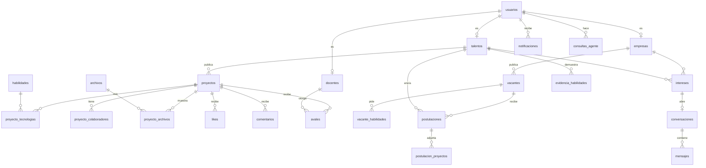

# ImpulsaU — Modelo de datos

> **Versión:** 1.1 (fase 0) — Autenticación con Supabase Auth
> **Fecha:** 30 de septiembre de 2026
> **Base:** PostgreSQL con las extensiones `vector`, `pg_trgm` y `citext`
> **Implementación:** Drizzle ORM en `packages/db`, un archivo de esquema por módulo
> **Relacionado:** `impulsau-especificacion-tecnica.md` (casos de uso) y `impulsau-especificacion-tecnica-stack.md` (reglas técnicas)

---

## 1. Convenciones

| Tema | Convención |
|---|---|
| Nombres | Tablas y columnas en español, `snake_case`, tablas en plural |
| Llaves primarias | `id uuid` (UUID v7 generado en la aplicación, ordenable por tiempo). Tablas puente con llave compuesta |
| Fechas | `timestamptz`; nombres terminados en `_en` (`creado_en`, `publicado_en`) |
| Auditoría mínima | `creado_en` y `actualizado_en` en toda tabla con estado mutable |
| Borrado lógico | `eliminado_en` en usuarios, proyectos, comentarios y vacantes. Las consultas normales filtran `eliminado_en IS NULL` |
| Bloqueo optimista | Columna `version integer NOT NULL DEFAULT 1` donde hay edición concurrente |
| Enumeraciones | Tipos `enum` de PostgreSQL, espejados en Zod dentro de `packages/contracts` |
| JSON | `jsonb` solo para datos cuya forma valida un esquema Zod (tipado con `.$type<T>()` en Drizzle y validado al leer) |
| Contadores | Desnormalizados en la tabla dueña; los escribe la sincronización desde Redis con valores absolutos |
| Claves foráneas | `ON DELETE` explícito en cada relación (ver cada tabla) |

**Leyenda de las tablas:** PK = llave primaria · FK = llave foránea · UQ = única · NN = no nula.

---

## 2. Diagrama general

---

## 3. Extensiones y tipos

### 3.1 Extensiones

| Extensión | Uso |
|---|---|
| `vector` | Embeddings de 384 dimensiones con índice HNSW |
| `pg_trgm` | Búsqueda tolerante a errores en nombres y títulos |
| `citext` | Correos sin distinción de mayúsculas |

### 3.2 Enumeraciones

| Enum | Valores |
|---|---|
| `rol_usuario` | `talento`, `empresa`, `docente`, `admin` |
| `estado_usuario` | `pendiente_verificacion`, `activo`, `suspendido`, `eliminado` |
| `estado_academico` | `estudiante`, `egresado` |
| `departamento` | Los 14 departamentos de El Salvador |
| `tipo_enlace` | `github`, `linkedin`, `portafolio`, `otro` |
| `estado_verificacion_empresa` | `sin_solicitar`, `pendiente`, `verificada`, `rechazada` |
| `proposito_archivo` | `imagen_proyecto`, `adjunto_proyecto`, `cv`, `documento_verificacion`, `avatar` |
| `visibilidad_archivo` | `publico`, `privado` |
| `estado_archivo` | `pendiente`, `listo`, `procesado`, `rechazado` |
| `estado_proyecto` | `borrador`, `publicado`, `oculto` |
| `tipo_embedding` | `proyecto`, `talento`, `vacante` |
| `direccion_interes` | `empresa_a_talento`, `talento_a_empresa` |
| `estado_interes` | `pendiente`, `aceptado`, `declinado` |
| `tipo_vacante` | `pasantia`, `primer_empleo`, `trainee` |
| `modalidad_vacante` | `presencial`, `hibrida`, `remota` |
| `estado_vacante` | `borrador`, `abierta`, `pausada`, `cerrada` |
| `estado_postulacion` | `recibida`, `en_revision`, `entrevista`, `seleccionada`, `descartada` |
| `motivo_descarte` | `falta_habilidad_tecnica`, `perfil_incompleto`, `otro_candidato`, `vacante_cerrada`, `otro` |
| `estado_aval` | `pendiente`, `aprobado`, `rechazado`, `revocado` |
| `estado_consulta` | `en_cola`, `procesando`, `completada`, `error` |
| `calificacion_respuesta` | `util`, `no_util` |
| `tipo_notificacion` | `interes_recibido`, `interes_aceptado`, `mensaje_nuevo`, `like`, `comentario`, `aval_resuelto`, `postulacion_estado`, `visita_perfil`, `verificacion_resuelta` |
| `tipo_objetivo_reporte` | `proyecto`, `comentario`, `perfil`, `mensaje` |
| `motivo_reporte` | `contenido_ofensivo`, `contenido_copiado`, `posible_experiencia_laboral`, `spam`, `otro` |
| `estado_reporte` | `pendiente`, `resuelto_ocultado`, `descartado` |

---

## 4. Tablas por módulo

### 4.1 `auth`

La autenticación la administra **Supabase Auth** en su esquema `auth` (correo, contraseña, verificación, sesiones). ImpulsaU solo guarda el perfil y el rol.

**`usuarios`**

| Columna | Tipo | Reglas |
|---|---|---|
| `id` | uuid | PK; **es el mismo id del usuario en Supabase Auth** (`auth.users.id`), FK con `ON DELETE CASCADE` |
| `correo` | citext | NN, UQ (copia sincronizada para consultas y búsquedas) |
| `rol` | rol_usuario | NN |
| `estado` | estado_usuario | NN, por defecto `pendiente_verificacion`; pasa a `activo` cuando Auth confirma el correo |
| `fecha_nacimiento` | date | Obligatoria para talentos (la edad ≥ 18 se valida en el caso de uso `Registrarse`) |
| `creado_en` / `actualizado_en` / `eliminado_en` | timestamptz | — |

> Ya no existen `hash_contrasena` ni la tabla `tokens_usuario`: contraseñas, enlaces de verificación y recuperación los maneja Supabase Auth. Las sesiones tampoco viven en Redis.

### 4.2 `catalogos`

| Tabla | Columnas principales | Reglas e índices |
|---|---|---|
| `habilidades` | `id`, `nombre`, `slug`, `categoria`, `activa` | UQ `slug`; GIN `pg_trgm` en `nombre` |
| `carreras` | `id`, `nombre`, `slug` | UQ `slug` |
| `instituciones` | `id`, `nombre`, `slug`, `departamento` | UQ `slug` |
| `dominios_institucionales` | `id`, `institucion_id` (FK), `dominio`, `aprobado` | UQ `dominio` |

### 4.3 `perfiles`

**`talentos`**

| Columna | Tipo | Reglas |
|---|---|---|
| `usuario_id` | uuid | PK, FK → usuarios, `ON DELETE CASCADE` |
| `nombre_completo` | text | NN |
| `carrera_id` | uuid | FK → carreras |
| `institucion_id` | uuid | FK → instituciones |
| `estado_academico` | estado_academico | NN |
| `ciclo` | smallint | Obligatorio si es estudiante |
| `anio_egreso` | smallint | Obligatorio si es egresado |
| `departamento` | departamento | — |
| `bio` | text | Máx. 600 caracteres |
| `declaracion_sin_experiencia_en` | timestamptz | NN (momento en que aceptó la declaración) |
| `primer_empleo_en` | timestamptz | Al marcarse, el perfil sale de las búsquedas |
| `privacidad` | jsonb | Forma validada por Zod (qué campos son públicos) |
| `almacenamiento_usado_bytes` | bigint | NN, por defecto 0 |
| `almacenamiento_limite_bytes` | bigint | NN, por defecto 20 MB (plan gratuito de Supabase Storage) |
| `version` | integer | Bloqueo optimista |
| `creado_en` / `actualizado_en` | timestamptz | — |

Restricciones:
- `CHECK ((estado_academico = 'estudiante' AND ciclo IS NOT NULL) OR (estado_academico = 'egresado' AND anio_egreso IS NOT NULL))`
- `CHECK (almacenamiento_usado_bytes <= almacenamiento_limite_bytes)`

Índices: parcial en (`carrera_id`, `estado_academico`, `departamento`) `WHERE primer_empleo_en IS NULL`.

**`talento_habilidades`** (habilidades declaradas)

| Columna | Reglas |
|---|---|
| `talento_id` | FK → talentos, `ON DELETE CASCADE` |
| `habilidad_id` | FK → habilidades |
| PK | (`talento_id`, `habilidad_id`) |

**`evidencia_habilidades`** (habilidades demostradas, derivada)

| Columna | Reglas |
|---|---|
| `talento_id`, `habilidad_id` | PK compuesta |
| `proyectos` | smallint NN: proyectos publicados donde el talento es autor o colaborador confirmado y aparece la habilidad |
| `actualizado_en` | timestamptz |

La recalcula un job al publicar, editar u ocultar proyectos y al confirmar colaboraciones. Índice en (`habilidad_id`, `proyectos`) para la búsqueda de empresas.

**`enlaces_talento`**

| Columna | Reglas |
|---|---|
| `id` | PK |
| `talento_id` | FK → talentos, `ON DELETE CASCADE` |
| `tipo` | tipo_enlace NN |
| `url` | text NN (validada como URL https) |

**`empresas`**

| Columna | Tipo | Reglas |
|---|---|---|
| `usuario_id` | uuid | PK, FK → usuarios |
| `nombre_comercial` | text | NN |
| `nombre_legal` | text | — |
| `sector` | text | — |
| `sitio_web` | text | — |
| `descripcion` | text | — |
| `estado_verificacion` | estado_verificacion_empresa | NN, por defecto `sin_solicitar` |
| `verificada_en` | timestamptz | — |
| `es_agencia` | boolean | NN, por defecto `false` |
| `cliente_declarado` | text | Obligatorio si `es_agencia` |

Restricción: `CHECK (NOT es_agencia OR cliente_declarado IS NOT NULL)`.

**`docentes`**

| Columna | Reglas |
|---|---|
| `usuario_id` | PK, FK → usuarios |
| `nombre_completo` | NN |
| `institucion_id` | FK → instituciones, NN |
| `dominio_id` | FK → dominios_institucionales, NN |
| `verificado_en` | timestamptz |

### 4.4 `archivos`

**`archivos`**

| Columna | Tipo | Reglas |
|---|---|---|
| `id` | uuid | PK |
| `propietario_id` | uuid | FK → usuarios, NN |
| `clave` | text | NN, UQ (ruta en el almacenamiento, generada por el servidor) |
| `proposito` | proposito_archivo | NN |
| `visibilidad` | visibilidad_archivo | NN |
| `tipo_mime` | text | NN |
| `tamano_bytes` | bigint | NN, `CHECK (tamano_bytes > 0)` |
| `estado` | estado_archivo | NN, por defecto `pendiente` |
| `id_multiparte` | text | Solo en subidas multiparte |
| `creado_en` / `confirmado_en` / `procesado_en` | timestamptz | — |

Índice parcial en `creado_en` `WHERE estado = 'pendiente'` (para la limpieza de huérfanos).

### 4.5 `proyectos`

**`proyectos`**

| Columna | Tipo | Reglas |
|---|---|---|
| `id` | uuid | PK |
| `autor_id` | uuid | FK → talentos, NN |
| `titulo` | text | NN, 5–120 caracteres |
| `descripcion` | text | NN, máx. 5000 caracteres |
| `materia` / `periodo` | text | — |
| `url_repositorio` / `url_demo` / `url_video` | text | URLs https |
| `estado` | estado_proyecto | NN, por defecto `borrador` |
| `likes` / `reposts` / `comentarios` / `compartidos` | integer | NN, por defecto 0 (contadores sincronizados) |
| `version` | integer | Bloqueo optimista |
| `version_contenido` | integer | Sube cuando cambian título, descripción o tecnologías (para embeddings) |
| `publicado_en` / `creado_en` / `actualizado_en` / `eliminado_en` | timestamptz | — |

Índices:
- Feed: (`publicado_en` DESC, `id` DESC) `WHERE estado = 'publicado' AND eliminado_en IS NULL`
- Perfil: (`autor_id`, `publicado_en` DESC)
- Búsqueda: GIN `pg_trgm` en `titulo`

| Tabla | Columnas | Reglas |
|---|---|---|
| `proyecto_tecnologias` | `proyecto_id`, `habilidad_id` | PK compuesta; índice en `habilidad_id` |
| `proyecto_archivos` | `proyecto_id`, `archivo_id`, `orden` | PK (`proyecto_id`, `archivo_id`); UQ (`proyecto_id`, `orden`) |
| `proyecto_colaboradores` | `proyecto_id`, `talento_id`, `contribucion`, `confirmado_en` | PK compuesta; `contribucion` NN |

**`embeddings`**

| Columna | Tipo | Reglas |
|---|---|---|
| `id` | uuid | PK |
| `tipo` | tipo_embedding | NN |
| `entidad_id` | uuid | NN |
| `vector` | vector(384) | NN |
| `version_contenido` | integer | NN (solo se actualiza si la nueva es mayor) |
| `actualizado_en` | timestamptz | — |

UQ (`tipo`, `entidad_id`); índice HNSW en `vector` con `vector_cosine_ops`.

### 4.6 `interacciones`

| Tabla | Columnas | Reglas |
|---|---|---|
| `likes` | `usuario_id`, `proyecto_id`, `creado_en` | PK (`usuario_id`, `proyecto_id`); índice en `proyecto_id`. Escrita por lotes desde Redis |
| `reposts` | `usuario_id`, `proyecto_id`, `comentario`, `creado_en` | PK (`usuario_id`, `proyecto_id`); índice (`usuario_id`, `creado_en` DESC) para el feed |
| `comentarios` | `id`, `proyecto_id`, `autor_id`, `padre_id`, `cuerpo`, `editado_en`, `creado_en`, `eliminado_en` | `padre_id` FK → comentarios (un solo nivel, validado en el caso de uso); `cuerpo` 1–2000 caracteres; índice (`proyecto_id`, `creado_en`, `id`) |
| `seguimientos` | `seguidor_id`, `seguido_id`, `creado_en` | PK compuesta; `CHECK (seguidor_id <> seguido_id)` |

### 4.7 `conexiones`

**`intereses`**

| Columna | Tipo | Reglas |
|---|---|---|
| `id` | uuid | PK |
| `empresa_id` | uuid | FK → empresas, NN |
| `talento_id` | uuid | FK → talentos, NN |
| `direccion` | direccion_interes | NN |
| `mensaje` | text | Máx. 300 caracteres |
| `estado` | estado_interes | NN, por defecto `pendiente` |
| `creado_en` / `respondido_en` | timestamptz | — |

UQ (`empresa_id`, `talento_id`, `direccion`).

### 4.8 `mensajeria`

**`conversaciones`**

| Columna | Reglas |
|---|---|
| `id` | PK |
| `empresa_id`, `talento_id` | FK, NN; **UQ (`empresa_id`, `talento_id`)**: una sola conversación por par aunque ambos muestren interés a la vez |
| `interes_id` | FK → intereses |
| `vacante_id` | FK → vacantes, opcional |
| `ultima_secuencia` | bigint NN, por defecto 0 |
| `ultimo_mensaje_en` | timestamptz |

**`mensajes`**

| Columna | Reglas |
|---|---|
| `id` | PK |
| `conversacion_id` | FK → conversaciones, `ON DELETE CASCADE` |
| `secuencia` | bigint NN; **UQ (`conversacion_id`, `secuencia`)** |
| `remitente_id` | FK → usuarios |
| `cuerpo` | text NN, 1–4000 caracteres |
| `client_message_id` | uuid NN, **UQ** (idempotencia de reenvíos) |
| `creado_en` | timestamptz |

| Tabla | Columnas | Reglas |
|---|---|---|
| `lecturas` | `conversacion_id`, `usuario_id`, `ultima_secuencia_leida` | PK compuesta; solo avanza con `GREATEST` |
| `bloqueos` | `bloqueador_id`, `bloqueado_id`, `creado_en` | PK compuesta |

### 4.9 `vacantes`

**`vacantes`**

| Columna | Tipo | Reglas |
|---|---|---|
| `id` | uuid | PK |
| `empresa_id` | uuid | FK → empresas, NN |
| `titulo` | text | NN |
| `descripcion` | text | NN |
| `tipo` | tipo_vacante | NN (solo vacantes de entrada) |
| `modalidad` | modalidad_vacante | NN |
| `departamento` | departamento | Opcional si es remota |
| `estado` | estado_vacante | NN, por defecto `borrador` |
| `version` | integer | Bloqueo optimista |
| `publicada_en` / `cerrada_en` / `creado_en` / `actualizado_en` / `eliminado_en` | timestamptz | — |

Índice: (`estado`, `publicada_en` DESC) `WHERE eliminado_en IS NULL`.

| Tabla | Columnas | Reglas |
|---|---|---|
| `vacante_habilidades` | `vacante_id`, `habilidad_id`, `requerida` | PK compuesta; `requerida` distingue requerida de deseable |

**`postulaciones`**

| Columna | Tipo | Reglas |
|---|---|---|
| `id` | uuid | PK |
| `vacante_id` | uuid | FK → vacantes, NN |
| `talento_id` | uuid | FK → talentos, NN |
| `estado` | estado_postulacion | NN, por defecto `recibida` |
| `motivo_descarte` | motivo_descarte | Obligatorio si `descartada` |
| `detalle_descarte` | text | — |
| `version` | integer | Bloqueo optimista |
| `creado_en` / `actualizado_en` | timestamptz | — |

Restricciones:
- **UQ (`talento_id`, `vacante_id`)**
- `CHECK (estado <> 'descartada' OR motivo_descarte IS NOT NULL)`

Índice: (`vacante_id`, `estado`).

| Tabla | Columnas | Reglas |
|---|---|---|
| `postulacion_proyectos` | `postulacion_id`, `proyecto_id` | PK compuesta |
| `historial_postulaciones` | `id`, `postulacion_id`, `de_estado`, `a_estado`, `actor_id`, `creado_en` | Auditoría de cada cambio de estado |
| `listas_candidatos` (P3) | `id`, `empresa_id`, `nombre`, `creado_en` | UQ (`empresa_id`, `nombre`) |
| `lista_talentos` (P3) | `lista_id`, `talento_id`, `nota`, `creado_en` | PK compuesta; la nota nunca se expone al talento |

### 4.10 `avales`

**`avales`**

| Columna | Tipo | Reglas |
|---|---|---|
| `id` | uuid | PK |
| `proyecto_id` | uuid | FK → proyectos, NN |
| `docente_id` | uuid | FK → docentes, NN |
| `solicitante_id` | uuid | FK → talentos, NN |
| `materia` / `periodo` | text | NN |
| `estado` | estado_aval | NN, por defecto `pendiente` |
| `comentario` | text | Máx. 600 caracteres |
| `creado_en` / `resuelto_en` | timestamptz | — |

UQ (`proyecto_id`, `docente_id`). Índice (`docente_id`, `estado`).

### 4.11 `agente`

**`consultas_agente`**

| Columna | Tipo | Reglas |
|---|---|---|
| `id` | uuid | PK |
| `usuario_id` | uuid | FK → usuarios, NN |
| `pregunta` | text | NN, máx. 1000 caracteres |
| `intencion` | text | Validada contra el esquema de intenciones |
| `filtros` | jsonb | Validado por Zod |
| `estado` | estado_consulta | NN |
| `respuesta` | jsonb | Respuesta estructurada validada por Zod |
| `calificacion` | calificacion_respuesta | — |
| `duracion_ms` | integer | Para métricas |
| `creado_en` / `completada_en` | timestamptz | — |

Índice (`usuario_id`, `creado_en` DESC).

### 4.12 `notificaciones`

**`notificaciones`**

| Columna | Tipo | Reglas |
|---|---|---|
| `id` | uuid | PK |
| `usuario_id` | uuid | FK → usuarios, `ON DELETE CASCADE` |
| `tipo` | tipo_notificacion | NN |
| `datos` | jsonb | NN; unión discriminada por `tipo` en Zod |
| `clave_agrupacion` | text | Para agrupar ("A Ana y 5 más…") |
| `evento_id` | uuid | UQ (deduplicación desde el outbox) |
| `leida_en` / `creado_en` | timestamptz | — |

Índices: (`usuario_id`, `creado_en` DESC, `id`) y parcial (`usuario_id`) `WHERE leida_en IS NULL`.

| Tabla | Columnas | Reglas |
|---|---|---|
| `preferencias_notificacion` | `usuario_id`, `tipo`, `activa` | PK (`usuario_id`, `tipo`) |

### 4.13 `moderacion`

| Tabla | Columnas | Reglas |
|---|---|---|
| `reportes` | `id`, `reportante_id`, `objetivo_tipo`, `objetivo_id`, `motivo`, `detalle`, `estado`, `resuelto_por`, `resuelto_en`, `creado_en` | UQ (`reportante_id`, `objetivo_tipo`, `objetivo_id`); índice parcial `WHERE estado = 'pendiente'` |
| `solicitudes_verificacion` | `id`, `empresa_id`, `correo_corporativo`, `estado`, `revisado_por`, `motivo_rechazo`, `creado_en`, `revisado_en` | Una solicitud pendiente por empresa (índice único parcial `WHERE estado = 'pendiente'`) |
| `solicitud_archivos` | `solicitud_id`, `archivo_id` | PK compuesta; archivos siempre privados |
| `acciones_moderacion` | `id`, `admin_id`, `accion`, `objetivo_tipo`, `objetivo_id`, `motivo`, `creado_en` | Auditoría inmutable |

### 4.14 Infraestructura (`compartido`)

| Tabla | Columnas | Reglas |
|---|---|---|
| `outbox` | `id`, `tipo_evento`, `version_evento`, `payload` (jsonb), `creado_en`, `publicado_en`, `intentos` | Índice parcial `WHERE publicado_en IS NULL`; se lee con `FOR UPDATE SKIP LOCKED` |
| `eventos_procesados` | `evento_id`, `consumidor`, `procesado_en` | PK (`evento_id`, `consumidor`) |

> Las llaves de idempotencia, contadores en caliente, rate limits y sesiones viven en Redis.

---

## 5. Reglas de integridad que no expresa el esquema

Estas reglas viven en los casos de uso (y tienen pruebas propias):

| Regla | Módulo |
|---|---|
| Edad ≥ 18 al registrarse como talento | auth |
| Un comentario solo puede responder a un comentario raíz | interacciones |
| Solo empresas verificadas publican vacantes y muestran interés | vacantes, conexiones |
| Una postulación solo se crea si la vacante está `abierta` (inserción condicional) | vacantes |
| Transiciones válidas de `estado_postulacion` (máquina de estados) | vacantes |
| Un talento con `primer_empleo_en` no aparece en búsquedas ni recibe intereses | perfiles, conexiones |
| Solo se adjuntan a una postulación proyectos propios o donde se es colaborador confirmado | vacantes |
| El docente solo avala proyectos de su institución | avales |
| La cuota de almacenamiento se reserva de forma atómica al crear la intención de subida | archivos |

---

## 6. Eliminación de cuentas y privacidad

- Eliminar la cuenta marca `eliminado_en`, anonimiza nombre y correo, oculta proyectos y comentarios, y elimina el usuario de Supabase Auth.
- Los archivos privados (CV, documentos) se borran del almacenamiento de inmediato; los públicos, en la siguiente limpieza.
- Los mensajes se conservan para la otra parte con el remitente anonimizado.
- Los registros de auditoría (moderación, historial de postulaciones) se conservan sin datos personales.

---

## 7. Datos iniciales (seeds idempotentes)

| Seed | Contenido | Entornos |
|---|---|---|
| Catálogos | Habilidades, carreras, instituciones, dominios institucionales, departamentos | Todos |
| Administrador | Una cuenta de administración inicial, creada en Supabase Auth con la API de administración (credenciales por variable de entorno) | Todos |
| Demostración | Talentos, proyectos, avales, empresas, vacantes y postulaciones ficticios con una historia coherente para la demo | Dev, preview y producción (curado) |
| Pruebas | Datos mínimos generados por cada prueba E2E | CI y preview |

Todos usan `ON CONFLICT` para poder ejecutarse más de una vez sin duplicar.
