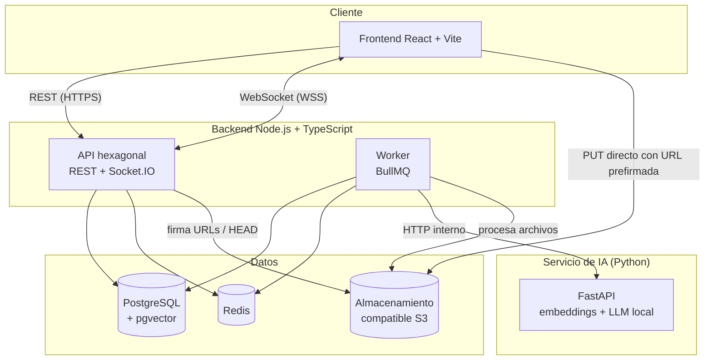
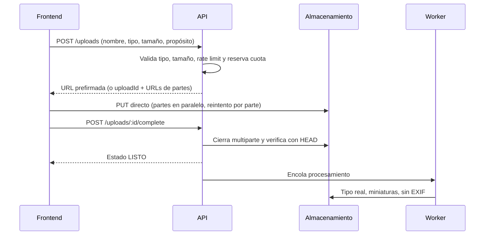
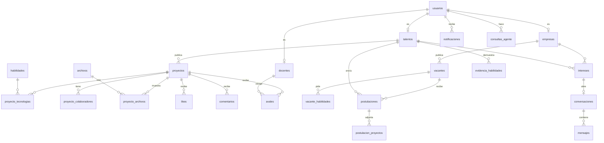

# ImpulsaU — Documentación de la fase 0

> **Proyecto:** ImpulsaU, plataforma que conecta directamente a personas sin experiencia laboral con empresas que contratan talento de entrada.
> **Fecha de consolidación:** 3 de octubre de 2026
> **Contenido:** siete documentos unidos en un solo archivo. Cuando dos partes tratan el mismo tema, **prevalece la más reciente**; dentro de la Parte 2, las secciones 20 y 21 prevalecen sobre las anteriores.

## Contenido

1. Parte 1 · Especificación general (visión, reglas y casos de uso)
2. Parte 2 · Especificación técnica del stack
3. Parte 3 · Modelo de datos
4. Parte 4 · Pruebas E2E con Playwright
5. Parte 5 · Criterios de aceptación del módulo auth
6. Parte 6 · Backlog de construcción
7. Parte 7 · Guía de creación y conexión de plataformas

> El diseño de interfaz está en la carpeta `vistas/` (galería `index.html`, capturas PNG y HTML por pantalla).


---

# Parte 1 · Especificación general (visión, reglas y casos de uso)

## ImpulsaU — Especificación técnica

> **Plataforma:** ImpulsaU
> **Tipo:** Proyecto universitario
> **Versión del documento:** 0.3 (borrador de planificación)
> **Fecha:** 28 de septiembre de 2026
> **Demo:** octubre de 2026 (fecha exacta por confirmar) · **Entrega final:** principios de noviembre de 2026


> **⚠ Aviso de vigencia (actualizado 1 oct 2026):** la infraestructura final usa **Supabase** (base, archivos y autenticación) y no Azure; ver la sección 20 de la especificación técnica del stack (versión 2.0).
>
> **Aviso de vigencia (30 sep 2026):** este documento conserva la visión, las reglas de negocio y los casos de uso, que siguen vigentes. Las siguientes secciones quedaron **reemplazadas** por documentos posteriores y deben leerse allí:
> - Stack, IA (ahora en TypeScript, no Python), arquitectura del backend (NestJS por módulos con dos salidas), sistema de diseño y paleta (negro, blanco y menta), infraestructura, despliegue, CI/CD y desarrollo con agentes → **Especificación técnica del stack**.
> - Modelo de datos → **Modelo de datos**.
> - Pruebas extremo a extremo → **Pruebas E2E con Playwright**.
> - Requisito de ingreso: el único requisito es **no tener experiencia laboral** (estudiantes y egresados), con un solo rol "Talento"; actor Docente, conexión por interés mutuo y salida al conseguir el primer empleo (definidos después de la versión original de este documento).

---

### Índice

1. [Visión y propuesta de valor](#1-visión-y-propuesta-de-valor)
2. [Reglas de negocio fundamentales](#2-reglas-de-negocio-fundamentales)
3. [Actores](#3-actores)
4. [Alcance y priorización](#4-alcance-y-priorización)
5. [Casos de uso](#5-casos-de-uso)
6. [Arquitectura](#6-arquitectura)
7. [Conexiones esperadas](#7-conexiones-esperadas)
8. [Agente de IA propio](#8-agente-de-ia-propio)
9. [Modelo de datos](#9-modelo-de-datos)
10. [Idempotencia y concurrencia](#10-idempotencia-y-concurrencia)
11. [Interacciones con Redis (likes y contadores)](#11-interacciones-con-redis-likes-y-contadores)
12. [Subida de archivos](#12-subida-de-archivos)
13. [Infraestructura y despliegue](#13-infraestructura-y-despliegue)
14. [Seguridad y privacidad](#14-seguridad-y-privacidad)
15. [Requerimientos no funcionales](#15-requerimientos-no-funcionales)
16. [Desarrollo con agentes y contratos](#16-desarrollo-con-agentes-y-contratos)
17. [Cronograma](#17-cronograma)
18. [Riesgos](#18-riesgos)
19. [Decisiones pendientes](#19-decisiones-pendientes)

---

### 1. Visión y propuesta de valor

**ImpulsaU** es una plataforma que **conecta directamente a personas sin experiencia laboral con empresas que contratan talento de entrada**, usando como carta de presentación los proyectos que realizaron durante su formación, respaldados por sus docentes.

#### Por qué ImpulsaU no es un "LinkedIn 2.0"

LinkedIn premia lo que ya se tiene: cargos, años de experiencia y contactos. Esta plataforma invierte la lógica: **la moneda es la evidencia de lo que la persona sabe hacer**, y la plataforma es un **trampolín hacia el primer empleo**, no un lugar para quedarse.

| LinkedIn | ImpulsaU |
|---|---|
| Sección de experiencia laboral | No existe; el perfil es un portafolio de proyectos |
| Habilidades declaradas | Habilidades respaldadas por proyectos concretos |
| Recomendaciones entre contactos | Avales de docentes verificados, ligados a una materia |
| Vacantes con "X años de experiencia" | Solo vacantes de entrada (pasantías, primer empleo, trainee) |
| Cualquiera escribe a cualquiera | Conversación solo tras interés mutuo |
| Perfil permanente | El perfil "se gradúa" al conseguir el primer empleo |
| Feed de publicaciones generales | Feed exclusivo de proyectos |

#### Métrica principal de éxito

**Tiempo desde el registro hasta el primer empleo** y porcentaje de talentos que lo consiguen.

---

### 2. Reglas de negocio fundamentales

| ID | Regla |
|---|---|
| RN-01 | **Requisito único de ingreso:** no tener experiencia laboral formal (empleo con contrato o planilla en el área de su formación). |
| RN-02 | **No cuentan como experiencia** y pueden mostrarse como proyectos: prácticas profesionales, pasantías académicas, horas sociales, voluntariado, proyectos académicos y trabajos freelance esporádicos. |
| RN-03 | Edad mínima de registro: **18 años**. |
| RN-04 | El registro exige una **declaración de cero experiencia** aceptando la definición de RN-01 y RN-02. |
| RN-05 | Al conseguir el primer empleo, el perfil pasa a **"primer empleo conseguido"**: sale de las búsquedas y queda como caso de éxito. |
| RN-06 | Las empresas solo pueden publicar **vacantes de entrada**. Una vacante que exija experiencia previa no se publica. |
| RN-07 | Solo **empresas verificadas** pueden publicar vacantes y mostrar interés en talentos. |
| RN-08 | Una conversación solo se abre cuando existe **interés mutuo** (una parte muestra interés y la otra acepta). |
| RN-09 | Solo se registran empresas que contratan para sí mismas. Si se permiten agencias, deben declarar para qué empresa reclutan. |
| RN-10 | Un docente se verifica mediante **correo institucional** de un dominio aprobado. |
| RN-11 | Las habilidades se eligen de un **catálogo normalizado**; no se aceptan como texto libre. |
| RN-12 | Una habilidad sin proyecto que la respalde se muestra como **"declarada"**; con proyecto, como **"demostrada"**. |
| RN-13 | El talento decide qué campos de su perfil son públicos. |

---

### 3. Actores

| Actor | Descripción |
|---|---|
| **Visitante** | Sin sesión. Ve proyectos, perfiles públicos y vacantes. |
| **Talento** | Persona sin experiencia laboral. Estado académico: estudiante (con ciclo) o egresado (con año de egreso). Publica proyectos, se postula, usa el agente. |
| **Empresa** | Organización que contrata directamente. Busca talento, publica vacantes, usa el agente. |
| **Docente** | Profesor verificado por correo institucional. Avala proyectos de talentos. |
| **Administrador** | Verifica empresas, modera contenido, administra catálogos. |
| **Sistema** | Procesos automáticos: workers, sincronizaciones, limpiezas. |

---

### 4. Alcance y priorización

El alcance se ajusta a un plazo de ~6 semanas, con apoyo de agentes de IA para desarrollo.

| Nivel | Contenido |
|---|---|
| **P1 — Núcleo (obligatorio)** | Autenticación; perfiles de talento y empresa; proyectos con imágenes y enlaces; feed; likes por Redis; búsqueda con filtros y búsqueda semántica; vacantes y postulaciones; agente de IA (intenciones básicas); interés mutuo y mensajería en tiempo real |
| **P2 — Importante** | Comentarios; notificaciones; avales de docentes; verificación de empresas; panel de administración básico; salida por primer empleo |
| **P3 — Recuperable con IA de desarrollo** | Subida multiparte; patrón outbox; repost y compartir con Open Graph; retroalimentación obligatoria al descartar; listas de candidatos; moderación completa |
| **Trabajo futuro (solo diseño)** | Retos de empresas; estadísticas de perfil; invitación de docentes por correo; video alojado en la plataforma; ranking de populares |

---

### 5. Casos de uso

Prioridad: **P1** núcleo, **P2** importante, **P3** recuperable, **F** futuro.

La **fecha objetivo** es el día en que el caso de uso debe estar terminado, probado e integrado (no solo programado). Todas las fechas son de 2026.

#### M1. Autenticación

| ID | Caso de uso | Actor | Prioridad | Fecha objetivo |
|---|---|---|---|---|
| CU-01 | Registrarse como Talento (estado académico, fecha de nacimiento, declaración de cero experiencia) | Visitante | P1 | 4 oct |
| CU-02 | Registrarse como Empresa | Visitante | P1 | 4 oct |
| CU-03 | Registrarse como Docente con correo institucional | Visitante | P2 | 1 nov |
| CU-04 | Verificar correo electrónico | Todos | P2 | 1 nov |
| CU-05 | Iniciar sesión | Todos | P1 | 4 oct |
| CU-06 | Cerrar sesión (este dispositivo o todos) | Autenticado | P1 | 4 oct |
| CU-07 | Renovar sesión automáticamente | Sistema | P1 | 4 oct |
| CU-08 | Recuperar contraseña | Todos | P2 | 1 nov |

#### M2. Perfiles y búsqueda

| ID | Caso de uso | Actor | Prioridad | Fecha objetivo |
|---|---|---|---|---|
| CU-09 | Editar perfil de talento (formación, habilidades, CV, enlaces) | Talento | P1 | 11 oct |
| CU-10 | Editar perfil de empresa | Empresa | P1 | 11 oct |
| CU-11 | Ver perfil público | Todos | P1 | 11 oct |
| CU-12 | Buscar talentos con filtros (carrera, institución, estado académico, habilidades, ubicación) | Empresa | P1 | 18 oct |
| CU-13 | Configurar privacidad del perfil | Talento | P2 | 1 nov |
| CU-14 | Ver indicador de perfil completo | Talento | P2 | 1 nov |
| CU-15 | Marcar "conseguí mi primer empleo" | Talento | P2 | 1 nov |
| CU-16 | Seguir a un talento o empresa | Autenticado | P3 | 1 nov (si hay margen) |

#### M3. Proyectos

| ID | Caso de uso | Actor | Prioridad | Fecha objetivo |
|---|---|---|---|---|
| CU-17 | Publicar proyecto (título, descripción, tecnologías, materia, imágenes, enlaces) | Talento | P1 | 11 oct |
| CU-18 | Editar o eliminar proyecto propio | Talento | P1 | 11 oct |
| CU-19 | Ver detalle de proyecto | Todos | P1 | 11 oct |
| CU-20 | Explorar feed de proyectos | Todos | P1 | 11 oct |
| CU-21 | Agregar colaboradores y declarar contribuciones | Talento | P2 | 1 nov |

#### M4. Interacción social

| ID | Caso de uso | Actor | Prioridad | Fecha objetivo |
|---|---|---|---|---|
| CU-22 | Dar y quitar like | Autenticado | P1 | 11 oct |
| CU-23 | Comentar y responder (un nivel) | Autenticado | P2 | 1 nov |
| CU-24 | Editar o eliminar comentario propio | Autor | P2 | 1 nov |
| CU-25 | Reportar contenido o perfil no elegible | Autenticado | P2 | 1 nov |
| CU-26 | Repostear proyecto (simple o con comentario) | Autenticado | P3 | 1 nov (si hay margen) |
| CU-27 | Compartir enlace externo con vista previa | Todos | P3 | 1 nov (si hay margen) |
| CU-28 | Compartir proyecto por mensaje interno | Autenticado | P3 | 1 nov (si hay margen) |

#### M5. Conexión directa y mensajería

| ID | Caso de uso | Actor | Prioridad | Fecha objetivo |
|---|---|---|---|---|
| CU-29 | Mostrar interés en un talento (con mensaje breve) | Empresa verificada | P1 | 25 oct |
| CU-30 | Mostrar interés en una empresa | Talento | P1 | 25 oct |
| CU-31 | Aceptar o declinar un interés recibido | Talento, Empresa | P1 | 25 oct |
| CU-32 | Enviar y recibir mensajes en tiempo real | Participantes | P1 | 25 oct |
| CU-33 | Ver historial de conversación paginado | Participantes | P1 | 25 oct |
| CU-34 | Ver "escribiendo" y "leído" | Participantes | P2 | 1 nov |
| CU-35 | Bloquear o reportar usuario | Autenticado | P2 | 1 nov |

#### M6. Agente de IA

| ID | Caso de uso | Actor | Prioridad | Fecha objetivo |
|---|---|---|---|---|
| CU-36 | Consultar al agente sobre su perfil y brechas | Talento | P1 | 25 oct |
| CU-37 | Buscar candidatos en lenguaje natural | Empresa | P1 | 25 oct |
| CU-38 | Ver historial de consultas al agente | Talento, Empresa | P2 | 1 nov |
| CU-39 | Calificar respuesta del agente | Talento, Empresa | P2 | 1 nov |

#### M7. Vacantes y postulaciones

| ID | Caso de uso | Actor | Prioridad | Fecha objetivo |
|---|---|---|---|---|
| CU-40 | Publicar vacante de entrada | Empresa verificada | P1 | 18 oct |
| CU-41 | Editar, pausar o cerrar vacante | Empresa | P1 | 18 oct |
| CU-42 | Explorar y buscar vacantes | Todos | P1 | 18 oct |
| CU-43 | Postularse adjuntando proyectos | Talento | P1 | 18 oct |
| CU-44 | Revisar postulaciones y cambiar estado | Empresa | P1 | 18 oct |
| CU-45 | Seguimiento de mis postulaciones | Talento | P1 | 18 oct |
| CU-46 | Retroalimentación obligatoria al descartar | Empresa | P3 | 1 nov (si hay margen) |

#### M8. Notificaciones

| ID | Caso de uso | Actor | Prioridad | Fecha objetivo |
|---|---|---|---|---|
| CU-47 | Recibir notificaciones en tiempo real (likes, comentarios, intereses, mensajes, postulaciones, avales) | Autenticado | P2 | 1 nov |
| CU-48 | Ver bandeja y marcar como leídas | Autenticado | P2 | 1 nov |

#### M9. Avales de docentes

| ID | Caso de uso | Actor | Prioridad | Fecha objetivo |
|---|---|---|---|---|
| CU-49 | Solicitar aval de un proyecto a un docente (materia y periodo) | Talento | P2 | 1 nov |
| CU-50 | Aprobar o rechazar aval con comentario | Docente | P2 | 1 nov |
| CU-51 | Revocar aval | Docente | P2 | 1 nov |
| CU-52 | Invitar por correo a un docente no registrado | Talento | F | Trabajo futuro |

#### M10. Empresas y administración

| ID | Caso de uso | Actor | Prioridad | Fecha objetivo |
|---|---|---|---|---|
| CU-53 | Solicitar verificación de empresa | Empresa | P2 | 1 nov |
| CU-54 | Aprobar o rechazar verificación | Administrador | P2 | 1 nov |
| CU-55 | Revisar reportes y ocultar contenido | Administrador | P2 | 1 nov |
| CU-56 | Suspender o reactivar cuentas | Administrador | P2 | 1 nov |
| CU-57 | Administrar catálogos (habilidades, carreras, instituciones, dominios) | Administrador | P2 | 1 nov |
| CU-58 | Crear listas de candidatos con notas privadas | Empresa | P3 | 1 nov (si hay margen) |
| CU-59 | Publicar retos para talentos | Empresa | F | Trabajo futuro |

#### 5.1 Flujos detallados de los casos críticos

##### CU-01 · Registrarse como Talento

- **Precondición:** el visitante no tiene cuenta.
- **Flujo principal:**
  1. Ingresa nombre, correo, contraseña, fecha de nacimiento y estado académico.
  2. Acepta la declaración de cero experiencia laboral y los términos.
  3. El sistema valida edad ≥ 18, formato de datos y correo no registrado.
  4. Crea la cuenta con estado `PENDIENTE_VERIFICACION` y envía correo de verificación.
  5. Inicia sesión automáticamente y redirige a completar perfil.
- **Alternos:** correo ya registrado → mensaje genérico (no revelar existencia de cuentas); menor de edad → registro rechazado.
- **Idempotencia:** `Idempotency-Key` en la petición; restricción única sobre el correo.

##### CU-17 · Publicar proyecto

- **Precondición:** talento autenticado.
- **Flujo principal:**
  1. Completa título, descripción, tecnologías (del catálogo), materia y enlaces.
  2. Por cada imagen, el frontend solicita una intención de subida y sube directo al almacenamiento (ver sección 12).
  3. Envía el proyecto con los ids de los archivos confirmados.
  4. El sistema valida, guarda y encola el cálculo del embedding.
  5. El proyecto aparece en el feed y en el perfil.
- **Alternos:** archivo no confirmado → rechazo con detalle; cuota excedida → rechazo antes de subir.
- **Idempotencia:** `Idempotency-Key`; el job de embedding usa `jobId` determinista.

##### CU-22 · Dar like

- **Flujo principal:**
  1. El frontend marca el like de inmediato (UI optimista) y envía `PUT /projects/:id/like`.
  2. La API ejecuta el script Lua en Redis (sección 11) y responde con el total.
  3. El worker sincroniza con Postgres por lotes y genera la notificación.
- **Alternos:** error → el frontend revierte el estado visual.
- **Idempotencia:** `SADD` en Redis y restricción única en Postgres.

##### CU-29 a CU-31 · Interés mutuo y apertura de conversación

- **Flujo principal:**
  1. La empresa verificada marca interés en un talento con un mensaje breve.
  2. El talento recibe notificación y acepta.
  3. El sistema crea la conversación (única por par empresa–talento) y notifica a ambos.
  4. Ambos pueden chatear en tiempo real.
- **Alternos:** el talento declina → la empresa recibe aviso neutro; ambos marcan interés a la vez → se crea una sola conversación (`ON CONFLICT`).

##### CU-36 / CU-37 · Consultar al agente

- **Flujo principal:**
  1. El usuario escribe su pregunta; el frontend envía `POST /agent/queries`.
  2. La API valida el límite de uso, encola la consulta y responde `202` con `queryId`.
  3. El worker pide al servicio de IA interpretar la pregunta (JSON de intención).
  4. El worker ejecuta las herramientas correspondientes contra la base de datos, respetando permisos y privacidad.
  5. El worker pide al servicio de IA redactar la respuesta con los datos obtenidos.
  6. La API emite `agent:response` por WebSocket; el frontend reemplaza el skeleton por la respuesta.
- **Alternos:** cola llena → `429` con mensaje amable; intención fuera de alcance → respuesta explicando qué puede hacer el agente; tiempo agotado → mensaje de reintento.

##### CU-43 / CU-44 · Postulación y cambio de estado

- **Flujo principal:**
  1. El talento se postula adjuntando proyectos; se valida que la vacante esté abierta en la misma transacción.
  2. La empresa cambia el estado (`RECIBIDA → EN_REVISION → ENTREVISTA → SELECCIONADA | DESCARTADA`).
  3. Cada cambio notifica al talento. Al quedar `SELECCIONADA`, se le pide confirmar el primer empleo (CU-15).
- **Concurrencia:** bloqueo optimista con columna `version`; `409` si otro reclutador cambió antes.
- **Idempotencia:** restricción única (talento, vacante).

---

### 6. Arquitectura

#### 6.1 Vista general



#### 6.2 Stack tecnológico

| Capa | Tecnología | Estado |
|---|---|---|
| Frontend | React + Vite + TypeScript, Tailwind | Decidido |
| Backend | Node.js + TypeScript, arquitectura hexagonal | Decidido |
| Framework HTTP | Fastify (sugerido) o Express | Por confirmar |
| Tiempo real | Socket.IO con adaptador de Redis | Decidido |
| ORM / consultas | Drizzle ORM (recomendado sobre Prisma por control de SQL, bloqueos y pgvector) | Por confirmar |
| Validación y contratos | Zod | Decidido |
| Base de datos | PostgreSQL + pgvector | Decidido |
| Caché, colas, contadores | Redis + BullMQ | Decidido |
| IA | Python + FastAPI + llama-cpp-python + modelo de embeddings | Decidido |
| Almacenamiento | Compatible S3 (MinIO en local) | Proveedor por confirmar |
| Subidas en frontend | Uppy (plugin S3) | Sugerido |

#### 6.3 Arquitectura hexagonal (API y worker)

```
apps/api/src
├── domain/            # Entidades, value objects, reglas, eventos de dominio. Sin dependencias externas.
├── application/       # Casos de uso (uno por CU) y puertos (interfaces).
│   ├── use-cases/
│   └── ports/
├── infrastructure/    # Adaptadores: Drizzle, Redis, S3, servicio IA, correo, colas.
└── interfaces/        # Entrada: controladores HTTP, gateway de Socket.IO, middlewares.
```

**Regla de dependencias:** `interfaces → application → domain`, e `infrastructure → application`. El dominio no importa nada de infraestructura. Se verifica automáticamente en CI con `dependency-cruiser`.

#### 6.4 Puertos principales

| Puerto | Responsabilidad | Adaptador |
|---|---|---|
| `UnidadDeTrabajo` | Ejecutar operaciones dentro de una transacción | Drizzle |
| `RepositorioTalentos`, `RepositorioEmpresas`, `RepositorioProyectos`, `RepositorioVacantes`, `RepositorioPostulaciones`, `RepositorioConversaciones` | Persistencia de cada agregado | Drizzle |
| `RepositorioReacciones` | Likes y contadores | Redis (Lua) |
| `BuscadorTalentos` | Búsqueda híbrida (filtros + similitud) | Drizzle + SQL pgvector |
| `ModeloIA` | Embeddings, interpretación y redacción | HTTP al servicio Python |
| `Almacenamiento` | URLs prefirmadas, multiparte, verificación | S3 |
| `ColaTrabajos` | Encolar jobs | BullMQ |
| `PublicadorEventos` | Publicar eventos de dominio | Outbox / BullMQ |
| `NotificadorTiempoReal` | Emitir eventos a usuarios | Socket.IO |
| `ServicioHash`, `ServicioTokens` | Contraseñas y JWT | Argon2, jose |
| `LimitadorTasa`, `RegistroIdempotencia` | Rate limiting y llaves de idempotencia | Redis |
| `EnviadorCorreo` | Correos transaccionales | SMTP |

---

### 7. Conexiones esperadas

#### 7.1 Mapa de conexiones

| Origen | Destino | Protocolo | Autenticación | Propósito |
|---|---|---|---|---|
| Frontend | API | REST sobre HTTPS | JWT de acceso (Bearer) + refresh en cookie `httpOnly` | Operaciones CRUD, búsquedas, autenticación |
| Frontend | API | WebSocket (WSS) con Socket.IO | JWT en el handshake | Mensajes, notificaciones, respuestas del agente |
| Frontend | Almacenamiento | HTTPS `PUT` | URL prefirmada con expiración corta | Subida directa de archivos |
| Frontend | Almacenamiento/CDN | HTTPS `GET` | Público o URL firmada | Lectura de imágenes y archivos |
| API | PostgreSQL | TCP con TLS | Credenciales (cadena con pooling) | Persistencia |
| API | Redis | TCP con TLS | Token/contraseña | Caché, contadores, rate limit, idempotencia, adaptador Socket.IO |
| API | Almacenamiento | HTTPS (API S3) | Access key/secret | Firmar URLs, verificar objetos |
| Worker | PostgreSQL | TCP con TLS | Credenciales | Sincronizaciones, embeddings, notificaciones |
| Worker | Redis | TCP con TLS | Token/contraseña | Consumir colas y streams |
| Worker | Servicio IA | HTTPS interno | Token de servicio compartido | Embeddings, interpretación, redacción |
| Worker | Almacenamiento | HTTPS (API S3) | Access key/secret | Miniaturas, limpieza de metadatos, borrado de huérfanos |
| API | Correo | SMTP/HTTPS | Credenciales del proveedor | Verificación y recuperación |

**Reglas:** el servicio de IA **nunca** accede a la base de datos ni es llamado desde el frontend; toda llamada entre servicios tiene timeout y reintentos solo si la operación es idempotente.

#### 7.2 Endpoints REST (prefijo `/api/v1`)

##### Autenticación
| Método | Ruta | Descripción |
|---|---|---|
| POST | `/auth/register` | Registro (talento, empresa, docente) |
| POST | `/auth/login` | Inicio de sesión |
| POST | `/auth/refresh` | Renovar token de acceso |
| POST | `/auth/logout` | Cerrar sesión actual |
| POST | `/auth/logout-all` | Cerrar todas las sesiones |
| POST | `/auth/verify-email` | Verificar correo |
| POST | `/auth/forgot-password` | Solicitar recuperación |
| POST | `/auth/reset-password` | Restablecer contraseña |
| GET | `/me` | Usuario actual |

##### Perfiles y catálogos
| Método | Ruta | Descripción |
|---|---|---|
| GET | `/talents` | Búsqueda con filtros (paginación por cursor) |
| GET | `/talents/:id` | Perfil público de talento |
| PATCH | `/me/talent-profile` | Editar perfil de talento |
| PUT | `/me/privacy` | Configuración de privacidad |
| POST | `/me/first-job` | Marcar primer empleo conseguido |
| GET | `/companies/:id` | Perfil de empresa |
| PATCH | `/me/company-profile` | Editar perfil de empresa |
| POST | `/companies/verification-requests` | Solicitar verificación |
| GET | `/skills?q=` | Autocompletado de habilidades |
| GET | `/catalogs/careers`, `/catalogs/institutions` | Catálogos |
| GET | `/search/talents` | Búsqueda híbrida (texto libre + filtros) |

##### Proyectos e interacción
| Método | Ruta | Descripción |
|---|---|---|
| POST | `/projects` | Crear proyecto |
| GET | `/projects/:id` | Detalle |
| PATCH | `/projects/:id` | Editar (encabezado `If-Match` con versión) |
| DELETE | `/projects/:id` | Eliminar |
| GET | `/feed` | Feed paginado por cursor |
| PUT / DELETE | `/projects/:id/like` | Dar / quitar like |
| PUT / DELETE | `/projects/:id/repost` | Repostear / deshacer |
| POST | `/projects/:id/shares` | Registrar compartido |
| GET / POST | `/projects/:id/comments` | Listar / crear comentarios |
| PATCH / DELETE | `/comments/:id` | Editar / eliminar comentario |
| POST | `/projects/:id/endorsement-requests` | Solicitar aval |
| GET | `/p/:id` | HTML con Open Graph para compartir (fuera del prefijo) |

##### Conexión y mensajería
| Método | Ruta | Descripción |
|---|---|---|
| PUT | `/talents/:id/interest` | Empresa muestra interés |
| PUT | `/companies/:id/interest` | Talento muestra interés |
| POST | `/interests/:id/accept` | Aceptar interés |
| POST | `/interests/:id/decline` | Declinar interés |
| GET | `/conversations` | Lista con no leídos |
| GET | `/conversations/:id/messages?beforeSeq=` | Historial paginado |
| POST | `/conversations/:id/messages` | Alternativa REST para enviar (si falla el socket) |

##### Vacantes
| Método | Ruta | Descripción |
|---|---|---|
| GET / POST | `/vacancies` | Listar / crear vacante |
| GET / PATCH | `/vacancies/:id` | Detalle / editar, pausar, cerrar |
| POST | `/vacancies/:id/applications` | Postularse |
| GET | `/vacancies/:id/applications` | Postulaciones (empresa) |
| PATCH | `/applications/:id/status` | Cambiar estado (`If-Match`) |
| GET | `/me/applications` | Mis postulaciones |

##### Agente, archivos, notificaciones, avales y administración
| Método | Ruta | Descripción |
|---|---|---|
| POST | `/agent/queries` | Enviar consulta (responde `202` con `queryId`) |
| GET | `/agent/queries/:id` | Estado/resultado (respaldo del socket) |
| GET | `/agent/history` | Historial de consultas |
| POST | `/agent/queries/:id/feedback` | Calificar respuesta |
| POST | `/uploads` | Crear intención de subida |
| POST | `/uploads/:id/parts` | URLs de partes (multiparte) |
| POST | `/uploads/:id/complete` | Confirmar subida |
| GET | `/files/:id/url` | URL firmada de lectura (archivos privados) |
| GET | `/notifications` | Bandeja |
| POST | `/notifications/read` | Marcar leídas hasta un id |
| GET | `/me/endorsement-requests` | Solicitudes de aval (docente) |
| POST | `/endorsement-requests/:id/approve` · `/reject` | Resolver solicitud |
| DELETE | `/endorsements/:id` | Revocar aval |
| POST | `/reports` | Reportar contenido o perfil |
| GET / PATCH | `/admin/reports`, `/admin/reports/:id` | Moderación |
| PATCH | `/admin/companies/:id/verification` | Verificar empresa |
| PATCH | `/admin/users/:id/status` | Suspender / reactivar |

**Convenciones:** todas las creaciones aceptan `Idempotency-Key`; las ediciones concurrentes usan `If-Match`; los errores siguen un formato único `{ code, message, details }`; los códigos relevantes son `409` (conflicto de versión), `422` (llave de idempotencia reutilizada con otro cuerpo) y `429` (límite de tasa o cola del agente llena).

#### 7.3 Eventos WebSocket

**Salas:** `user:{id}` (todo lo personal) y `conversation:{id}` (participantes).

| Dirección | Evento | Payload | Notas |
|---|---|---|---|
| Cliente → Servidor | `message:send` | `{ conversationId, clientMessageId, body }` | Con acknowledgment; idempotente por `clientMessageId` |
| Cliente → Servidor | `message:read` | `{ conversationId, seq }` | Solo avanza (`GREATEST`) |
| Cliente → Servidor | `typing:start` / `typing:stop` | `{ conversationId }` | Sin persistencia |
| Cliente → Servidor | `conversation:sync` | `{ conversationId, afterSeq }` | Recuperar mensajes tras reconexión |
| Servidor → Cliente | `message:new` | `{ conversationId, seq, clientMessageId, senderId, body, createdAt }` | |
| Servidor → Cliente | `message:read` | `{ conversationId, userId, seq }` | |
| Servidor → Cliente | `typing` | `{ conversationId, userId, active }` | |
| Servidor → Cliente | `notification:new` | `{ id, type, data, createdAt }` | |
| Servidor → Cliente | `interest:accepted` | `{ interestId, conversationId }` | |
| Servidor → Cliente | `agent:response` | `{ queryId, status, answer, sources }` | `status`: `done` o `error` |

#### 7.4 Servicio de IA (interno)

| Método | Ruta | Entrada | Salida |
|---|---|---|---|
| POST | `/v1/embed` | `{ texts: string[] }` | `{ vectors: number[][] }` (384 dimensiones) |
| POST | `/v1/parse` | `{ query, role }` | `{ intent, filters, semanticQuery, confidence }` |
| POST | `/v1/generate` | `{ intent, role, data }` | `{ answer }` |
| GET | `/health` | — | Estado y modelo cargado |

Autenticación con token de servicio en un encabezado; el servicio rechaza cualquier petición sin él.

#### 7.5 Colas y trabajos (BullMQ)

| Cola | Disparador | Concurrencia | `jobId` | Descripción |
|---|---|---|---|---|
| `embeddings` | Crear/editar proyecto, perfil o vacante | 2 | `emb:{tipo}:{id}:v{version}` | Calcula y guarda el embedding si la versión es más nueva |
| `agent-queries` | `POST /agent/queries` | 1 | `agent:{queryId}` | Interpretación, herramientas y redacción |
| `notifications` | Eventos de dominio | 4 | `notif:{eventoId}` | Crea y emite notificaciones |
| `uploads-process` | Subida confirmada | 2 | `upl:{uploadId}` | Tipo real, miniaturas, limpieza de EXIF |
| `reactions-sync` | Repetible cada 10 s | 1 | fijo | Sincroniza likes y contadores de Redis a Postgres |
| `outbox-relay` | Repetible cada 2 s | 1 | fijo | Publica eventos de la tabla outbox |
| `cleanup` | Repetible cada hora | 1 | fijo | Subidas huérfanas, cuotas, llaves expiradas |

#### 7.6 Llaves de Redis

| Llave | Tipo | Expiración | Uso |
|---|---|---|---|
| `reacciones:likes:{proyectoId}` | SET | — | Usuarios que dieron like |
| `stats:{proyectoId}` | HASH | — | Contadores (likes, reposts, compartidos, vistas) |
| `stream:reacciones` | STREAM | Recorte por longitud | Cambios pendientes de sincronizar |
| `sucios:proyectos` | SET | — | Proyectos con contadores por sincronizar |
| `visita:{empresaId}:{talentoId}:{fecha}` | STRING | 24 h | Deduplicar visitas a perfiles |
| `idem:{usuarioId}:{ruta}:{llave}` | STRING | 24 h | Registro de idempotencia |
| `rl:{alcance}:{id}` | STRING | Ventana | Rate limiting |
| `refresh:{usuarioId}:{tokenId}` | STRING | Vida del token | Sesiones revocables |
| `cache:*` | Varios | Corta | Caché de lecturas (perfiles, feed) |
| `lock:*` | STRING | Segundos | Candados contra estampida |
| `bull:*` | Varios | — | Internas de BullMQ |

---

### 8. Agente de IA propio

#### 8.1 Principio de diseño

Sin APIs externas y con CPU gratuita, **el LLM no hace todo el trabajo**: interpreta la pregunta y redacta la respuesta. Los datos y cálculos los resuelven piezas deterministas.

| Capacidad | Resuelve | Tecnología |
|---|---|---|
| Consultas estructuradas | Filtros exactos (carrera, habilidades, estado) | Capa semántica → consultas parametrizadas |
| Búsqueda semántica (RAG) | Similitud de significado en proyectos, perfiles y vacantes | Embeddings multilingües (p. ej. `multilingual-e5-small`) + pgvector |
| Análisis de brechas | Qué habilidades faltan frente a vacantes reales | Cálculo de conjuntos y frecuencias |
| Interpretación | Pregunta → JSON de intención | LLM pequeño cuantizado (1.5B–3B, GGUF) con gramática JSON |
| Redacción | Datos → respuesta en lenguaje natural | Mismo LLM, o plantillas como plan B |

#### 8.2 Capa semántica

Diccionario que traduce conceptos del negocio a campos reales, para que el modelo nunca invente columnas ni genere SQL libre:

| Concepto | Campo / fuente | Operadores permitidos |
|---|---|---|
| carrera | `talentos.carrera_id` (catálogo) | igual, en lista |
| habilidad | `talento_habilidades` (catálogo) | contiene todas, contiene alguna |
| estado académico | `talentos.estado_academico` | igual |
| año de egreso | `talentos.anio_egreso` | rango |
| institución | `talentos.institucion_id` | igual, en lista |
| ubicación | `talentos.departamento` | igual |
| proyectos avalados | `avales` | existe, cantidad mínima |

#### 8.3 Intenciones iniciales

| Intención | Rol | Herramientas que ejecuta |
|---|---|---|
| `analizar_perfil` | Talento | Obtener perfil, completitud, habilidades demostradas vs declaradas |
| `evaluar_para_puesto` | Talento | Buscar vacantes similares, calcular brechas |
| `sugerir_siguiente_proyecto` | Talento | Brechas + habilidades más pedidas |
| `buscar_candidatos` | Empresa | Filtros estructurados + búsqueda semántica + ranking combinado |
| `resumir_candidato` | Empresa | Obtener perfil público y proyectos |
| `fuera_de_alcance` | Ambos | Explicar qué puede hacer el agente |

#### 8.4 Reglas del agente

- Solo accede a datos que el usuario tiene permiso de ver y respeta la privacidad de cada perfil.
- Nunca usa ni infiere datos como género o edad para rankear candidatos.
- Las respuestas citan las fuentes usadas (vacantes, proyectos).
- Límite de consultas por usuario y por día.
- Evaluación con un conjunto de 30–50 preguntas de prueba: acierto de intención, relevancia de resultados y calificaciones de usuarios (CU-39).

---

### 9. Modelo de datos

#### 9.1 Entidades principales

| Entidad | Campos relevantes | Restricciones e índices clave |
|---|---|---|
| `usuarios` | correo, hash, rol, estado, fecha de nacimiento | Único: correo |
| `talentos` | usuario, carrera, institución, estado académico, año de egreso/ciclo, privacidad, primer empleo, almacenamiento usado, `version` | Índices por filtros de búsqueda |
| `empresas` | usuario, nombre, sector, verificada | — |
| `docentes` | usuario, institución, dominio de correo | — |
| `habilidades` | nombre normalizado | Único: nombre; GIN `pg_trgm` |
| `talento_habilidades` | talento, habilidad | Único: (talento, habilidad) |
| `proyectos` | autor, título, descripción, materia, enlaces, contadores desnormalizados, `version`, `version_contenido` | Índice (creado_en, id); GIN `pg_trgm` en título |
| `proyecto_colaboradores` | proyecto, talento, contribución, confirmada | Único: (proyecto, talento) |
| `likes` | usuario, proyecto | Único: (usuario, proyecto) |
| `reposts` | usuario, proyecto, comentario | Único: (usuario, proyecto) |
| `comentarios` | proyecto, autor, padre, cuerpo | Índice (proyecto, creado_en) |
| `embeddings` | tipo, entidad, vector(384), `version_contenido` | Índice HNSW; único: (tipo, entidad) |
| `vacantes` | empresa, título, modalidad, estado, habilidades | Índice por estado y fecha |
| `postulaciones` | talento, vacante, estado, motivo de descarte, `version` | Único: (talento, vacante) |
| `intereses` | origen, destino, dirección, estado | Único: (empresa, talento, dirección) |
| `conversaciones` | empresa, talento, `ultima_secuencia` | Único: (empresa, talento) |
| `mensajes` | conversación, secuencia, remitente, cuerpo, `client_message_id` | Único: (conversación, secuencia); único: `client_message_id` |
| `lecturas` | conversación, usuario, última secuencia leída | Único: (conversación, usuario) |
| `notificaciones` | usuario, tipo, datos, leída | Índice (usuario, creado_en) |
| `avales` | proyecto, docente, materia, periodo, estado | Único: (proyecto, docente) |
| `uploads` | dueño, clave, propósito, tamaño, estado, visibilidad | Índice (estado, creado_en) |
| `reportes` | reportante, objetivo, motivo, estado | — |
| `outbox` | tipo de evento, payload, procesado | Índice parcial en no procesados |
| `eventos_procesados` | id del evento, consumidor | Único: (evento, consumidor) |
| `consultas_agente` | usuario, pregunta, intención, respuesta, calificación | Índice (usuario, creado_en) |

#### 9.2 Catálogos iniciales (seed idempotente)

Habilidades, carreras, instituciones, departamentos de El Salvador y dominios de correo institucional aprobados.

---

### 10. Idempotencia y concurrencia

#### 10.1 Idempotencia

| Operación | Mecanismo |
|---|---|
| Like, repost, seguir, interés, guardar en lista | `PUT` / `DELETE` (nunca toggle) + restricción única |
| Crear proyecto, comentario, postulación, subida | `Idempotency-Key` registrada en Redis con `SET NX` (24 h) |
| Enviar mensaje | `clientMessageId` único + acknowledgment del socket |
| Confirmar subida | Transición de estado que tolera repetición |
| Jobs | `jobId` determinista |
| Eventos y notificaciones | Outbox + tabla de eventos procesados |
| Sincronización de contadores | Escritura de valores absolutos, no deltas |

**Middleware de idempotencia:** llave nueva → se registra "en proceso" y se ejecuta; en proceso → `409`; completada → se devuelve la respuesta guardada; misma llave con otro cuerpo → `422`.

#### 10.2 Condiciones de carrera y soluciones

| Escenario | Solución |
|---|---|
| Likes simultáneos | Script Lua atómico en Redis (sección 11) |
| Interés mutuo simultáneo | Conversación única por par + `ON CONFLICT DO NOTHING` |
| Dos reclutadores cambian una postulación | Bloqueo optimista (`version`) + condición sobre estado actual |
| Colaboradores editan un proyecto | Bloqueo optimista + `If-Match` |
| Postularse mientras se cierra la vacante | Inserción condicional o `SELECT … FOR UPDATE` sobre la vacante |
| Subidas simultáneas exceden la cuota | Reserva atómica de cuota con `UPDATE … WHERE usado + tamaño <= límite` |
| Orden de mensajes | Secuencia por conversación asignada por el servidor |
| Acuses de lectura desordenados | `GREATEST(ultima_leida, nueva)` |
| Embedding viejo sobrescribe uno nuevo | Actualizar solo si la versión del job es mayor |
| Workers leen la misma fila del outbox | `FOR UPDATE SKIP LOCKED` |
| Caché con datos viejos | Invalidar tras escribir, expiraciones cortas, llaves con versión |
| Rate limit con carrera | Operaciones atómicas en Redis (Lua o `MULTI`) |
| Renovación de token en varias pestañas | Renovación única compartida en el frontend + margen de gracia en backend |

**Principios:** transacciones cortas; nada de IA, correo ni almacenamiento dentro de una transacción; aislamiento `READ COMMITTED` por defecto con condiciones explícitas.

#### 10.3 Carga de datos

- Paginación por cursor (keyset) en feeds, mensajes, búsquedas y notificaciones.
- Sin N+1: joins para autor y "¿di like?", contadores desnormalizados.
- Índices: HNSW (pgvector), GIN `pg_trgm`, compuestos para paginación.
- Protección contra estampida de caché con candados `SET NX`.
- Pool de conexiones pequeño por proceso y cadena con pooling del proveedor.
- Datos de demo: 200–500 talentos, proyectos y vacantes sintéticos; embeddings por lotes.

---

### 11. Interacciones con Redis (likes y contadores)

Los likes y contadores **no** hacen `UPDATE … + 1` por interacción. Redis es la ruta rápida y Postgres recibe escrituras por lotes.

**Por Redis:** likes, contadores de reposts y compartidos, vistas, visitas a perfiles, no leídos.
**Directo a Postgres:** postulaciones, intereses, conversaciones, mensajes, avales, proyectos, cuotas.

#### 11.1 Dar like (script Lua atómico)

```lua
-- KEYS: 1=set de likes, 2=hash de stats, 3=stream, 4=set de sucios
-- ARGV: 1=usuarioId, 2=proyectoId, 3=timestamp
local agregado = redis.call('SADD', KEYS[1], ARGV[1])
if agregado == 1 then
  local total = redis.call('HINCRBY', KEYS[2], 'likes', 1)
  redis.call('XADD', KEYS[3], '*', 'op', 'like', 'u', ARGV[1], 'p', ARGV[2], 'ts', ARGV[3])
  redis.call('SADD', KEYS[4], ARGV[2])
  return {1, total}
end
return {0, tonumber(redis.call('HGET', KEYS[2], 'likes') or '0')}
```

#### 11.2 Sincronización (cada 5–10 s)

1. **Relaciones:** leer el stream por lotes (`XREADGROUP`), colapsar por (usuario, proyecto) quedándose con la última operación, un `INSERT … ON CONFLICT DO NOTHING` y un `DELETE` por lote, y `XACK` tras el commit.
2. **Contadores:** tomar ids de `sucios:proyectos`, leer valores de Redis y escribirlos en **una sola sentencia** con valores absolutos.
3. **Reconstrucción:** si falta una llave, se reconstruye desde Postgres con candado.

#### 11.3 Estructuras adicionales

- Vistas únicas: HyperLogLog (`PFADD`).
- Visitas de empresas: `SET … NX EX 86400` por empresa, talento y día.
- Populares de la semana (futuro): sorted set con `ZINCRBY`.

---

### 12. Subida de archivos

El backend **nunca recibe los bytes**: autoriza, firma y registra.



| Tipo | Formatos | Máximo | Cantidad | Bucket |
|---|---|---|---|---|
| Imágenes de proyecto | JPG, PNG, WebP | 5 MB | 10 por proyecto | Público |
| Video de proyecto | Enlace de YouTube (MVP) | — | 1 | — |
| CV | PDF | 5 MB | 1 | Privado |
| Adjuntos de proyecto | PDF, ZIP | 50 MB | 3 | Público |
| Documentos de verificación | PDF, JPG, PNG | 10 MB | 5 | Privado |

- Archivos menores a 10 MB: una sola URL `PUT`. Mayores: multiparte (P3).
- Clave generada por el servidor (UUID), nunca el nombre original.
- Cuota por usuario (p. ej. 500 MB) reservada atómicamente.
- Limpieza de subidas `PENDIENTE` de más de 24 h y regla de ciclo de vida para multipartes incompletas.

---

### 13. Infraestructura y despliegue

**Presupuesto:** solo el dominio. Todo lo demás en planes gratuitos.

> Los planes gratuitos cambian con frecuencia. Verificar límites vigentes (RAM, horas, almacenamiento, comandos, conexiones, requisito de tarjeta) antes de desplegar.

#### 13.1 Plataformas

| Componente | Plataforma sugerida | Consideraciones |
|---|---|---|
| Frontend | Vercel o Netlify | Dominio principal (`tudominio.com`) |
| API + Socket.IO | Render (free) o Koyeb | Debe ser servicio persistente (no serverless) por WebSocket; se duerme tras inactividad. Subdominio `api.tudominio.com` |
| Worker | Mismo proveedor que la API | Puede correr en el mismo proceso en el MVP si el plan gratuito limita servicios |
| Servicio IA | Hugging Face Spaces (CPU básico, Docker) | Más RAM disponible en plan gratuito; proteger con token de servicio |
| PostgreSQL + pgvector | Neon o Supabase | Usar cadena con pooling para la app y conexión directa para migraciones |
| Redis | Upstash | Límite de comandos: usar Lua, pipelines y lotes |
| Almacenamiento | Cloudflare R2, Backblaze B2 o Supabase Storage | Compatible S3; bucket público y privado |
| Correo | Plan gratuito de proveedor SMTP transaccional | Solo verificación y recuperación |

#### 13.2 Entorno local

Docker Compose con: PostgreSQL + pgvector, Redis, MinIO (S3 local), API, worker y servicio de IA. Los agentes de desarrollo y el equipo trabajan contra este entorno; se despliega desde la semana 1 para detectar problemas de plataforma temprano.

#### 13.3 Variables de entorno

| Variable | Servicio | Descripción |
|---|---|---|
| `DATABASE_URL` | API, worker | Conexión con pooling |
| `DATABASE_URL_DIRECT` | Migraciones | Conexión directa |
| `REDIS_URL` | API, worker | Conexión Redis con TLS |
| `JWT_ACCESS_SECRET`, `JWT_REFRESH_SECRET` | API | Firmas de tokens |
| `S3_ENDPOINT`, `S3_ACCESS_KEY`, `S3_SECRET_KEY`, `S3_BUCKET_PUBLIC`, `S3_BUCKET_PRIVATE` | API, worker | Almacenamiento |
| `AI_SERVICE_URL`, `AI_SERVICE_TOKEN` | Worker, servicio IA | Comunicación interna |
| `CORS_ORIGIN`, `APP_URL` | API | Dominio del frontend |
| `SMTP_*` | API | Correo |
| `VITE_API_URL`, `VITE_WS_URL` | Frontend | Endpoints públicos |

#### 13.4 Arranque en frío

Los servicios gratuitos se duermen. Antes de la demo y la defensa: despertar API, servicio IA y base de datos unos minutos antes y ejecutar una consulta de calentamiento al agente.

---

### 14. Seguridad y privacidad

- Contraseñas con Argon2; JWT de acceso corto (~15 min); refresh en cookie `httpOnly`, `Secure`, `SameSite`, con rotación y revocación en Redis.
- Validación de toda entrada con Zod; CORS restringido al dominio.
- Rate limiting en login, registro, mensajería, subidas y agente.
- Permisos por rol verificados en los casos de uso; el agente usa los mismos permisos.
- Buckets separados: público (proyectos) y privado (CV, documentos), con URLs firmadas de corta duración.
- Eliminación de metadatos EXIF (ubicación GPS) en imágenes.
- Edad mínima de 18 años; conversación solo tras interés mutuo; solo empresas verificadas contactan.
- El talento controla la visibilidad de sus datos y puede eliminar su cuenta.
- El ranking de candidatos no usa ni infiere género ni edad.
- Registro de uso de herramientas de IA en el desarrollo según la política de la universidad.

---

### 15. Requerimientos no funcionales

| ID | Categoría | Requerimiento |
|---|---|---|
| RNF-01 | Seguridad | Hash de contraseñas, JWT con refresh revocable, CORS restringido, validación con Zod |
| RNF-02 | Seguridad | Rate limiting por IP y usuario con Redis |
| RNF-03 | Privacidad | Control de visibilidad y eliminación de cuenta |
| RNF-04 | Rendimiento | Endpoints REST < 500 ms (excepto IA, asíncrona) |
| RNF-05 | Rendimiento | Toda lista paginada por cursor |
| RNF-06 | UX | Skeleton loaders con las dimensiones del contenido real |
| RNF-07 | UX | Responsive, móvil primero, modo claro y oscuro |
| RNF-08 | Accesibilidad | Contraste, navegación por teclado, textos alternativos |
| RNF-09 | Tiempo real | Reconexión automática y sincronización de mensajes perdidos |
| RNF-10 | Mantenibilidad | Hexagonal verificada en CI; pruebas unitarias por caso de uso |
| RNF-11 | Disponibilidad | Funcionar en planes gratuitos tolerando arranque en frío |
| RNF-12 | Observabilidad | Logs estructurados en API, worker y servicio IA |
| RNF-13 | Archivos | Ningún byte pasa por el backend; URLs prefirmadas con expiración corta |
| RNF-14 | Archivos | Multiparte con reintento y reanudación para archivos > 10 MB |
| RNF-15 | Archivos | Validación de tipo real y cuota por usuario |
| RNF-16 | Archivos | Miniaturas y eliminación de EXIF en segundo plano |
| RNF-17 | Archivos | Archivos sensibles solo con URLs firmadas temporales |
| RNF-18 | Archivos | Limpieza automática de subidas huérfanas |
| RNF-19 | Consistencia | Operaciones idempotentes según sección 10.1 |
| RNF-20 | Consistencia | Contadores sincronizados a Postgres en ≤ 10 s |
| RNF-21 | IA | Respuesta del agente en ≤ 30 s con cola normal; `429` si la cola está llena |

---

### 16. Desarrollo con agentes y contratos

#### 16.1 Estructura del monorepo

```
/apps
  /web          → frontend React        (agente Front)
  /api          → API Node hexagonal    (agente Backend)
  /worker       → jobs BullMQ           (agente Backend)
/services
  /ai           → servicio Python       (agente IA)
/packages
  /contracts    → esquemas Zod, eventos WS, jobs, OpenAPI del servicio IA
  /db           → esquema Drizzle y migraciones (agente BD)
```

#### 16.2 Contratos

| Contrato | Fuente de verdad | Consumidores |
|---|---|---|
| REST | Esquemas Zod → tipos + OpenAPI generada | Front, Backend |
| WebSocket | Mapa tipado `ClientToServerEvents` / `ServerToClientEvents` | Front, Backend |
| Base de datos | Esquema Drizzle + migraciones | Backend (solo en adaptadores) |
| Servicio IA | OpenAPI de FastAPI/Pydantic → tipos TS | Backend (worker) |
| Jobs y eventos | Nombres y payloads versionados (`ProyectoLikeado.v1`) | Backend, worker |

#### 16.3 Agentes

| Agente | Dueño de | Solo lee | Reglas clave |
|---|---|---|---|
| BD | `packages/db` | contracts | Restricciones únicas, índices, columnas `version`; nunca edita migraciones aplicadas |
| Backend | `apps/api`, `apps/worker` | contracts, db | Hexagonal estricta, `PUT`/`DELETE`, `Idempotency-Key`, likes por puerto de reacciones, transacciones cortas, prueba de concurrencia por CU |
| Front | `apps/web` | contracts | Cliente tipado generado, skeletons, UI optimista, genera `Idempotency-Key` y `clientMessageId` |
| IA | `services/ai` | contracts | Sin estado, sin acceso a BD, salidas con gramática JSON |

#### 16.4 Flujo por caso de uso

1. Contrato propuesto en PR a `packages/contracts`, aprobado por la persona arquitecta.
2. Migración del agente BD si aplica.
3. Backend implementa; Front construye contra servidor simulado (MSW) generado del contrato.
4. Integración real y prueba de extremo a extremo.

Si un agente necesita algo fuera del contrato, **no improvisa**: solicita un cambio de contrato.

#### 16.5 Controles en CI

- Tipado y lint en todo el monorepo.
- Pruebas de contrato (respuestas reales validadas contra esquemas Zod).
- `dependency-cruiser`: el dominio no puede importar infraestructura.
- Detección de cambios incompatibles en OpenAPI.
- CODEOWNERS en `packages/contracts` y `packages/db`.
- Pruebas de concurrencia (peticiones paralelas) y pruebas de carga con k6.

#### 16.6 Rol de las personas

Cada integrante supervisa un agente y revisa sus PRs; una persona actúa como arquitecta. Los agentes proponen; las personas deciden y hacen merge. Nadie hace merge de código que no pueda explicar.

---

### 17. Cronograma

| Semana | Fechas | Objetivo | Entregable |
|---|---|---|---|
| 1 | 28 sep – 4 oct | Monorepo, Docker Compose, contratos de autenticación, esquema Drizzle, autenticación, despliegue "hola mundo" en todas las plataformas. **En paralelo:** prueba del LLM en Hugging Face Spaces | Login funcionando en producción; informe de rendimiento del modelo |
| 2 | 5 – 11 oct | Perfiles, proyectos con subida de imágenes, feed con skeletons, likes por Redis | Publicar y ver proyectos |
| 3 | 12 – 18 oct | Búsqueda con filtros, embeddings y búsqueda semántica, vacantes y postulaciones | **Versión para la demo** |
| 4 | 19 – 25 oct | Agente de IA integrado, interés mutuo y mensajería en tiempo real | Agente y chat funcionando |
| 5 | 26 oct – 1 nov | Notificaciones, comentarios, avales, verificación de empresas, pruebas de concurrencia y carga, datos de demo. Elementos P3 si hay margen | Sistema completo en producción |
| 6 | 2 – 6 nov | Congelamiento de funciones: errores, documentación, ensayo de presentación | Entrega final |

#### 17.1 Hitos

| Fecha | Hito | Criterio de cumplimiento |
|---|---|---|
| Lun 28 sep | Inicio del proyecto | Repositorio creado, roles y agentes asignados |
| Mar 29 sep | Stack cerrado | ORM, framework HTTP y tamaño del equipo decididos |
| Mié 30 sep | Contratos de autenticación aprobados | PR de `packages/contracts` con M1 aprobado; fecha de la demo confirmada |
| Vie 2 oct | Reglas de negocio cerradas | Decisiones 3 y 4 de la sección 19 resueltas |
| Dom 4 oct | Autenticación en producción | Registro, login y logout funcionando en el dominio; informe de rendimiento del LLM |
| Dom 11 oct | Proyectos en producción | Publicar, ver, explorar y dar like a proyectos |
| Mié 14 oct | Alcance de la demo congelado | Lista final de lo que se mostrará |
| Dom 18 oct | **Versión para la demo lista** | Búsqueda semántica, vacantes y postulaciones funcionando en producción |
| Octubre (por confirmar) | **Demo** | Presentación del avance |
| Dom 25 oct | Agente y chat | Agente respondiendo consultas reales; interés mutuo y mensajería |
| Dom 1 nov | Sistema completo | Todos los P1 y P2 en producción; inicio del congelamiento de funciones |
| Mar 3 nov | Pruebas cerradas | Pruebas de concurrencia y carga ejecutadas con resultados documentados |
| Mié 4 nov | Documentación completa | Informe, manual y este documento actualizados |
| Jue 5 nov | Ensayo general | Presentación completa sobre el entorno de producción |
| Vie 6 nov | **Entrega final (fecha tentativa)** | Ajustar a la fecha oficial de principios de noviembre |

#### 17.2 Detalle diario de la semana 6

| Fecha | Actividad |
|---|---|
| Lun 2 nov | Corrección de errores encontrados en pruebas; carga final de datos de demostración |
| Mar 3 nov | Pruebas de concurrencia y carga (k6); gráficas para el informe |
| Mié 4 nov | Documentación técnica y de metodología (incluye uso de IA en el desarrollo) |
| Jue 5 nov | Ensayo general y calentamiento de servicios |
| Vie 6 nov | Entrega |

**Si la demo es a inicios de octubre:** autenticación, perfiles, proyectos y el agente respondiendo de forma aislada.

---

### 18. Riesgos

| Riesgo | Probabilidad | Impacto | Mitigación |
|---|---|---|---|
| LLM local demasiado lento en CPU gratuita | Alta | Alto | Prueba en semana 1; modelo más pequeño; plantillas para redactar; colas y caché |
| Calidad de interpretación del modelo pequeño | Media | Medio | Gramática JSON, pocas intenciones, conjunto de pruebas |
| Límites y cambios de planes gratuitos | Media | Alto | Desplegar desde semana 1; adaptadores intercambiables; entorno local completo |
| Arranque en frío durante la demo | Alta | Medio | Calentamiento previo |
| Alcance mayor que el tiempo disponible | Alta | Alto | Priorización P1–P3, congelamiento en semana 6 |
| Código generado por IA inconsistente | Media | Medio | Contratos, reglas por agente, CI con reglas de arquitectura, revisión humana |
| Pérdida de likes si Redis falla antes de sincronizar | Baja | Bajo | Sincronización frecuente, persistencia de Redis, dato no crítico |
| Perfiles que incumplen el requisito de cero experiencia | Media | Medio | Declaración, reportes, moderación, salida por primer empleo |

---

### 19. Decisiones pendientes

| # | Decisión | Propuesta actual | Fecha límite |
|---|---|---|---|
| 1 | Tamaño del equipo y asignación de agentes | — | 29 sep |
| 2 | Fecha exacta de la demo | — | 30 sep |
| 3 | ¿Un empleo fuera del área de formación excluye? | No excluye | 2 oct |
| 4 | ¿Se permiten agencias de reclutamiento? | Sí, declarando la empresa cliente | 2 oct |
| 5 | ORM | Drizzle | 29 sep |
| 6 | Framework HTTP | Fastify | 29 sep |
| 7 | Proveedor de almacenamiento | Compatible S3 con plan gratuito | 6 oct |
| 8 | Proveedor de correo | Plan gratuito SMTP transaccional | 25 oct |
| 9 | Modelo LLM y de embeddings definitivos | Según prueba de la semana 1 | 4 oct |
| 10 | Nombre de la plataforma | **Decidido: ImpulsaU** | ✓ |


---

# Parte 2 · Especificación técnica del stack

## ImpulsaU — Especificación técnica del stack

> **Versión:** 2.1 (fase 0) — Sin Azure: Supabase (base, archivos y autenticación) para una carga máxima de 20 usuarios simultáneos
> **Fecha:** 29 de septiembre de 2026
> **Complementa a:** `impulsau-especificacion-tecnica.md` (visión, casos de uso, arquitectura general).
> **Reemplaza en ese documento:** la IA en Python (ahora TypeScript), el ORM y el framework "por confirmar" (ahora Drizzle y NestJS sobre Fastify), la separación API/worker (ahora una app con dos salidas) y la paleta anterior (ahora negro, blanco y menta).


> **⚠ Cambios de la versión 2.0 (1 oct 2026).** La sección **20** prevalece sobre todo lo que contradiga en este documento:
> - **Azure queda descartado.** Las subsecciones 19.3 a 19.14 y 19.19 que mencionan la VM, Azure PostgreSQL, Caddy o dos réplicas quedan como referencia para escalar en el futuro, no como plan actual.
> - **Supabase** aporta PostgreSQL, almacenamiento de archivos y **autenticación** (con sus correos), en dos proyectos: producción y dev.
> - La autenticación propia (Argon2, emisión de JWT, refresh tokens en Redis, tokens de correo) **se elimina**: el backend solo valida los tokens de Supabase.
> - Carga objetivo: **máximo 20 usuarios simultáneos**, por lo que producción corre en **una sola instancia**.

---

### Índice

1. [Principios](#1-principios)
2. [Stack decidido](#2-stack-decidido)
3. [Política de TypeScript estricto (cero `any`)](#3-política-de-typescript-estricto-cero-any)
4. [Monorepo y herramientas](#4-monorepo-y-herramientas)
5. [Paquete de contratos](#5-paquete-de-contratos)
6. [Backend (NestJS): una base de código, dos salidas](#6-backend-nestjs-una-base-de-código-dos-salidas)
7. [Base de datos](#7-base-de-datos)
8. [Redis y colas](#8-redis-y-colas)
9. [Servicio de IA en TypeScript](#9-servicio-de-ia-en-typescript)
10. [Frontend](#10-frontend)
11. [Sistema de diseño](#11-sistema-de-diseño)
12. [Seguridad](#12-seguridad)
13. [Pruebas](#13-pruebas)
14. [CI y calidad](#14-ci-y-calidad)
15. [Configuración y entornos](#15-configuración-y-entornos)
16. [Convenciones](#16-convenciones)
17. [Reglas para agentes de desarrollo](#17-reglas-para-agentes-de-desarrollo)
18. [Pendientes técnicos](#18-pendientes-técnicos)
19. [Despliegue, entornos y CI/CD](#19-despliegue-entornos-y-cicd)
20. [Versión 2.0: Supabase y despliegue sin Azure](#20-versión-20-supabase-y-despliegue-sin-azure)
21. [Ajustes del esqueleto del repositorio](#21-ajustes-del-esqueleto-del-repositorio)

---

### 1. Principios

| Principio | En la práctica |
|---|---|
| **Todo TypeScript** | Frontend, API, worker y servicio de IA en TS. Un solo lenguaje, un solo linter, un solo CI. |
| **Cero `any`** | Ni escrito ni heredado de librerías. Todo lo externo entra como `unknown` y se valida con Zod. |
| **Contratos primero** | Ningún endpoint, evento o job existe sin su esquema en `packages/contracts`. |
| **Módulos con hexágono interno** | Cada módulo (auth, proyectos…) tiene su dominio, aplicación, puertos e infraestructura. El dominio no conoce NestJS, Drizzle ni Redis. Se verifica en CI. |
| **Idempotente por diseño** | `PUT`/`DELETE` en vez de toggles, `Idempotency-Key`, restricciones únicas, `jobId` deterministas. |
| **Sistema de diseño propio** | Sin Tailwind, sin MUI, sin clases sueltas. Estilos solo dentro de `packages/ui`. |
| **Costo cero** | Todo corre en planes gratuitos; solo se paga el dominio. |

---

### 2. Stack decidido

| Capa | Tecnología | Motivo |
|---|---|---|
| Lenguaje | TypeScript en modo estricto | Tipos compartidos de punta a punta |
| Gestor de paquetes | pnpm (workspaces) | Rápido, estricto con dependencias fantasma |
| Orquestación del monorepo | Turborepo | Caché de builds y tareas por paquete |
| Runtime | Node.js LTS | Requerido por NestJS, BullMQ y node-llama-cpp |
| Framework backend | **NestJS** con **adaptador de Fastify** (`@nestjs/platform-fastify`) | Módulos, inyección de dependencias con decoradores, guards, interceptores, filtros |
| Build del backend | Nest CLI con **SWC** y verificación de tipos con `tsc --noEmit` | Soporta metadata de decoradores y compila rápido |
| Validación en backend | **nestjs-zod** (`createZodDto` + `ZodValidationPipe`) | DTOs generados desde los esquemas Zod del contrato |
| Tiempo real | `@nestjs/websockets` + `@nestjs/platform-socket.io` + adaptador de Redis | Gateways con decoradores, salas, reconexión |
| Colas | **`@nestjs/bullmq`** (BullMQ) | Procesadores con decoradores; solo se registran en la salida worker |
| Configuración | `@nestjs/config` con validación Zod | El proceso no arranca con variables inválidas |
| Logs | `nestjs-pino` | Logs estructurados con id de petición |
| Validación y contratos | **Zod** | Una sola fuente para tipos, validación y OpenAPI |
| ORM / consultas | **Drizzle ORM** + `drizzle-kit` | Control de SQL, `ON CONFLICT`, bloqueos, pgvector |
| Base de datos | PostgreSQL + pgvector | Datos y embeddings en un solo lugar |
| Caché y contadores | Redis (ioredis) | Contadores, rate limit, idempotencia, sesiones |
| IA: servidor | NestJS (app `apps/ai`, misma base que el backend) | Mismo lenguaje, mismas convenciones |
| IA: LLM | **node-llama-cpp** (modelo GGUF cuantizado) | Salida forzada por esquema JSON |
| IA: embeddings | **Transformers.js** (`@huggingface/transformers`) | Embeddings multilingües en CPU |
| Frontend | React + Vite (SPA) | Ya decidido |
| Rutas | **TanStack Router** | Rutas y parámetros tipados |
| Datos del servidor | **TanStack Query** | Caché, reintentos, UI optimista |
| Formularios | React Hook Form + `@hookform/resolvers/zod` | Reutiliza esquemas del contrato |
| Estilos | **vanilla-extract** (`css`, `recipes`) | Estilos en TS, tema tipado, sin runtime |
| Componentes accesibles | **React Aria Components** (headless) | Accesibilidad sin estilo impuesto |
| Subida de archivos | Uppy (plugin S3 multiparte) | Partes, reintentos, reanudación |
| Autenticación | `@nestjs/jwt` / `jose` + Argon2 (`@node-rs/argon2`) | Estándar y sin dependencias nativas pesadas |
| Pruebas | Vitest (o Jest) + `@nestjs/testing` + Testing Library + Playwright | Unitarias, integración, componentes y extremo a extremo |
| Carga | k6 | Pruebas de concurrencia y rendimiento |

**Versiones:** se fijan exactas (sin `^` ni `~`) en la semana 1 y se actualizan solo de forma deliberada.

---

### 3. Política de TypeScript estricto (cero `any`)

#### 3.1 `tsconfig.base.json`

```jsonc
{
  "compilerOptions": {
    "target": "ES2022",
    "strict": true,
    "noUncheckedIndexedAccess": true,
    "exactOptionalPropertyTypes": true,
    "noImplicitOverride": true,
    "noFallthroughCasesInSwitch": true,
    "useUnknownInCatchVariables": true,
    "skipLibCheck": true
  }
}
```

El backend y `apps/ai` extienden esta base y agregan lo que NestJS necesita:

```jsonc
{
  "extends": "../../packages/config/tsconfig.base.json",
  "compilerOptions": {
    "module": "CommonJS",
    "experimentalDecorators": true,
    "emitDecoratorMetadata": true
  }
}
```

El frontend y los paquetes compartidos usan `"module": "ESNext"`, `"moduleResolution": "Bundler"` y **no** activan decoradores.

#### 3.2 Reglas de ESLint (typescript-eslint, preset `strict-type-checked`)

| Regla | Nivel | Por qué |
|---|---|---|
| `@typescript-eslint/no-explicit-any` | error | Prohíbe escribir `any` |
| `@typescript-eslint/no-unsafe-assignment` / `-member-access` / `-call` / `-return` / `-argument` | error | Detecta el `any` que llega de librerías o `JSON.parse` |
| `@typescript-eslint/ban-ts-comment` | error (sin excepciones) | Prohíbe `@ts-ignore` y `@ts-nocheck`; `@ts-expect-error` solo con descripción |
| `@typescript-eslint/consistent-type-assertions` | error, `assertionStyle: "never"` salvo `as const` | Las aserciones `as` esconden errores |
| `@typescript-eslint/no-non-null-assertion` | error | Prohíbe `!` |
| `@typescript-eslint/switch-exhaustiveness-check` | error | Todo `switch` sobre uniones debe ser exhaustivo |
| `@typescript-eslint/no-floating-promises` | error | Toda promesa se espera o se maneja |
| `react/forbid-dom-props` y `react/forbid-component-props` (`className`, `style`) | error fuera de `packages/ui` | Cero clases sueltas |

#### 3.3 Fronteras: todo entra como `unknown`

| Frontera | Cómo se tipa |
|---|---|
| Cuerpo, parámetros y query HTTP | DTOs de `nestjs-zod` creados desde el contrato + `ZodValidationPipe` global |
| Eventos de Socket.IO entrantes | Pipe Zod en cada `@SubscribeMessage` |
| Payloads de BullMQ | Validación Zod al inicio de cada procesador |
| Respuestas del servicio de IA | Validación Zod en el adaptador `ModeloIA` |
| Salida del LLM | Gramática por esquema JSON + validación Zod posterior |
| Variables de entorno | `ConfigModule` con función `validate` basada en Zod |
| `JSON.parse`, `localStorage`, `fetch` | Envoltorios que devuelven `unknown` y se validan |
| Errores en `catch` | `unknown`; se estrechan con `instanceof` o guardas |

#### 3.4 Puntos de NestJS donde puede colarse `any`

| Punto | Regla |
|---|---|
| `ExecutionContext.switchToHttp().getRequest()` | Siempre con tipo explícito (`getRequest<SolicitudAutenticada>()`) y solo dentro de guards e interceptores de `compartido/` |
| `createParamDecorator` | El dato llega como `unknown` y se valida antes de devolverlo |
| Metadata con `Reflector` | Usar `Reflector.createDecorator<T>()` para decoradores tipados |
| Cuerpo crudo en `@Body()` | Prohibido sin DTO de Zod |
| Payload en `@MessageBody()` | Prohibido sin pipe de Zod |

Si una librería expone `any`, se encapsula en un **adaptador tipado** y el resto del código solo ve la interfaz propia.

#### 3.5 Errores del dominio

Los casos de uso no lanzan excepciones para errores esperados: devuelven `Resultado<T, ErrorDominio>` (unión discriminada `{ ok: true, valor } | { ok: false, error }`). El controlador traduce cada `ErrorDominio` a su excepción HTTP con un `switch` exhaustivo; un filtro de excepciones global produce el formato de error del contrato.

---

### 4. Monorepo y herramientas

```
impulsau/
├── apps/
│   ├── backend/          # NestJS: una base de código, dos salidas (HTTP y worker)
│   ├── web/              # React + Vite (SPA), módulos espejo del backend
│   └── ai/               # Servicio de IA (NestJS + node-llama-cpp + Transformers.js)
├── packages/
│   ├── contracts/        # Zod por módulo: REST, WebSocket, jobs, eventos, servicio IA
│   ├── db/               # Esquema Drizzle, migraciones, seeds
│   ├── ui/               # Sistema de diseño: tokens, tema, componentes
│   └── config/           # tsconfig, ESLint y Prettier compartidos
├── infra/
│   └── docker-compose.yml   # Postgres+pgvector, Redis, MinIO
├── turbo.json
└── pnpm-workspace.yaml
```

| Herramienta | Uso |
|---|---|
| Prettier | Formato único |
| ESLint (flat config) | Reglas de la sección 3 y de arquitectura |
| dependency-cruiser | Reglas hexagonales y entre módulos (sección 6.3) |
| Husky + lint-staged | Lint y formato antes de cada commit |

---

### 5. Paquete de contratos

`packages/contracts` es la **única fuente de verdad** entre apps y se organiza con **los mismos módulos** que el backend y el frontend.

```
packages/contracts/src/
├── comun/            # Paginación por cursor, errores, ids, fechas
├── auth/             # rest.ts, eventos.ts
├── perfiles/
├── proyectos/        # rest.ts, jobs.ts, eventos.ts
├── interacciones/
├── conexiones/
├── mensajeria/       # rest.ts, ws.ts
├── vacantes/
├── agente/           # rest.ts, ws.ts, ia.ts (intenciones)
├── avales/
├── archivos/
├── notificaciones/   # rest.ts, ws.ts
├── moderacion/
└── catalogos/
```

**Reglas:**

- Cada esquema exporta su tipo con `z.infer`; nadie escribe interfaces duplicadas a mano.
- En el backend, los DTOs se crean con `createZodDto(esquema)`: la clase existe para NestJS, pero su forma viene del contrato.
- IDs con tipos de marca (`z.string().uuid().brand<"ProyectoId">()`).
- Fechas como strings ISO en el contrato; se convierten a `Date` en los bordes.
- Errores con formato único: `{ code, message, details? }`, con `code` como unión literal.
- La especificación OpenAPI se genera desde los esquemas Zod.
- Cambios incompatibles requieren aprobación de la persona arquitecta.

---

### 6. Backend (NestJS): una base de código, dos salidas

#### 6.1 Estructura por módulos

```
apps/backend/src/
├── modulos/
│   ├── auth/
│   │   ├── dominio/              # Entidades, value objects, errores, eventos (TypeScript puro)
│   │   ├── aplicacion/           # Casos de uso: registrarse.ts, iniciar-sesion.ts…
│   │   ├── puertos/              # Interfaces + tokens de inyección
│   │   ├── infraestructura/      # Adaptadores: Drizzle, Argon2, JWT…
│   │   ├── http/                 # auth.controller.ts, DTOs
│   │   ├── trabajos/             # Procesadores de BullMQ (si el módulo tiene jobs)
│   │   ├── auth.module.ts        # Módulo base: casos de uso y adaptadores
│   │   ├── auth.http.module.ts   # Importa el base + controladores y gateways
│   │   ├── auth.worker.module.ts # Importa el base + procesadores
│   │   └── index.ts              # API pública del módulo
│   ├── perfiles/  proyectos/  interacciones/  conexiones/  mensajeria/
│   ├── vacantes/  agente/  avales/  archivos/  notificaciones/
│   └── moderacion/  catalogos/
├── compartido/
│   ├── dominio/                  # Resultado, ErrorDominio, EventoDominio
│   ├── infraestructura/          # Módulos globales: base de datos, Redis, colas, logger, config
│   └── http/                     # Guards (auth, roles), interceptores (idempotencia), filtro de errores
├── app.http.module.ts            # Une los *.http.module de todos los módulos
├── app.worker.module.ts          # Une los *.worker.module de todos los módulos
├── main-http.ts                  # Salida 1: API REST + WebSocket
└── main-worker.ts                # Salida 2: procesadores de colas
```

#### 6.2 Las dos salidas

| Salida | Arranque | Registra | Escala |
|---|---|---|---|
| **HTTP** (`main-http.ts`) | `NestFactory.create(AppHttpModule, new FastifyAdapter())` | Controladores, gateways de Socket.IO, guards, interceptores; puede **encolar** jobs | Por tráfico web |
| **Worker** (`main-worker.ts`) | `NestFactory.createApplicationContext(AppWorkerModule)` | Procesadores de BullMQ y tareas repetibles; sin servidor HTTP | Por volumen de jobs |

Ambas comparten los mismos módulos base (dominio, casos de uso, adaptadores), así que una regla de negocio existe en un solo lugar. Se despliegan como **dos procesos** del mismo build; si el plan gratuito solo permite un servicio, pueden correr juntos en un mismo contenedor durante el MVP.

#### 6.3 Reglas de dependencias

| Capa | Puede importar | No puede importar |
|---|---|---|
| `dominio/` | Solo `compartido/dominio` | NestJS, Drizzle, Redis, Zod de infraestructura, otros módulos |
| `aplicacion/` | `dominio/`, `puertos/`, y de NestJS **solo** `@Injectable` e `@Inject` | Adaptadores, Drizzle, Redis, Fastify |
| `infraestructura/` | Todo lo anterior + librerías externas | `http/` |
| `http/` | `aplicacion/`, contratos, `compartido/http` | `infraestructura/` directamente |
| Otro módulo | Solo su `index.ts` | Sus carpetas internas |

La comunicación entre módulos es por la API pública (`index.ts`) o por eventos de dominio. dependency-cruiser verifica todas estas reglas en CI.

#### 6.4 Inyección de dependencias

Los puertos son interfaces (desaparecen al compilar), así que **siempre** se inyectan con tokens explícitos:

```ts
// modulos/auth/puertos/repositorio-usuarios.ts
export const REPOSITORIO_USUARIOS = Symbol('RepositorioUsuarios');
export interface RepositorioUsuarios {
  buscarPorCorreo(correo: Correo): Promise<Usuario | null>;
  guardar(usuario: Usuario): Promise<void>;
}

// modulos/auth/aplicacion/iniciar-sesion.ts
@Injectable()
export class IniciarSesion {
  constructor(
    @Inject(REPOSITORIO_USUARIOS) private readonly usuarios: RepositorioUsuarios,
    @Inject(SERVICIO_HASH) private readonly hash: ServicioHash,
    @Inject(SERVICIO_TOKENS) private readonly tokens: ServicioTokens,
  ) {}

  async ejecutar(entrada: EntradaIniciarSesion): Promise<Resultado<Sesion, ErrorAuth>> { /* … */ }
}

// modulos/auth/auth.module.ts
@Module({
  providers: [
    IniciarSesion, Registrarse, CerrarSesion,
    { provide: REPOSITORIO_USUARIOS, useClass: DrizzleRepositorioUsuarios },
    { provide: SERVICIO_HASH, useClass: Argon2Hash },
    { provide: SERVICIO_TOKENS, useClass: JoseTokens },
  ],
  exports: [IniciarSesion, Registrarse, CerrarSesion],
})
export class AuthModule {}
```

En pruebas, cambiar un adaptador es tan simple como `overrideProvider(REPOSITORIO_USUARIOS).useValue(simulado)` con `@nestjs/testing`.

#### 6.5 Piezas transversales (`compartido/http`)

| Pieza | Responsabilidad |
|---|---|
| `JwtGuard` | Autenticación en rutas y en el handshake del socket |
| `RolesGuard` + decorador `@Roles()` tipado | Permisos por rol (talento, empresa, docente, admin) |
| `IdempotenciaInterceptor` | `Idempotency-Key` con Redis (`SET NX`, 24 h) |
| `LimiteTasaGuard` | Rate limiting con script Lua en Redis |
| `FiltroErrores` | Formato único `{ code, message, details }` |
| `ZodValidationPipe` global | Validación de todos los DTOs |

#### 6.6 Controladores delgados

Un controlador solo: recibe el DTO validado, llama al caso de uso, traduce el `Resultado` a respuesta o excepción. Ninguna regla de negocio vive en `http/`.

#### 6.7 Tiempo real

- `@WebSocketGateway` por módulo que lo necesite (`mensajeria`, `notificaciones`, `agente`).
- Adaptador de Socket.IO personalizado con el adaptador de Redis desde el inicio.
- Autenticación en el handshake con el mismo `JwtGuard`.
- Salas `user:{id}` y `conversation:{id}`; acknowledgments tipados según el contrato.
- El worker emite eventos a usuarios a través del emisor de Redis de Socket.IO, sin servidor HTTP propio.

---

### 7. Base de datos

| Aspecto | Decisión |
|---|---|
| Esquema | Drizzle en `packages/db/src/esquema/`, un archivo por agregado |
| Migraciones | `drizzle-kit generate`; revisadas a mano; nunca se editan una vez aplicadas |
| Nombres | Tablas y columnas en `snake_case` y español (`proyectos`, `creado_en`) |
| IDs | UUID v7 (ordenables por tiempo) generados en la aplicación |
| Fechas | `timestamptz` siempre |
| Borrado | Lógico (`eliminado_en`) en proyectos, comentarios y perfiles; físico en likes y sesiones |
| Bloqueo optimista | Columna `version` en proyectos, postulaciones y perfiles |
| Vectores | `vector(384)` de pgvector con índice HNSW |
| Búsqueda de texto | Extensión `pg_trgm` con índices GIN |
| Conexión | Pool pequeño por proceso; cadena con pooling para la app, directa para migraciones |
| Seeds | Idempotentes (`ON CONFLICT DO NOTHING/UPDATE`): catálogos y datos de demostración |

El detalle de entidades, restricciones e índices va en el documento de modelo de datos (siguiente entregable de la fase 0).

---

### 8. Redis y colas

| Uso | Implementación |
|---|---|
| Likes y contadores | Scripts Lua atómicos + Stream + sincronización por lotes (valores absolutos) |
| Idempotencia | `SET NX` con expiración de 24 h |
| Rate limiting | Script Lua de ventana deslizante |
| Sesiones | Refresh tokens revocables |
| Caché | Lecturas con expiración corta y candado contra estampida |
| Socket.IO | Adaptador de Redis |

| Cola | Concurrencia | Notas |
|---|---|---|
| `embeddings` | 2 | `jobId` por entidad y versión de contenido |
| `agente` | 1 | Límite de tamaño; si se llena, la API responde `429` |
| `notificaciones` | 4 | Deduplicación por id de evento |
| `archivos` | 2 | Tipo real, miniaturas, limpieza de EXIF |
| `reacciones-sync` | 1 | Repetible cada 10 s |
| `outbox` | 1 | Repetible cada 2 s, `FOR UPDATE SKIP LOCKED` |
| `limpieza` | 1 | Repetible cada hora |

Los nombres de colas y sus payloads viven en el `jobs.ts` de cada módulo en `packages/contracts`. Los procesadores se declaran con `@Processor` dentro del módulo dueño y solo se registran en la salida worker.

---

### 9. Servicio de IA en TypeScript

#### 9.1 Diseño

- App separada (`apps/ai`) con NestJS: cargar un modelo ocupa mucha RAM y CPU, y no debe competir con la API.
- Sin estado y sin acceso a la base de datos.
- Protegido con token de servicio.
- Desplegable en Hugging Face Spaces (Docker, CPU).

#### 9.2 Endpoints

| Ruta | Entrada | Salida | Tecnología |
|---|---|---|---|
| `POST /v1/embed` | textos | vectores de 384 dimensiones | Transformers.js |
| `POST /v1/parse` | pregunta, rol | intención estructurada | node-llama-cpp con gramática por esquema |
| `POST /v1/generate` | intención, rol, datos | respuesta redactada | node-llama-cpp (o plantillas como plan B) |
| `GET /health` | — | estado y modelos cargados | — |

#### 9.3 Intenciones con esquema forzado

El esquema de intenciones se define una vez en `packages/contracts/src/ia` con Zod, se convierte a JSON Schema para la gramática de node-llama-cpp y se usa también para validar la salida. Así el modelo **no puede** devolver una intención o un filtro que no exista.

#### 9.4 Modelos (a confirmar en la prueba de la semana 1)

| Uso | Candidato | Criterio de aceptación |
|---|---|---|
| Embeddings | Modelo multilingüe pequeño (p. ej. familia e5-small) | < 300 ms por texto corto en CPU |
| LLM | Modelo instruct de 1.5B–3B en GGUF Q4 | Interpretación correcta en ≥ 85 % de las preguntas de prueba; respuesta completa en ≤ 30 s |

---

### 10. Frontend

#### 10.1 Estructura (espejo de los módulos del backend)

```
apps/web/src/
├── modulos/
│   ├── auth/
│   │   ├── api/          # Consultas y mutaciones de TanStack Query con el cliente tipado
│   │   ├── componentes/  # Composición con componentes de packages/ui (sin estilos propios)
│   │   ├── pantallas/    # IniciarSesion.tsx, Registro.tsx
│   │   └── rutas.tsx     # Rutas del módulo
│   ├── perfiles/  proyectos/  interacciones/  conexiones/  mensajeria/
│   ├── vacantes/  agente/  avales/  archivos/  notificaciones/
│   └── moderacion/  catalogos/
├── compartido/           # Cliente HTTP tipado, socket, sesión, tema
├── rutas.tsx             # Une las rutas de todos los módulos
└── main.tsx
```

Un caso de uso como "publicar proyecto" vive en carpetas con el mismo nombre en tres lugares: `packages/contracts/src/proyectos`, `apps/backend/src/modulos/proyectos` y `apps/web/src/modulos/proyectos`.

#### 10.2 Decisiones

| Tema | Decisión |
|---|---|
| Rutas | TanStack Router con parámetros y búsqueda validados por Zod |
| Datos | TanStack Query; claves de consulta tipadas por módulo |
| UI optimista | Likes, reposts, seguir y mensajes |
| Formularios | React Hook Form + resolver de Zod con los esquemas del contrato |
| Estado global | Mínimo: sesión y tema. Sin Redux ni librerías de estado global |
| Tiempo real | Un único socket compartido; los eventos actualizan la caché de TanStack Query |
| Sesión | Renovación única compartida entre peticiones concurrentes |
| Tema | Oscuro por defecto; respeta la preferencia del sistema; interruptor manual guardado |

#### 10.3 Puntos de quiebre

| Nombre | Rango | Navegación |
|---|---|---|
| Celular | < 768 px | Barra inferior con 5 destinos; publicar al centro |
| Tablet | 768–1199 px | Riel lateral con íconos y etiquetas |
| Escritorio | ≥ 1200 px | Barra superior con enlaces |

---

### 11. Sistema de diseño

#### 11.1 Identidad

Dirección visual **Trayectoria**: negro y blanco como base, **menta** como color de marca y de acción, morado reservado **solo** para avales docentes.

**Motivos propios** (se implementan como componentes, no como estilos sueltos):

| Motivo | Uso |
|---|---|
| Línea de trayectoria | Perfil, panel lateral, verificación de empresa, pasos de formularios |
| Medidor de evidencia segmentado | Habilidades demostradas, coincidencias con vacantes |
| Esquina cortada | Tarjetas de proyecto y bloques destacados |
| Tipografía monoespaciada en datos | Etiquetas, tecnologías, fechas, estados |
| Sello de aval | Proyectos avalados |

#### 11.2 Tipografía

| Rol | Familia | Uso |
|---|---|---|
| Display | Bricolage Grotesque (600, 700) | Títulos |
| Texto | Figtree (400–700) | Cuerpo, botones, formularios |
| Datos | JetBrains Mono (400, 500, 700) | Etiquetas en mayúsculas, métricas, metadatos |

Escala: 10, 11, 12, 13, 14, 15, 16, 18, 22, 28, 34, 40, 56, 64 px. Cuerpo mínimo de 15 px en pantalla.

#### 11.3 Tokens de color

| Token semántico | Oscuro (por defecto) | Claro |
|---|---|---|
| `fondo` | #0A0A0A | #FFFFFF |
| `superficie` | #151515 | #F4F4F4 |
| `superficieElevada` | #1F1F1F | #EAEAEA |
| `borde` | #2B2B2B | #DEDEDE |
| `texto` | #F5F5F5 | #0A0A0A |
| `textoSecundario` | #A3A3A3 | #5C5C5C |
| `accion.fondo` | #3DDC97 | #3DDC97 |
| `accion.texto` | #0F2A1F | #0F2A1F |
| `acento.texto` (menta como texto) | #7BE5B4 | #0D7A4F |
| `logro.fondo` / `logro.texto` | rgba(61,220,151,0.14) / #7BE5B4 | #D8F7E8 / #0D7A4F |
| `aval` | #B09FDC | #5B3FB0 |
| `advertencia.fondo` / `advertencia.texto` | rgba(255,196,107,0.14) / #FFC46B | #FFF1D6 / #8A5300 |
| `error.fondo` / `error.texto` | rgba(255,143,133,0.14) / #FF8F85 | #FBE9E7 / #B42318 |
| `enlace` | #7BE5B4 | #0D7A4F |
| `foco` | #7BE5B4 | #0D7A4F |

**Reglas:** una sola acción en menta por bloque; la menta nunca va como texto sobre fondo claro (se usa `acento.texto`); todo estado lleva ícono o texto además del color; validar contraste AA al implementar.

#### 11.4 Forma y espacio

| Token | Valores |
|---|---|
| Espaciado | 2, 4, 6, 8, 10, 12, 14, 16, 18, 20, 24, 28, 32, 40, 48 px |
| Radios | 4 (etiquetas), 8 (botones, campos), 10–12 (tarjetas), 999 (avatares, puntos) |
| Corte diagonal | 36 px (tarjetas grandes), 22 px (tarjetas pequeñas), 64 px (panel de marca) |
| Área táctil mínima | 44 × 44 px |

#### 11.5 Implementación con vanilla-extract

```ts
// packages/ui/src/tema/contrato.css.ts
import { createThemeContract } from '@vanilla-extract/css';

export const tema = createThemeContract({
  color: {
    fondo: null, superficie: null, superficieElevada: null, borde: null,
    texto: null, textoSecundario: null, enlace: null, foco: null, aval: null,
    accion: { fondo: null, texto: null },
    acento: { texto: null },
    logro: { fondo: null, texto: null },
    advertencia: { fondo: null, texto: null },
    error: { fondo: null, texto: null },
  },
  fuente: { display: null, texto: null, datos: null },
});
```

Los valores de la tabla 11.3 se asignan con `createTheme(tema, {...})` en `temaOscuro.css.ts` y `temaClaro.css.ts`. Ningún componente usa un color literal: solo `tema.color.*`.

#### 11.6 Componentes de `packages/ui`

| Grupo | Componentes |
|---|---|
| Layout | `Pila`, `Fila`, `Grilla`, `Contenedor`, `Separador` |
| Texto | `Titulo`, `Texto`, `Dato` (monoespaciado) |
| Acciones | `Boton` (variante: accion, secundario, fantasma, advertencia), `BotonIcono`, `Enlace` |
| Formularios | `Campo`, `AreaTexto`, `Selector`, `Casilla`, `Segmentado`, `CampoTecnologias`, `ZonaSubida` |
| Datos | `Insignia` (logro, neutro, falta, aval), `MedidorEvidencia`, `Avatar`, `Estadistica` |
| Superficies | `Tarjeta` (con o sin corte), `Panel`, `Modal`, `Hoja` (móvil) |
| Navegación | `BarraSuperior`, `RielLateral`, `BarraInferior`, `Pestañas`, `Pasos` |
| Producto | `TarjetaProyecto`, `Trayectoria` (horizontal y vertical), `SelloAval`, `RespuestaAsistente`, `BurbujaMensaje`, `FilaCandidato`, `Notificacion` |
| Estados | `Esqueleto`, `EstadoVacio`, `AvisoError`, `AvisoConexion` |

Cada componente expone **solo props tipadas** (variantes, tamaños, estados); ninguno acepta `className` ni `style`. Los que tienen comportamiento complejo (modal, selector, pestañas, casilla) se construyen sobre React Aria Components.

#### 11.7 Accesibilidad

- Elementos nativos (`button`, `a`, `input` con `label`); nunca `onClick` en `div`.
- `aria-label` en botones de solo ícono; `aria-current` en navegación; `aria-busy` en esqueletos.
- Navegación completa con teclado y foco visible con el token `foco`.
- Contraste AA verificado por cada par de tokens.
- Respeto de `prefers-reduced-motion`.

---

### 12. Seguridad

| Tema | Decisión |
|---|---|
| Contraseñas | Argon2id |
| Tokens | JWT de acceso de 15 min; refresh en cookie `httpOnly`, `Secure`, `SameSite=Lax`, con rotación y revocación en Redis |
| CORS | Solo el dominio de ImpulsaU |
| Encabezados | `@fastify/helmet` registrado en el adaptador de Fastify de NestJS |
| Rate limit | Login, registro, mensajería, subidas y agente |
| Autorización | Verificada en los casos de uso por rol y propiedad, nunca solo en el frontend |
| Archivos | URLs prefirmadas de corta duración; bucket privado para CV y documentos |
| Servicio de IA | Token de servicio; nunca expuesto al navegador |
| Secretos | Solo en variables de entorno de cada plataforma; nunca en el repositorio |
| Dependencias | Auditoría en CI (`pnpm audit`) |

---

### 13. Pruebas

| Tipo | Herramienta | Alcance mínimo |
|---|---|---|
| Unitarias de dominio | Vitest | Reglas de negocio y casos de uso con puertos simulados |
| Módulos NestJS | `@nestjs/testing` | Casos de uso con adaptadores reemplazados por `overrideProvider` |
| Integración | Vitest + contenedores de Postgres y Redis | Adaptadores, rutas y contratos |
| Concurrencia | Vitest con `Promise.all` | Likes, interés mutuo, postulaciones, cuotas, mensajes |
| Componentes | Vitest + Testing Library | Componentes de `packages/ui` |
| Extremo a extremo | Playwright | Ver `impulsau-pruebas-e2e-playwright.md` |
| Carga | k6 | Feed, chat y cola del agente |
| Agente | Conjunto de 30–50 preguntas | Acierto de intención y relevancia |

**Regla:** cada caso de uso se entrega con sus pruebas derivadas de los criterios de aceptación.

---

### 14. CI y calidad

Pipeline en cada PR (GitHub Actions):

1. Instalación con caché de pnpm.
2. `tsc --noEmit` en todo el monorepo.
3. ESLint (incluye cero `any` y cero `className` fuera de `ui`).
4. dependency-cruiser (reglas hexagonales).
5. Pruebas unitarias e integración.
6. Detección de cambios incompatibles en OpenAPI.
7. Build de todas las apps.

**Protección de ramas:** `main` solo acepta PRs con CI en verde y al menos una revisión humana; `packages/contracts` y `packages/db` requieren revisión de la persona arquitecta (CODEOWNERS).

---

### 15. Configuración y entornos

| Entorno | Uso |
|---|---|
| Local | Docker Compose (Postgres + pgvector, Redis, MinIO) y apps con `pnpm dev` |
| Producción | Plataformas gratuitas (ver especificación general, sección 13) |

Cada app valida sus variables al arrancar (en NestJS, este esquema se pasa como función `validate` a `ConfigModule.forRoot`):

```ts
// apps/backend/src/compartido/infraestructura/entorno.ts
import { z } from 'zod';

const Entorno = z.object({
  NODE_ENV: z.enum(['development', 'production', 'test']),
  PORT: z.coerce.number().int().positive(),
  DATABASE_URL: z.string().url(),
  REDIS_URL: z.string().url(),
  JWT_ACCESS_SECRET: z.string().min(32),
  AI_SERVICE_URL: z.string().url(),
  AI_SERVICE_TOKEN: z.string().min(32),
  CORS_ORIGIN: z.string().url(),
});

export const entorno = Entorno.parse(process.env);
```

---

### 16. Convenciones

| Tema | Convención |
|---|---|
| Idioma del código | Dominio y negocio en español (`Proyecto`, `darLike`); términos técnicos estándar en inglés cuando no tienen traducción natural |
| Archivos | `kebab-case.ts`; sufijos de NestJS (`.module.ts`, `.controller.ts`, `.gateway.ts`, `.processor.ts`); componentes React en `PascalCase.tsx` |
| Módulos | Mismo nombre en contratos, backend y frontend |
| Tipos | `PascalCase`; sin prefijo `I` en interfaces |
| Rutas REST | Recursos en inglés y plural (`/projects`, `/vacancies`), como en la especificación general |
| Commits | Conventional Commits (`feat(proyectos): publicar proyecto CU-17`) |
| Ramas | `cu-17-publicar-proyecto`, una por caso de uso |
| PRs | Pequeños, con referencia al caso de uso y sus criterios de aceptación |
| Fechas | UTC en servidor y base; zona de El Salvador solo al mostrar |

---

### 17. Reglas para agentes de desarrollo

Cada app y paquete tiene su archivo de instrucciones. Reglas comunes a todos:

1. Leer el contrato antes de escribir código; si falta algo, **solicitar** el cambio, no improvisar.
2. Cero `any`, cero `as` (salvo `as const`), cero `!`, cero `@ts-ignore`.
3. Todo lo externo entra como `unknown` y se valida con Zod.
4. Un caso de uso por tarea, con sus pruebas.
5. No agregar dependencias sin aprobación.
6. En el frontend, ningún `className` ni `style`: solo componentes de `packages/ui`.
7. En el backend, el dominio no importa NestJS ni infraestructura; la capa de aplicación solo usa `@Injectable` e `@Inject`.
8. Puertos siempre inyectados con tokens (`@Inject(TOKEN)`), nunca por clase concreta.
9. Trabajar dentro del módulo asignado; otros módulos solo a través de su `index.ts`.
10. Los procesadores de colas se registran solo en el `*.worker.module.ts`; los controladores y gateways, solo en el `*.http.module.ts`.
11. Nunca editar migraciones aplicadas ni el contrato sin PR aprobado.

---

### 18. Pendientes técnicos

| # | Pendiente | Fecha límite |
|---|---|---|
| 1 | Prueba del LLM y embeddings en Hugging Face Spaces | 4 oct |
| 2 | Fijar versiones exactas de todas las dependencias | 4 oct |
| 3 | Confirmar proveedor de almacenamiento compatible S3 | 6 oct |
| 4 | Validar contraste AA de todos los pares de tokens | 3 oct |
| 5 | Modelo de datos detallado | ✓ `impulsau-modelo-de-datos.md` |
| 6 | Contratos detallados por módulo | 2 oct |
| 7 | Criterios de aceptación por caso de uso | 2 oct |
| 8 | Archivos de instrucciones de cada agente | 3 oct |
| 9 | Activar Azure for Students y verificar elegibilidad con correo institucional | 1 oct |
| 10 | Crear repositorio, entornos de GitHub, proyecto en Vercel y dominio | 3 oct |
| 11 | Confirmar extensión `vector` en Azure Database for PostgreSQL | 4 oct |
| 12 | Confirmar RAM real de la VM elegida y regiones permitidas por la suscripción | 1 oct |
| 13 | Confirmar máximo de conexiones del plan B1MS y ajustar pools | 3 oct |
| 14 | Medir consumo de memoria con 2 réplicas HTTP + worker en la VM | 4 oct |

---

### 19. Despliegue, entornos y CI/CD

#### 19.1 Entornos

| Entorno | Rama | Propósito | Dominio (ejemplo) |
|---|---|---|---|
| **Preview** | Cada PR hacia `develop` | Probar el cambio completo (frontend y, si aplica, backend) **antes** del merge | URL automática de Vercel por PR + `api-preview.impulsau.[tld]` |
| **Dev** | `develop` | Integración continua del equipo; datos de prueba | `dev.impulsau.[tld]` y `api-dev.impulsau.[tld]` |
| **Producción** | `main` | Demo y entrega final; datos de demostración curados | `impulsau.[tld]` y `api.impulsau.[tld]` |

Todos los previews de Vercel apuntan al **slot de preview del backend** (sección 19.15), que ejecuta el backend del PR que se está probando o, si ninguno lo ocupa, el de `develop`.

#### 19.2 Flujo de ramas

```
cu-17-publicar-proyecto ──PR──► develop ──PR de release──► main
        │                          │                         │
  CI + preview completo       deploy a dev         promoción por fast-forward
  prueba manual en preview    automático           (misma imagen ya probada)
```

- Una rama por caso de uso, creada desde `develop` y **rebasada** sobre `develop` antes del merge (historial lineal).
- Nada entra a `develop` sin CI en verde, E2E en verde contra el preview y la casilla "Probado en preview" marcada por quien revisa.
- A `main` **solo** llegan PRs cuyo origen es `develop`. Un check lo verifica y bloquea cualquier otro origen.
- `main` nunca recibe commits propios: siempre es un **fast-forward** de `develop` (sección 19.16).
- No hay hotfix directo a `main`: una corrección urgente entra a `develop` como cualquier cambio y se promueve con un release inmediato. Así el historial nunca diverge.

#### 19.3 Dónde se despliega cada pieza (propuesta recomendada)

| Componente | Producción | Dev | Motivo |
|---|---|---|---|
| Frontend (`apps/web`) | **Vercel** (rama `main`) | **Vercel** (rama `develop`) + previews por PR | Previews automáticos por rama, CDN y TLS sin configuración |
| Backend HTTP + worker (`apps/backend`) | **Azure** – máquina virtual burstable con Docker Compose (dos contenedores del mismo build: `http` y `worker`) + Caddy para TLS | **Render** (plan gratuito, ambas salidas en un contenedor) | En Azure no se duerme: WebSocket estables y sin arranque en frío en la demo |
| Base de datos | **Azure Database for PostgreSQL** – Flexible Server B1MS, base `impulsau` | **Neon** (plan gratuito) | Producción gestionada y sin pausas; dev separado para no abrir el firewall de producción a Render |
| Redis | **Upstash** (base de producción) | **Upstash** (base de dev) | Azure no ofrece Redis gestionado gratuito; ahorra RAM en la VM |
| Almacenamiento de archivos | **Cloudflare R2** u otro compatible S3 (buckets `prod-publico`, `prod-privado`) | Buckets `dev-*` | Azure Blob no es compatible con S3; se mantiene el diseño de URLs prefirmadas y Uppy |
| Servicio de IA (`apps/ai`) | **Hugging Face Spaces** (CPU, Docker) | El mismo Space | Es la opción gratuita con más RAM; las VMs gratuitas de Azure no alcanzan para el modelo |
| Correo | Proveedor SMTP transaccional (plan gratuito) | El mismo, con remitente de pruebas | Verificación y recuperación |
| Imágenes Docker | **GitHub Container Registry** | Igual | Gratuito e integrado con Actions |
| DNS | Registrador del dominio | — | Único gasto del proyecto |

**Plan B sin Azure** (si la verificación de estudiante falla o se agota el crédito): backend en Render o Koyeb, base de datos en Neon o Supabase. El código no cambia; solo variables de entorno y el workflow de despliegue.

#### 19.4 Evaluación de Azure for Students

| Aspecto | Evaluación |
|---|---|
| Costo y requisitos | Crédito de USD 100 por 12 meses, sin tarjeta, renovable cada año mientras se siga siendo estudiante. Exige ser estudiante universitario a tiempo completo, mayor de 18 años y verificarse (normalmente con correo institucional) |
| PostgreSQL | **Muy viable.** 750 horas mensuales de Flexible Server B1MS con 32 GB durante 12 meses: alcanza para un servidor encendido todo el mes. Hay que habilitar la extensión `vector` en la configuración del servidor. Se usa solo para producción |
| Backend (VM) | **Viable pero ajustado.** 750 horas mensuales de VMs burstable pequeñas por 12 meses. Tienen poca RAM (alrededor de 1 GB), suficiente para `http` + `worker` de NestJS con swap y Redis fuera de la VM, pero no para el modelo de IA |
| Container Apps | Viable como alternativa a la VM, con escalado a cero; pero el escalado a cero corta los WebSocket y un contenedor siempre encendido consume la cuota gratuita y luego el crédito |
| Servicio de IA | **No recomendable.** El modelo necesita varios GB de RAM; en Azure consumiría el crédito rápidamente. Hugging Face Spaces es mejor opción |
| Redis gestionado | **No viable gratis.** Se mantiene Upstash |
| Almacenamiento | Blob Storage tiene cuota gratuita, pero **no es compatible con S3**: exigiría otro adaptador de almacenamiento y reemplazar el plugin de subida. Se mantiene un proveedor compatible S3 |
| Frontend | Static Web Apps es gratuito, pero Vercel ofrece previews por rama con menos configuración |
| Riesgos | Los servicios "gratis por 12 meses" pasan a cobrarse después; sin tarjeta, al agotarse el crédito los recursos se detienen. Configurar **alertas de presupuesto** desde el primer día y apagar lo que no se use |

**Conclusión:** Azure es factible y conveniente para la **base de datos** y el **backend siempre encendido**, que son justo los puntos débiles de otros planes gratuitos (pausas y arranques en frío). Para frontend, IA, Redis y archivos conviene quedarse con Vercel, Hugging Face, Upstash y un proveedor S3.

#### 19.5 Workflows de GitHub Actions

| Workflow | Disparador | Qué hace |
|---|---|---|
| `ci.yml` | PR hacia `develop` o `main` | Instala con caché, `tsc --noEmit`, ESLint, dependency-cruiser, **verificación de migraciones** (sección 19.18), pruebas unitarias e integración (con Postgres y Redis como servicios del job), build. Turborepo ejecuta solo lo afectado |
| `contratos.yml` | PR que toca `packages/contracts` | Genera OpenAPI y detecta cambios incompatibles; requiere aprobación de la persona arquitecta (CODEOWNERS) |
| `preview-backend.yml` | PR hacia `develop` que toca `apps/backend`, `packages/contracts` o `packages/db` (o con la etiqueta `preview-backend`) | Toma el slot de preview, crea una rama de base en Neon desde dev, migra, despliega la imagen del PR y deja un comentario con las URLs |
| `e2e-preview.yml` | Cuando Vercel termina un deploy de preview y el slot está listo | Corre Playwright contra la URL del preview y el slot del backend |
| `liberar-preview.yml` | PR cerrado o fusionado | Borra la rama de Neon y devuelve el slot a la imagen de `develop` |
| `origen-release.yml` | PR hacia `main` | Falla si la rama de origen no es `develop` o si `main` no es ancestro de `develop` (check obligatorio) |
| `deploy-dev.yml` | Push a `develop` | Construye la imagen del backend (etiqueta = SHA), la publica en GHCR, ejecuta migraciones en Neon (dev) y actualiza Render. Vercel despliega el frontend por su cuenta |
| `promover-prod.yml` | PR de release aprobado (o ejecución manual) | En el entorno `production` con **aprobación manual**: verifica que sea fast-forward, empuja `develop` a `main` sin crear commits nuevos, y despliega en la VM de Azure **la misma imagen que ya corre en dev** (no reconstruye) |
| `deploy-ai.yml` | Push a `main` que toca `apps/ai` | Sincroniza `apps/ai` con el Space de Hugging Face |
| `seguridad.yml` | Semanal y en PR | `pnpm audit` y análisis de código (CodeQL si el repositorio es público) |
| `mantenimiento.yml` | Programado (diario) | Llama al endpoint de salud del servicio de IA y del backend de dev, y avisa si alguno falla |

**Reglas de los workflows:**

- Migraciones siempre **antes** de actualizar el backend, y compatibles hacia atrás (agregar columnas primero, quitar después).
- Secretos solo en **GitHub Environments** (`dev`, `production`), nunca en el repositorio.
- Un despliegue que falla no borra la versión anterior: la VM conserva la imagen previa para volver atrás con un solo comando.
- Si el repositorio es privado, revisar los minutos gratuitos de Actions y la disponibilidad de aprobaciones en entornos según el plan de GitHub del equipo.

#### 19.6 Configuración de Vercel

- Proyecto apuntando a `apps/web` en el monorepo; build con `pnpm turbo build --filter=web`.
- Rama de producción: `main`. Dominio fijo de `develop`: `dev.impulsau.[tld]`.
- Variables por entorno: `VITE_API_URL` y `VITE_WS_URL` apuntan a dev en previews y en `develop`, y a producción en `main`.
- Reescritura de todas las rutas a `index.html` (SPA).
- El endpoint `/p/:id` con Open Graph lo sirve el backend, no Vercel.

#### 19.7 VM de Azure (producción)

- Docker Compose con: `caddy` (TLS automático y **balanceador de carga**), **dos réplicas** de `backend-http` y una de `backend-worker`, todas de la misma imagen con distinto comando (ver 19.19).
- Límite de memoria por contenedor y archivo de swap para absorber picos.
- Firewall: solo puertos 80, 443 y SSH restringido.
- Alertas de presupuesto en la suscripción y monitoreo básico de la VM.

#### 19.8 Decisiones de despliegue cerradas

| # | Decisión | Elección | Motivo |
|---|---|---|---|
| D1 | Producción | Azure (VM + PostgreSQL gestionado) | Sin pausas ni arranque en frío; WebSocket estables |
| D2 | Dev | Render (backend) + Neon (PostgreSQL) + Upstash (Redis de dev) | Totalmente separado de producción; si se duerme, no afecta la demo |
| D3 | Tamaño de VM | La burstable de 2 vCPU con arquitectura **x86** (AMD) incluida en la oferta gratuita | Mismas imágenes Docker que en local y en CI; la ARM obligaría a construir imágenes `arm64` |
| D4 | Región | La región de EE. UU. más cercana que la suscripción permita **para ambos** (VM y PostgreSQL), p. ej. centro-sur o este | Menor latencia desde El Salvador; VM y base en la misma región para evitar latencia y costos de red |
| D5 | Acceso a la base de producción | Solo desde la IP pública de la VM (firewall del servidor) | Nadie más llega a producción; las migraciones corren desde la VM |
| D6 | Imágenes | Una imagen del backend por commit en GHCR, etiquetada con el SHA; `latest-prod` y `latest-dev` como alias | Despliegues reproducibles y reversión inmediata |
| D7 | TLS | Caddy en la VM con certificados automáticos | Sin configuración manual de certificados |
| D8 | Aprobación de producción | Entorno `production` de GitHub con revisor obligatorio (persona arquitecta) | Nada llega a producción sin revisión humana |
| D9 | Presupuesto | Alertas de Azure al 25 %, 50 % y 80 % del crédito | Detectar consumo antes de que se agote |
| D10 | Respaldos | Respaldos automáticos del servidor (retención por defecto) + volcado semanal cifrado al bucket privado | Protección si se pierde la suscripción o el crédito |

#### 19.9 Convención de nombres en Azure

| Recurso | Nombre |
|---|---|
| Grupo de recursos | `rg-impulsau-prod` |
| Máquina virtual | `vm-impulsau-prod` |
| IP pública | `ip-impulsau-prod` |
| Grupo de seguridad de red | `nsg-impulsau-prod` |
| Servidor PostgreSQL | `psql-impulsau-prod` |
| Base de datos | `impulsau` |
| Alerta de presupuesto | `budget-impulsau` |

Todo en un solo grupo de recursos: al terminar el proyecto, borrar el grupo elimina todo y evita cobros posteriores.

#### 19.10 DNS

| Registro | Tipo | Apunta a |
|---|---|---|
| `impulsau.[tld]` | A / ALIAS | Vercel (producción) |
| `www` | CNAME | Vercel |
| `dev` | CNAME | Vercel (rama `develop`) |
| `api` | A | IP pública de la VM de Azure |
| `api-dev` | CNAME | Servicio de Render |

El servicio de IA **no** tiene subdominio público propio: solo lo llaman el worker de producción y el de dev, con su token.

#### 19.11 Red y seguridad

| Punto | Regla |
|---|---|
| Grupo de seguridad de la VM | Entrada solo 80 y 443 desde internet; 22 (SSH) solo con llave, sin contraseña |
| SSH desde GitHub Actions | Usuario de despliegue dedicado con llave propia guardada como secreto del entorno `production` |
| Firewall de PostgreSQL | Solo la IP de la VM; acceso administrativo temporal agregando la IP propia y quitándola al terminar |
| Conexión a la base | TLS obligatorio (`sslmode=require`) |
| Usuarios de base | Uno para la aplicación (sin permisos de administración) y otro para migraciones |
| Actualizaciones de la VM | Actualizaciones automáticas de seguridad del sistema operativo |

#### 19.12 Secretos por entorno (GitHub Environments)

| Secreto | `dev` | `production` |
|---|---|---|
| `DATABASE_URL` / `DATABASE_URL_MIGRACIONES` | Neon | Azure PostgreSQL |
| `REDIS_URL` | Upstash dev | Upstash prod |
| `JWT_ACCESS_SECRET` / `JWT_REFRESH_SECRET` | Propios de dev | Propios de prod (nunca compartidos) |
| `S3_*` | Buckets `dev-*` | Buckets `prod-*` |
| `AI_SERVICE_URL` / `AI_SERVICE_TOKEN` | Space de IA | Space de IA (token distinto) |
| `SMTP_*` | Remitente de pruebas | Remitente real |
| `RENDER_DEPLOY_HOOK` | ✓ | — |
| `VM_HOST` / `VM_USUARIO` / `VM_LLAVE_SSH` | — | ✓ |
| `GHCR_TOKEN` | ✓ | ✓ |

Las variables públicas del frontend (`VITE_API_URL`, `VITE_WS_URL`) se configuran en Vercel por entorno, no en GitHub.

#### 19.13 Despliegue a producción paso a paso (`promover-prod.yml`)

1. **Aprobación:** el job espera al revisor del entorno `production`.
2. **Promoción:** verifica que `main` sea ancestro de `develop` y empuja `develop` a `main` (fast-forward). No se construye nada: la imagen con ese SHA ya existe desde `deploy-dev`.
3. **Conexión:** entra a la VM por SSH con el usuario de despliegue.
4. **Descarga:** `docker compose pull` de la imagen con ese SHA.
5. **Migraciones:** corre las migraciones con un contenedor temporal de la misma imagen, usando el usuario de migraciones. Si fallan, el despliegue se detiene y la versión anterior sigue funcionando.
6. **Actualización escalonada:** se reemplaza una réplica de `backend-http` a la vez (Caddy deja de enviarle tráfico mientras se reinicia) y luego el worker. La API nunca queda sin atender (ver 19.19).
7. **Verificación:** consulta `https://api.impulsau.[tld]/salud` hasta recibir respuesta correcta o agotar el tiempo.
8. **Reversión automática:** si la verificación falla, vuelve a levantar la imagen anterior y marca el job como fallido.

#### 19.14 Puesta en marcha (orden de ejecución)

| # | Paso | Fecha | Dependencia |
|---|---|---|---|
| 1 | Activar Azure for Students y confirmar verificación | 1 oct | — |
| 2 | Revisar regiones permitidas y RAM de la VM elegida | 1 oct | 1 |
| 3 | Comprar el dominio | 1 oct | — |
| 4 | Crear repositorio, ramas `main` y `develop`, protección de ramas, CODEOWNERS | 2 oct | — |
| 5 | Crear entornos `dev` y `production` en GitHub con sus secretos | 3 oct | 4 |
| 6 | Crear cuentas: Vercel, Render, Neon, Upstash, R2, Hugging Face, SMTP | 2 oct | — |
| 7 | Crear en Azure: grupo de recursos, alerta de presupuesto, PostgreSQL, VM | 2–3 oct | 2 |
| 8 | Preparar la VM: Docker, swap, usuario de despliegue, Caddy, firewall | 3 oct | 7 |
| 9 | Configurar DNS | 3 oct | 3, 7 |
| 10 | Desplegar un "hola mundo" en todos los entornos por el flujo completo de CI/CD | 4 oct | 5–9 |

El paso 10 es el criterio de salida de la fase 0 en infraestructura: si un cambio trivial viaja solo desde una rama hasta producción pasando por preview, dev y aprobación, la infraestructura está lista.

#### 19.15 Preview completo antes del merge

Un preview solo de frontend no alcanza: si el PR cambia el backend, el preview mostraría el backend viejo. Por eso existe un **slot de preview del backend**.

| Pieza | Cómo funciona |
|---|---|
| Slot | Un servicio gratuito de Render (`impulsau-api-preview`) en `api-preview.impulsau.[tld]`, con salida HTTP y worker en un contenedor |
| Base de datos | Por cada PR, una **rama de Neon** creada desde la base de dev: datos realistas y migraciones del PR sin tocar dev |
| Redis y archivos | Base de Upstash y buckets propios del slot, que se limpian al liberarlo |
| Frontend | Todos los previews de Vercel apuntan a `api-preview` |
| Estado por defecto | Sin PR de backend ocupándolo, el slot ejecuta la imagen de `develop` sobre su propia rama de Neon; así los PRs solo de frontend también tienen backend para probar |
| Concurrencia | Un PR de backend a la vez (`concurrency` de GitHub Actions). Si hay otro, el workflow espera y comenta en el PR que está en cola |
| Liberación | Al cerrar o fusionar el PR: se borra la rama de Neon, se limpian Redis y buckets, y el slot vuelve a `develop` |

**Flujo de un PR con cambios de backend:**

1. Se abre el PR → corre el CI.
2. `preview-backend.yml` toma el slot, crea la rama de Neon, migra y despliega la imagen del PR.
3. Vercel publica el preview del frontend; el bot comenta en el PR ambas URLs.
4. Corren las E2E contra ese preview.
5. Quien revisa **prueba a mano** en el preview y marca "Probado en preview" en la plantilla del PR.
6. Solo entonces se habilita el merge.

**Limitación asumida:** un solo backend de preview a la vez. Con PRs pequeños (uno por caso de uso) la cola es corta; si se vuelve un cuello de botella, se agrega un segundo slot.

#### 19.16 Releases hacia `main`: rebase desde `develop` y fast-forward

**Por qué no usar el botón "Rebase and merge" de GitHub:** GitHub recrea los commits al rebasar, con SHAs nuevos. Entonces `main` y `develop` quedan con historiales distintos, el siguiente release arrastra commits "repetidos" y la imagen de producción no sería la misma que se probó en dev.

**Cómo se hace en ImpulsaU:**

1. `develop` siempre está por delante de `main` (como `main` solo recibe fast-forwards, nunca divergen y no hace falta rebasar en cada release).
2. Se abre el PR de release `develop` → `main`. Corren el CI y `origen-release.yml`.
3. La persona arquitecta aprueba el PR.
4. `promover-prod.yml` (en el entorno `production`, con su aprobación) empuja `develop` a `main` como **fast-forward**. GitHub marca el PR como fusionado automáticamente, porque sus commits ya están en `main`.
5. Se despliega en producción la imagen con ese mismo SHA, la que ya corrió en dev y en el preview.

**Si algún día `develop` y `main` divergieran** (por ejemplo, por un cambio accidental), `origen-release.yml` falla y la solución es rebasar `develop` sobre `main` y forzar el push de `develop` antes del release.

**Detalle técnico:** los pushes hechos con el `GITHUB_TOKEN` no disparan otros workflows, así que `promover-prod.yml` hace el push **y** el despliegue en el mismo flujo (o usa el token de una GitHub App si se prefiere separarlos).

#### 19.17 Reglas de protección (rulesets de GitHub)

| Rama | Reglas |
|---|---|
| `develop` | Sin push directo; PR obligatorio; historial lineal; rama actualizada antes del merge; checks obligatorios: CI, E2E del preview; 1 aprobación; método de merge: squash o rebase (un commit limpio por caso de uso) |
| `main` | Sin push directo excepto el workflow de promoción; PR obligatorio; historial lineal; checks obligatorios: CI y `origen-release`; aprobación de la persona arquitecta; sin botón de merge (lo cierra la promoción) |
| Ambas | Sin force-push ni borrado, salvo la corrección excepcional de 19.16 hecha por la persona arquitecta |

**Plantilla de PR** (`.github/pull_request_template.md`): caso de uso (CU-xx), criterios de aceptación cubiertos, capturas del preview y la casilla obligatoria "Probado en preview".

#### 19.18 Migraciones automáticas

Ninguna migración se aplica a mano. Cada entorno migra solo, en el momento exacto en que recibe código nuevo.

| Entorno | Cuándo se migra | Dónde corre | Base |
|---|---|---|---|
| CI | En cada PR | Job de CI | Postgres temporal del job (desde cero) |
| Preview | Al abrir el PR y en **cada push** que toque migraciones | `preview-backend.yml` | Rama de Neon del PR (se recrea desde dev si cambian las migraciones del PR) |
| Dev | Al hacer **merge a `develop`** | `deploy-dev.yml`, antes de actualizar Render | Neon (dev) |
| Producción | Al **promover a `main`** | `promover-prod.yml`, desde la VM, antes de actualizar los contenedores | Azure PostgreSQL |

Una misma migración pasa así por cuatro bases antes de llegar a producción: la vacía del CI, la rama del preview, dev y, finalmente, producción.

##### Cómo se ejecutan

- **Un script propio** en `packages/db` (`migrar.ts`) que usa el migrador de Drizzle. Drizzle registra en una tabla interna qué migraciones ya se aplicaron, así que correrlo dos veces no repite nada.
- **Candado:** el script toma un *advisory lock* de PostgreSQL antes de migrar. Si por error dos despliegues coinciden, el segundo espera en vez de aplicar la misma migración en paralelo.
- **Transacciones:** cada migración corre dentro de una transacción; si falla, no queda a medias.
- **Usuario de migraciones:** separado del usuario de la aplicación, que no tiene permisos para alterar el esquema.
- **Orden estricto:** primero migrar, después actualizar la aplicación. Si la migración falla, el despliegue se detiene y la versión anterior sigue funcionando.
- **Respaldo previo en producción:** antes de migrar, `promover-prod.yml` guarda un volcado de la base en el bucket privado.

##### Verificaciones en CI (bloquean el merge)

| Verificación | Qué detecta |
|---|---|
| Esquema sin migración | Se cambió el esquema de Drizzle pero no se generó la migración: el CI genera las migraciones y falla si aparece algún archivo nuevo |
| Migraciones consistentes | `drizzle-kit check` sobre el historial de migraciones |
| Migraciones inmutables | Un PR modifica o borra una migración que ya existe en `develop` |
| Aplicación desde cero | Todas las migraciones se aplican sobre una base vacía sin errores |
| Operaciones destructivas | Aviso obligatorio (requiere aprobación de la persona arquitecta) si una migración contiene `DROP` o renombra columnas o tablas |

##### Reglas para escribir migraciones

**Compatibles hacia atrás (expandir y contraer).** Durante unos segundos, la versión anterior de la aplicación convive con el esquema nuevo. Por eso:

| Cambio | Cómo se hace |
|---|---|
| Agregar columna | Nullable o con valor por defecto |
| Agregar tabla o índice | Directo |
| Renombrar columna | Release 1: crear la nueva y escribir en ambas. Release 2: migrar datos y leer de la nueva. Release 3: borrar la vieja |
| Borrar columna o tabla | Release 1: dejar de usarla en el código. Release 2: borrarla |
| Cambiar tipo de columna | Como un renombrado: columna nueva, migración de datos, borrado posterior |

**Sin migraciones de reversa.** Si una migración ya aplicada tiene un error, se corrige con **una migración nueva** (política *forward-only*). Nunca se edita una migración que ya llegó a `develop`.

**Datos y esquema separados.** Las migraciones de datos (rellenar una columna nueva, por ejemplo) van en archivos propios y deben ser idempotentes.

##### Dos PRs con migraciones al mismo tiempo

Como `develop` exige que la rama esté actualizada antes del merge, si otro PR con migración entra primero, el segundo debe rebasarse sobre `develop` y **regenerar** su migración para que quede después de la nueva. El registro de migraciones de Drizzle genera un conflicto en git que lo hace evidente; el CI vuelve a verificar todo después del rebase.

#### 19.19 Balanceo de carga y concurrencia

##### Principio: backend sin estado

El backend ya está diseñado para correr en **varias instancias a la vez** sin que importe cuál atiende cada petición. Nada vive en la memoria de un proceso:

| Estado | Dónde vive | Por qué permite varias instancias |
|---|---|---|
| Sesiones | Redis | Cualquier instancia valida y revoca tokens |
| Idempotencia y rate limit | Redis (operaciones atómicas) | Los límites y llaves son globales, no por instancia |
| Likes y contadores | Redis (Lua) | Atómicos sin importar qué instancia recibe el clic |
| Eventos de Socket.IO | Adaptador de Redis | Un mensaje emitido en una instancia llega a usuarios conectados a otra |
| Archivos | Almacenamiento S3 | Las subidas nunca pasan por el backend |
| Tareas y jobs programados | BullMQ | Las tareas repetibles se ejecutan **una vez**, no una por instancia (prohibido `setInterval` o cron en proceso) |
| Outbox | PostgreSQL con `FOR UPDATE SKIP LOCKED` | Varios workers no toman el mismo evento |
| Migraciones | Advisory lock de PostgreSQL | Solo una instancia migra |

**Regla para agentes y equipo:** ningún dato de negocio se guarda en variables de módulo, mapas en memoria ni cachés locales del proceso.

##### Topología en producción

```
                 Internet
                     │
              ┌──────▼──────┐
              │    Caddy    │  TLS + balanceo + health checks
              └──┬───────┬──┘
        ┌────────▼┐     ┌▼────────┐
        │ http #1 │     │ http #2 │   NestJS (REST + Socket.IO)
        └────┬────┘     └────┬────┘
             │   Redis (Upstash)  │── adaptador Socket.IO, colas, contadores
             │   PostgreSQL (Azure)
        ┌────▼────┐
        │ worker  │   BullMQ (concurrencia por cola)
        └─────────┘
```

| Pieza | Configuración |
|---|---|
| Réplicas `backend-http` | 2 (una por vCPU; Node usa un núcleo por proceso) |
| Política de balanceo | `least_conn` (menos conexiones activas), adecuada con WebSocket de larga duración |
| Afinidad (sticky) | Cookie de Caddy, necesaria para Socket.IO cuando cae al transporte de *long-polling* |
| Transporte de Socket.IO | WebSocket primero; *long-polling* solo como respaldo en redes que bloquean WebSocket |
| Health checks activos | Caddy consulta `/salud` de cada réplica cada pocos segundos y saca de rotación a la que falla |
| Reintentos del proxy | Solo para peticiones idempotentes (`GET`, `PUT`, `DELETE` y creaciones con `Idempotency-Key`) |
| Réplicas `backend-worker` | 1 (el paralelismo se controla con la concurrencia de cada cola) |

##### Protección contra sobrecarga

| Mecanismo | Qué hace |
|---|---|
| `@fastify/under-pressure` | Si el event loop se retrasa o la memoria sube de un umbral, la instancia responde `503` con `Retry-After` en vez de degradarse para todos; Caddy prueba otra réplica |
| Rate limit global y por usuario (Redis) | Frena ráfagas antes de que lleguen a la base |
| Cola del agente con tamaño máximo | Responde `429` cuando se llena, en lugar de acumular esperas |
| Concurrencia por cola en BullMQ | El worker nunca procesa más jobs de los que la VM soporta |
| Límite de conexiones de Socket.IO por usuario | Evita que un cliente abra decenas de sockets |
| Timeouts en todo | HTTP, base, Redis y servicio de IA, para que una dependencia lenta no bloquee instancias |

##### Presupuesto de conexiones a PostgreSQL

El servidor B1MS admite pocas conexiones simultáneas, así que se reparten de forma explícita:

| Proceso | Pool máximo |
|---|---|
| `backend-http` #1 | 8 |
| `backend-http` #2 | 8 |
| `backend-worker` | 6 |
| Migraciones y administración | 3 |
| **Total** | **25** |

El total debe quedar por debajo del máximo del plan (a confirmar al crear el servidor). Si se agregan réplicas, se reduce el pool de cada una o se activa el pooler de conexiones que ofrece Azure para PostgreSQL.

##### Despliegues sin caída

Con dos réplicas, cada despliegue es **escalonado**:

1. Se detiene la réplica #1: NestJS recibe la señal de apagado, deja de aceptar peticiones, termina las que están en curso y cierra los sockets (los clientes se reconectan solos a la réplica #2 y sincronizan los mensajes perdidos).
2. Caddy detecta que #1 no responde y envía todo a #2.
3. La réplica #1 arranca con la versión nueva y vuelve a rotación cuando `/salud` responde.
4. Se repite con la réplica #2 y, al final, con el worker (que termina sus jobs en curso antes de apagarse; BullMQ reintenta los que queden a medias).

Requisitos en el código: `enableShutdownHooks()` en NestJS, cierre ordenado de Fastify, Socket.IO, BullMQ, Redis y el pool de PostgreSQL, y un endpoint `/salud` que distinga "vivo" de "listo para recibir tráfico".

##### Límite honesto de la VM gratuita

La VM tiene 2 vCPU y poca RAM. Dos réplicas HTTP más el worker caben con límites de memoria por contenedor y swap, pero hay que **medirlo**. Si la memoria no alcanza, se corre con una réplica HTTP y el diseño sigue igual: el balanceo queda configurado y se activa en cuanto haya recursos.

**Para crecer más adelante** (fuera del presupuesto actual), el diseño sin estado permite, sin cambiar código: más réplicas en una VM mayor, varias VMs detrás de un balanceador gestionado, o contenedores con autoescalado. El servicio de IA escala aparte, con más instancias del Space repartidas por el adaptador `ModeloIA`.

##### Verificación con k6

| Escenario | Qué se comprueba |
|---|---|
| Ráfaga de likes al mismo proyecto desde muchos usuarios | El contador final es exacto con dos réplicas |
| Chat con usuarios repartidos entre réplicas | Los mensajes llegan en orden y sin duplicados de una réplica a otra |
| Despliegue durante carga sostenida | Cero errores 5xx visibles mientras se reemplazan las réplicas |
| Caída forzada de una réplica | Caddy la saca de rotación y los sockets se reconectan a la otra |
| Saturación del agente | La API responde `429` y el resto de la app sigue rápida |

---

### 20. Versión 2.0: Supabase y despliegue sin Azure

#### 20.1 Contexto

ImpulsaU se entrega como proyecto universitario, con un máximo estimado de **20 usuarios simultáneos**. A esa escala no se justifican una VM, un balanceador ni varias réplicas. El backend sigue siendo **sin estado** (sección 19.19), así que puede escalar más adelante sin cambiar código.

#### 20.2 Mapa de servicios

| Pieza | Producción | Dev | Preview por PR |
|---|---|---|---|
| Frontend | Vercel (`main`) | Vercel (`develop`) | Vercel (preview automático) |
| Backend (API + worker en un proceso, `main-todo.ts`) | Render (plan gratuito) | Koyeb (plan gratuito) | Slot en Koyeb |
| PostgreSQL | Supabase `impulsau-prod` | Supabase `impulsau-dev` | Rama de Neon creada desde una base de preview con seeds |
| Archivos | Supabase Storage (`impulsau-prod`) | Supabase Storage (`impulsau-dev`) | Supabase Storage (`impulsau-dev`, carpeta por PR) |
| Autenticación y sus correos | Supabase Auth (`impulsau-prod`) | Supabase Auth (`impulsau-dev`) | Supabase Auth (`impulsau-dev`) |
| Envío real de correos | SMTP propio configurado **dentro** de Supabase (Resend o Brevo) | Igual | Igual |
| Redis | Upstash `impulsau-prod` | Upstash `impulsau-dev` | Upstash `impulsau-preview` |
| IA | Hugging Face Spaces | Igual | Igual |

**Servicios que ya no se usan:** Azure, Cloudflare R2 y Caddy. Cloudflare puede quedarse solo para el DNS.

#### 20.3 Supabase Auth

**Qué hace Supabase:** registro con correo y contraseña, verificación de correo, inicio y cierre de sesión (incluido "en todos los dispositivos"), recuperación de contraseña, renovación automática de la sesión en el navegador y **envío de esos correos** con plantillas.

**Qué sigue haciendo ImpulsaU:** reglas de negocio del registro, roles, perfiles y autorización.

##### Correos: SMTP propio obligatorio

El servicio de correo incluido en Supabase está pensado solo para pruebas: entrega únicamente a direcciones del equipo del proyecto y con un límite muy bajo por hora. Por eso se configura un **SMTP propio** (Resend o Brevo, plan gratuito) en *Authentication → SMTP Settings* de cada proyecto. Supabase sigue disparando los correos y usando sus plantillas; el SMTP solo los entrega. Con SMTP propio, Supabase aplica un límite inicial de 30 correos por hora, suficiente para 20 usuarios y ajustable.

**Plantillas:** se personalizan en español y con la identidad de ImpulsaU (confirmar correo, recuperar contraseña, cambio de correo). Se guardan versionadas en el repositorio y se copian a ambos proyectos.

##### Flujo de registro (las reglas de negocio no se saltan)

1. El frontend envía el formulario de registro **al backend**, no directo a Supabase.
2. El caso de uso `Registrarse` valida las reglas: edad ≥ 18, declaración de cero experiencia, rol, estado académico y, para docentes, dominio institucional aprobado.
3. Si todo es válido, el backend crea la cuenta en Supabase Auth (lo que dispara el correo de verificación) y, en la misma operación lógica, crea el perfil en `usuarios` y la tabla de su rol. Si falla la creación del perfil, se elimina la cuenta de Auth (compensación).
4. El usuario confirma su correo desde el enlace y vuelve a ImpulsaU.

**Protección contra registros directos:** como la llave pública de Supabase es visible en el navegador, alguien podría crear una cuenta directamente contra Supabase. Esa cuenta **no sirve para nada**: el guard del backend rechaza cualquier token cuyo usuario no tenga perfil válido en `usuarios` (con declaración y rol). Además, el job de limpieza borra cuentas de Auth sin perfil después de 24 horas.

##### Inicio de sesión, sesión y cierre

- El frontend usa el cliente de Supabase para iniciar sesión, cerrar sesión y renovar el token automáticamente.
- Cada petición al backend lleva el token de acceso de Supabase como `Bearer`.
- El handshake de Socket.IO usa el mismo token.
- "Cerrar sesión en todos los dispositivos" usa el cierre de sesión global de Supabase.

##### Validación en NestJS

- Guard `SupabaseJwtGuard` en `compartido/http`: verifica la firma del token con las llaves públicas del proyecto (JWKS), la expiración y la audiencia.
- Con el `sub` del token carga el usuario de `usuarios` (rol y estado) y lo adjunta a la petición, tipado. Sin perfil o con cuenta suspendida, responde `403`.
- El puerto `ProveedorIdentidad` (crear cuenta, eliminar cuenta, generar enlaces) tiene un adaptador de Supabase. Si algún día se cambia de proveedor, solo cambia el adaptador.

##### URLs de redirección

| Proyecto | URL del sitio | URLs permitidas |
|---|---|---|
| `impulsau-prod` | `https://impulsau.[tld]` | Solo el dominio de producción |
| `impulsau-dev` | `https://dev.impulsau.[tld]` | Dominio de dev, previews de Vercel del proyecto (patrón con comodín) y `localhost` |

#### 20.4 Supabase como PostgreSQL

- Extensiones `vector`, `pg_trgm` y `citext` habilitadas en ambos proyectos.
- Drizzle sigue siendo el ORM; las migraciones siguen el flujo de la sección 19.18.
- Conexión desde el backend por el pooler de Supabase en **modo sesión** (o modo transacción con sentencias preparadas desactivadas en el driver).
- Las tablas de ImpulsaU viven en el esquema `public`; Supabase Auth administra el esquema `auth`. `usuarios.id` es el mismo id del usuario de Auth.
- **No se usan** la API de datos automática de Supabase ni Row Level Security desde el navegador: el frontend nunca consulta la base directamente; todo pasa por NestJS. Se deshabilita el acceso de la API de datos a las tablas de `public` para que la llave pública no exponga nada.

#### 20.5 Supabase Storage

- Compatible con S3: el adaptador de almacenamiento y las URLs prefirmadas no cambian.
- Buckets por proyecto: `publico` (imágenes de proyectos) y `privado` (CV y documentos de verificación).
- Las subidas siguen yendo **directo del navegador** al almacenamiento.

**Cuotas ajustadas** (el plan gratuito tiene 1 GB de archivos por proyecto):

| Ajuste | Antes | Ahora |
|---|---|---|
| Cuota por usuario | 500 MB | 20 MB |
| Imágenes de proyecto | Hasta 5 MB guardadas | Hasta 5 MB al subir; el worker las comprime a menos de 500 KB y borra el original |
| Adjuntos ZIP | Hasta 50 MB | Eliminados: el código va en el enlace al repositorio |
| Subida multiparte | Para archivos > 10 MB | No se necesita con estos límites; queda diseñada para el futuro |
| Video | Enlace de YouTube | Igual |

#### 20.6 Límites del plan gratuito y mitigaciones

| Límite | Mitigación |
|---|---|
| Pausa tras 7 días de poca actividad | Workflow diario `mantener-activo.yml` que consulta ambos proyectos; revisión manual antes de la demo y la defensa |
| Sin respaldos automáticos | Volcado semanal de la base de producción al bucket privado de dev (o almacenamiento externo), con retención de 4 semanas |
| 500 MB de base por proyecto | Suficiente para la carga prevista; los vectores (384 dimensiones) ocupan poco |
| 1 GB de archivos y 5 GB de salida | Cuotas de 20.5 y miniaturas comprimidas |
| Dos proyectos activos | Producción y dev; los previews usan Neon |
| Backend gratuito que se duerme | Workflow que llama a `/salud` cada pocos minutos en las fechas de demo y defensa |

#### 20.7 Cambios en el resto de la arquitectura

| Tema | Cambio |
|---|---|
| Módulo `auth` | Se reduce a `Registrarse` (con reglas de negocio), sincronización de perfil y guard de tokens. Se eliminan hash de contraseñas, emisión de JWT, refresh tokens y tokens de correo |
| Redis | Deja de guardar sesiones. Sigue para colas, contadores, idempotencia y rate limit |
| Salidas del backend | Se agrega `main-todo.ts` (API + worker en un proceso) para producción y dev; `main-http.ts` y `main-worker.ts` se mantienen para escalar |
| Balanceo | Una instancia; el diseño de 19.19 queda listo para cuando haya recursos |
| Variables de entorno | Nuevas: `SUPABASE_URL`, `SUPABASE_ANON_KEY` (frontend), `SUPABASE_SERVICE_ROLE_KEY` (solo backend, nunca en el navegador), `SUPABASE_JWKS_URL`. Se eliminan `JWT_ACCESS_SECRET` y `JWT_REFRESH_SECRET` |
| Despliegue a producción | `promover-prod.yml` hace el fast-forward, migra contra Supabase y dispara el despliegue en Render con su *deploy hook*. Render reemplaza la instancia cuando la nueva responde |
| Pruebas E2E | Las semillas crean usuarios ya confirmados con la API de administración de Supabase; la verificación de correo se prueba generando el enlace con esa misma API, sin leer correos |

#### 20.8 Cuentas necesarias (versión final)

| # | Plataforma | Uso |
|---|---|---|
| 1 | GitHub (+ Student Developer Pack) | Repositorio y CI/CD |
| 2 | Registrador de dominio (+ Cloudflare solo DNS, opcional) | Dominio |
| 3 | Supabase | Proyectos `impulsau-prod` e `impulsau-dev` |
| 4 | Resend o Brevo | SMTP para los correos de Supabase Auth (dominio verificado con SPF y DKIM) |
| 5 | Vercel | Frontend |
| 6 | Render | Backend de producción |
| 7 | Koyeb | Backend de dev y slot de preview |
| 8 | Neon | Bases de preview por PR |
| 9 | Upstash | Redis |
| 10 | Hugging Face | Servicio de IA |
| 11 | Bitwarden | Secretos del equipo |

---

### 21. Ajustes del esqueleto del repositorio

Al generar el repositorio inicial con las versiones vigentes (octubre de 2026) se ajustaron estos puntos. Prevalecen sobre lo anterior:

| Tema | Ajuste | Motivo |
|---|---|---|
| Node.js | **24** (`.nvmrc`), mínimo 22.22.3 | Requisito de las herramientas de NestJS 12 |
| NestJS | **12, solo ESM**: backend e IA con `"type": "module"`, `module`/`moduleResolution` `NodeNext` e imports relativos con extensión `.js` | NestJS 12 se publica únicamente como ESM |
| Build del backend | `nest build` con el compilador de TypeScript (no SWC) | Más simple y con soporte completo de metadata de decoradores |
| TypeScript | **6.0** | typescript-eslint aún no soporta TypeScript 7 |
| ESLint | **10** con `strict-type-checked`; la prohibición de `className`/`style` es una regla `no-restricted-syntax` propia | `eslint-plugin-react` no soporta ESLint 10 |
| Paquetes compartidos | `contracts` y `db` son ESM compilados con `tsc`; `ui` se consume como código fuente desde Vite | Una sola forma de módulos en todo el monorepo |
| pnpm | 10 (fijado en `packageManager`) | Versión estable conocida; el empaquetado usa `pnpm deploy --legacy` |
| Migraciones | Se aplican **al arrancar el contenedor** (`MIGRAR_AL_INICIAR=true`) con el candado de PostgreSQL; la primera migración crea las extensiones | Con una sola instancia por entorno es más simple y evita carreras entre el workflow y la plataforma |
| Conexiones a Supabase | App por el pooler en modo transacción; migraciones y respaldos por el pooler en modo sesión | La conexión directa del plan gratuito suele ser solo IPv6 |
| Imágenes | Backend e IA publicados en GHCR (públicos); Koyeb y Hugging Face los descargan. Render construye desde el `Dockerfile` en `main` | Una imagen por commit para dev y preview |


---

# Parte 3 · Modelo de datos

## ImpulsaU — Modelo de datos

> **Versión:** 1.1 (fase 0) — Autenticación con Supabase Auth
> **Fecha:** 30 de septiembre de 2026
> **Base:** PostgreSQL con las extensiones `vector`, `pg_trgm` y `citext`
> **Implementación:** Drizzle ORM en `packages/db`, un archivo de esquema por módulo
> **Relacionado:** `impulsau-especificacion-tecnica.md` (casos de uso) y `impulsau-especificacion-tecnica-stack.md` (reglas técnicas)

---

### 1. Convenciones

| Tema | Convención |
|---|---|
| Nombres | Tablas y columnas en español, `snake_case`, tablas en plural |
| Llaves primarias | `id uuid` (UUID v7 generado en la aplicación, ordenable por tiempo). Tablas puente con llave compuesta |
| Fechas | `timestamptz`; nombres terminados en `_en` (`creado_en`, `publicado_en`) |
| Auditoría mínima | `creado_en` y `actualizado_en` en toda tabla con estado mutable |
| Borrado lógico | `eliminado_en` en usuarios, proyectos, comentarios y vacantes. Las consultas normales filtran `eliminado_en IS NULL` |
| Bloqueo optimista | Columna `version integer NOT NULL DEFAULT 1` donde hay edición concurrente |
| Enumeraciones | Tipos `enum` de PostgreSQL, espejados en Zod dentro de `packages/contracts` |
| JSON | `jsonb` solo para datos cuya forma valida un esquema Zod (tipado con `.$type<T>()` en Drizzle y validado al leer) |
| Contadores | Desnormalizados en la tabla dueña; los escribe la sincronización desde Redis con valores absolutos |
| Claves foráneas | `ON DELETE` explícito en cada relación (ver cada tabla) |

**Leyenda de las tablas:** PK = llave primaria · FK = llave foránea · UQ = única · NN = no nula.

---

### 2. Diagrama general



---

### 3. Extensiones y tipos

#### 3.1 Extensiones

| Extensión | Uso |
|---|---|
| `vector` | Embeddings de 384 dimensiones con índice HNSW |
| `pg_trgm` | Búsqueda tolerante a errores en nombres y títulos |
| `citext` | Correos sin distinción de mayúsculas |

#### 3.2 Enumeraciones

| Enum | Valores |
|---|---|
| `rol_usuario` | `talento`, `empresa`, `docente`, `admin` |
| `estado_usuario` | `pendiente_verificacion`, `activo`, `suspendido`, `eliminado` |
| `estado_academico` | `estudiante`, `egresado` |
| `departamento` | Los 14 departamentos de El Salvador |
| `tipo_enlace` | `github`, `linkedin`, `portafolio`, `otro` |
| `estado_verificacion_empresa` | `sin_solicitar`, `pendiente`, `verificada`, `rechazada` |
| `proposito_archivo` | `imagen_proyecto`, `adjunto_proyecto`, `cv`, `documento_verificacion`, `avatar` |
| `visibilidad_archivo` | `publico`, `privado` |
| `estado_archivo` | `pendiente`, `listo`, `procesado`, `rechazado` |
| `estado_proyecto` | `borrador`, `publicado`, `oculto` |
| `tipo_embedding` | `proyecto`, `talento`, `vacante` |
| `direccion_interes` | `empresa_a_talento`, `talento_a_empresa` |
| `estado_interes` | `pendiente`, `aceptado`, `declinado` |
| `tipo_vacante` | `pasantia`, `primer_empleo`, `trainee` |
| `modalidad_vacante` | `presencial`, `hibrida`, `remota` |
| `estado_vacante` | `borrador`, `abierta`, `pausada`, `cerrada` |
| `estado_postulacion` | `recibida`, `en_revision`, `entrevista`, `seleccionada`, `descartada` |
| `motivo_descarte` | `falta_habilidad_tecnica`, `perfil_incompleto`, `otro_candidato`, `vacante_cerrada`, `otro` |
| `estado_aval` | `pendiente`, `aprobado`, `rechazado`, `revocado` |
| `estado_consulta` | `en_cola`, `procesando`, `completada`, `error` |
| `calificacion_respuesta` | `util`, `no_util` |
| `tipo_notificacion` | `interes_recibido`, `interes_aceptado`, `mensaje_nuevo`, `like`, `comentario`, `aval_resuelto`, `postulacion_estado`, `visita_perfil`, `verificacion_resuelta` |
| `tipo_objetivo_reporte` | `proyecto`, `comentario`, `perfil`, `mensaje` |
| `motivo_reporte` | `contenido_ofensivo`, `contenido_copiado`, `posible_experiencia_laboral`, `spam`, `otro` |
| `estado_reporte` | `pendiente`, `resuelto_ocultado`, `descartado` |

---

### 4. Tablas por módulo

#### 4.1 `auth`

La autenticación la administra **Supabase Auth** en su esquema `auth` (correo, contraseña, verificación, sesiones). ImpulsaU solo guarda el perfil y el rol.

**`usuarios`**

| Columna | Tipo | Reglas |
|---|---|---|
| `id` | uuid | PK; **es el mismo id del usuario en Supabase Auth** (`auth.users.id`), FK con `ON DELETE CASCADE` |
| `correo` | citext | NN, UQ (copia sincronizada para consultas y búsquedas) |
| `rol` | rol_usuario | NN |
| `estado` | estado_usuario | NN, por defecto `pendiente_verificacion`; pasa a `activo` cuando Auth confirma el correo |
| `fecha_nacimiento` | date | Obligatoria para talentos (la edad ≥ 18 se valida en el caso de uso `Registrarse`) |
| `creado_en` / `actualizado_en` / `eliminado_en` | timestamptz | — |

> Ya no existen `hash_contrasena` ni la tabla `tokens_usuario`: contraseñas, enlaces de verificación y recuperación los maneja Supabase Auth. Las sesiones tampoco viven en Redis.

#### 4.2 `catalogos`

| Tabla | Columnas principales | Reglas e índices |
|---|---|---|
| `habilidades` | `id`, `nombre`, `slug`, `categoria`, `activa` | UQ `slug`; GIN `pg_trgm` en `nombre` |
| `carreras` | `id`, `nombre`, `slug` | UQ `slug` |
| `instituciones` | `id`, `nombre`, `slug`, `departamento` | UQ `slug` |
| `dominios_institucionales` | `id`, `institucion_id` (FK), `dominio`, `aprobado` | UQ `dominio` |

#### 4.3 `perfiles`

**`talentos`**

| Columna | Tipo | Reglas |
|---|---|---|
| `usuario_id` | uuid | PK, FK → usuarios, `ON DELETE CASCADE` |
| `nombre_completo` | text | NN |
| `carrera_id` | uuid | FK → carreras |
| `institucion_id` | uuid | FK → instituciones |
| `estado_academico` | estado_academico | NN |
| `ciclo` | smallint | Obligatorio si es estudiante |
| `anio_egreso` | smallint | Obligatorio si es egresado |
| `departamento` | departamento | — |
| `bio` | text | Máx. 600 caracteres |
| `declaracion_sin_experiencia_en` | timestamptz | NN (momento en que aceptó la declaración) |
| `primer_empleo_en` | timestamptz | Al marcarse, el perfil sale de las búsquedas |
| `privacidad` | jsonb | Forma validada por Zod (qué campos son públicos) |
| `almacenamiento_usado_bytes` | bigint | NN, por defecto 0 |
| `almacenamiento_limite_bytes` | bigint | NN, por defecto 20 MB (plan gratuito de Supabase Storage) |
| `version` | integer | Bloqueo optimista |
| `creado_en` / `actualizado_en` | timestamptz | — |

Restricciones:
- `CHECK ((estado_academico = 'estudiante' AND ciclo IS NOT NULL) OR (estado_academico = 'egresado' AND anio_egreso IS NOT NULL))`
- `CHECK (almacenamiento_usado_bytes <= almacenamiento_limite_bytes)`

Índices: parcial en (`carrera_id`, `estado_academico`, `departamento`) `WHERE primer_empleo_en IS NULL`.

**`talento_habilidades`** (habilidades declaradas)

| Columna | Reglas |
|---|---|
| `talento_id` | FK → talentos, `ON DELETE CASCADE` |
| `habilidad_id` | FK → habilidades |
| PK | (`talento_id`, `habilidad_id`) |

**`evidencia_habilidades`** (habilidades demostradas, derivada)

| Columna | Reglas |
|---|---|
| `talento_id`, `habilidad_id` | PK compuesta |
| `proyectos` | smallint NN: proyectos publicados donde el talento es autor o colaborador confirmado y aparece la habilidad |
| `actualizado_en` | timestamptz |

La recalcula un job al publicar, editar u ocultar proyectos y al confirmar colaboraciones. Índice en (`habilidad_id`, `proyectos`) para la búsqueda de empresas.

**`enlaces_talento`**

| Columna | Reglas |
|---|---|
| `id` | PK |
| `talento_id` | FK → talentos, `ON DELETE CASCADE` |
| `tipo` | tipo_enlace NN |
| `url` | text NN (validada como URL https) |

**`empresas`**

| Columna | Tipo | Reglas |
|---|---|---|
| `usuario_id` | uuid | PK, FK → usuarios |
| `nombre_comercial` | text | NN |
| `nombre_legal` | text | — |
| `sector` | text | — |
| `sitio_web` | text | — |
| `descripcion` | text | — |
| `estado_verificacion` | estado_verificacion_empresa | NN, por defecto `sin_solicitar` |
| `verificada_en` | timestamptz | — |
| `es_agencia` | boolean | NN, por defecto `false` |
| `cliente_declarado` | text | Obligatorio si `es_agencia` |

Restricción: `CHECK (NOT es_agencia OR cliente_declarado IS NOT NULL)`.

**`docentes`**

| Columna | Reglas |
|---|---|
| `usuario_id` | PK, FK → usuarios |
| `nombre_completo` | NN |
| `institucion_id` | FK → instituciones, NN |
| `dominio_id` | FK → dominios_institucionales, NN |
| `verificado_en` | timestamptz |

#### 4.4 `archivos`

**`archivos`**

| Columna | Tipo | Reglas |
|---|---|---|
| `id` | uuid | PK |
| `propietario_id` | uuid | FK → usuarios, NN |
| `clave` | text | NN, UQ (ruta en el almacenamiento, generada por el servidor) |
| `proposito` | proposito_archivo | NN |
| `visibilidad` | visibilidad_archivo | NN |
| `tipo_mime` | text | NN |
| `tamano_bytes` | bigint | NN, `CHECK (tamano_bytes > 0)` |
| `estado` | estado_archivo | NN, por defecto `pendiente` |
| `id_multiparte` | text | Solo en subidas multiparte |
| `creado_en` / `confirmado_en` / `procesado_en` | timestamptz | — |

Índice parcial en `creado_en` `WHERE estado = 'pendiente'` (para la limpieza de huérfanos).

#### 4.5 `proyectos`

**`proyectos`**

| Columna | Tipo | Reglas |
|---|---|---|
| `id` | uuid | PK |
| `autor_id` | uuid | FK → talentos, NN |
| `titulo` | text | NN, 5–120 caracteres |
| `descripcion` | text | NN, máx. 5000 caracteres |
| `materia` / `periodo` | text | — |
| `url_repositorio` / `url_demo` / `url_video` | text | URLs https |
| `estado` | estado_proyecto | NN, por defecto `borrador` |
| `likes` / `reposts` / `comentarios` / `compartidos` | integer | NN, por defecto 0 (contadores sincronizados) |
| `version` | integer | Bloqueo optimista |
| `version_contenido` | integer | Sube cuando cambian título, descripción o tecnologías (para embeddings) |
| `publicado_en` / `creado_en` / `actualizado_en` / `eliminado_en` | timestamptz | — |

Índices:
- Feed: (`publicado_en` DESC, `id` DESC) `WHERE estado = 'publicado' AND eliminado_en IS NULL`
- Perfil: (`autor_id`, `publicado_en` DESC)
- Búsqueda: GIN `pg_trgm` en `titulo`

| Tabla | Columnas | Reglas |
|---|---|---|
| `proyecto_tecnologias` | `proyecto_id`, `habilidad_id` | PK compuesta; índice en `habilidad_id` |
| `proyecto_archivos` | `proyecto_id`, `archivo_id`, `orden` | PK (`proyecto_id`, `archivo_id`); UQ (`proyecto_id`, `orden`) |
| `proyecto_colaboradores` | `proyecto_id`, `talento_id`, `contribucion`, `confirmado_en` | PK compuesta; `contribucion` NN |

**`embeddings`**

| Columna | Tipo | Reglas |
|---|---|---|
| `id` | uuid | PK |
| `tipo` | tipo_embedding | NN |
| `entidad_id` | uuid | NN |
| `vector` | vector(384) | NN |
| `version_contenido` | integer | NN (solo se actualiza si la nueva es mayor) |
| `actualizado_en` | timestamptz | — |

UQ (`tipo`, `entidad_id`); índice HNSW en `vector` con `vector_cosine_ops`.

#### 4.6 `interacciones`

| Tabla | Columnas | Reglas |
|---|---|---|
| `likes` | `usuario_id`, `proyecto_id`, `creado_en` | PK (`usuario_id`, `proyecto_id`); índice en `proyecto_id`. Escrita por lotes desde Redis |
| `reposts` | `usuario_id`, `proyecto_id`, `comentario`, `creado_en` | PK (`usuario_id`, `proyecto_id`); índice (`usuario_id`, `creado_en` DESC) para el feed |
| `comentarios` | `id`, `proyecto_id`, `autor_id`, `padre_id`, `cuerpo`, `editado_en`, `creado_en`, `eliminado_en` | `padre_id` FK → comentarios (un solo nivel, validado en el caso de uso); `cuerpo` 1–2000 caracteres; índice (`proyecto_id`, `creado_en`, `id`) |
| `seguimientos` | `seguidor_id`, `seguido_id`, `creado_en` | PK compuesta; `CHECK (seguidor_id <> seguido_id)` |

#### 4.7 `conexiones`

**`intereses`**

| Columna | Tipo | Reglas |
|---|---|---|
| `id` | uuid | PK |
| `empresa_id` | uuid | FK → empresas, NN |
| `talento_id` | uuid | FK → talentos, NN |
| `direccion` | direccion_interes | NN |
| `mensaje` | text | Máx. 300 caracteres |
| `estado` | estado_interes | NN, por defecto `pendiente` |
| `creado_en` / `respondido_en` | timestamptz | — |

UQ (`empresa_id`, `talento_id`, `direccion`).

#### 4.8 `mensajeria`

**`conversaciones`**

| Columna | Reglas |
|---|---|
| `id` | PK |
| `empresa_id`, `talento_id` | FK, NN; **UQ (`empresa_id`, `talento_id`)**: una sola conversación por par aunque ambos muestren interés a la vez |
| `interes_id` | FK → intereses |
| `vacante_id` | FK → vacantes, opcional |
| `ultima_secuencia` | bigint NN, por defecto 0 |
| `ultimo_mensaje_en` | timestamptz |

**`mensajes`**

| Columna | Reglas |
|---|---|
| `id` | PK |
| `conversacion_id` | FK → conversaciones, `ON DELETE CASCADE` |
| `secuencia` | bigint NN; **UQ (`conversacion_id`, `secuencia`)** |
| `remitente_id` | FK → usuarios |
| `cuerpo` | text NN, 1–4000 caracteres |
| `client_message_id` | uuid NN, **UQ** (idempotencia de reenvíos) |
| `creado_en` | timestamptz |

| Tabla | Columnas | Reglas |
|---|---|---|
| `lecturas` | `conversacion_id`, `usuario_id`, `ultima_secuencia_leida` | PK compuesta; solo avanza con `GREATEST` |
| `bloqueos` | `bloqueador_id`, `bloqueado_id`, `creado_en` | PK compuesta |

#### 4.9 `vacantes`

**`vacantes`**

| Columna | Tipo | Reglas |
|---|---|---|
| `id` | uuid | PK |
| `empresa_id` | uuid | FK → empresas, NN |
| `titulo` | text | NN |
| `descripcion` | text | NN |
| `tipo` | tipo_vacante | NN (solo vacantes de entrada) |
| `modalidad` | modalidad_vacante | NN |
| `departamento` | departamento | Opcional si es remota |
| `estado` | estado_vacante | NN, por defecto `borrador` |
| `version` | integer | Bloqueo optimista |
| `publicada_en` / `cerrada_en` / `creado_en` / `actualizado_en` / `eliminado_en` | timestamptz | — |

Índice: (`estado`, `publicada_en` DESC) `WHERE eliminado_en IS NULL`.

| Tabla | Columnas | Reglas |
|---|---|---|
| `vacante_habilidades` | `vacante_id`, `habilidad_id`, `requerida` | PK compuesta; `requerida` distingue requerida de deseable |

**`postulaciones`**

| Columna | Tipo | Reglas |
|---|---|---|
| `id` | uuid | PK |
| `vacante_id` | uuid | FK → vacantes, NN |
| `talento_id` | uuid | FK → talentos, NN |
| `estado` | estado_postulacion | NN, por defecto `recibida` |
| `motivo_descarte` | motivo_descarte | Obligatorio si `descartada` |
| `detalle_descarte` | text | — |
| `version` | integer | Bloqueo optimista |
| `creado_en` / `actualizado_en` | timestamptz | — |

Restricciones:
- **UQ (`talento_id`, `vacante_id`)**
- `CHECK (estado <> 'descartada' OR motivo_descarte IS NOT NULL)`

Índice: (`vacante_id`, `estado`).

| Tabla | Columnas | Reglas |
|---|---|---|
| `postulacion_proyectos` | `postulacion_id`, `proyecto_id` | PK compuesta |
| `historial_postulaciones` | `id`, `postulacion_id`, `de_estado`, `a_estado`, `actor_id`, `creado_en` | Auditoría de cada cambio de estado |
| `listas_candidatos` (P3) | `id`, `empresa_id`, `nombre`, `creado_en` | UQ (`empresa_id`, `nombre`) |
| `lista_talentos` (P3) | `lista_id`, `talento_id`, `nota`, `creado_en` | PK compuesta; la nota nunca se expone al talento |

#### 4.10 `avales`

**`avales`**

| Columna | Tipo | Reglas |
|---|---|---|
| `id` | uuid | PK |
| `proyecto_id` | uuid | FK → proyectos, NN |
| `docente_id` | uuid | FK → docentes, NN |
| `solicitante_id` | uuid | FK → talentos, NN |
| `materia` / `periodo` | text | NN |
| `estado` | estado_aval | NN, por defecto `pendiente` |
| `comentario` | text | Máx. 600 caracteres |
| `creado_en` / `resuelto_en` | timestamptz | — |

UQ (`proyecto_id`, `docente_id`). Índice (`docente_id`, `estado`).

#### 4.11 `agente`

**`consultas_agente`**

| Columna | Tipo | Reglas |
|---|---|---|
| `id` | uuid | PK |
| `usuario_id` | uuid | FK → usuarios, NN |
| `pregunta` | text | NN, máx. 1000 caracteres |
| `intencion` | text | Validada contra el esquema de intenciones |
| `filtros` | jsonb | Validado por Zod |
| `estado` | estado_consulta | NN |
| `respuesta` | jsonb | Respuesta estructurada validada por Zod |
| `calificacion` | calificacion_respuesta | — |
| `duracion_ms` | integer | Para métricas |
| `creado_en` / `completada_en` | timestamptz | — |

Índice (`usuario_id`, `creado_en` DESC).

#### 4.12 `notificaciones`

**`notificaciones`**

| Columna | Tipo | Reglas |
|---|---|---|
| `id` | uuid | PK |
| `usuario_id` | uuid | FK → usuarios, `ON DELETE CASCADE` |
| `tipo` | tipo_notificacion | NN |
| `datos` | jsonb | NN; unión discriminada por `tipo` en Zod |
| `clave_agrupacion` | text | Para agrupar ("A Ana y 5 más…") |
| `evento_id` | uuid | UQ (deduplicación desde el outbox) |
| `leida_en` / `creado_en` | timestamptz | — |

Índices: (`usuario_id`, `creado_en` DESC, `id`) y parcial (`usuario_id`) `WHERE leida_en IS NULL`.

| Tabla | Columnas | Reglas |
|---|---|---|
| `preferencias_notificacion` | `usuario_id`, `tipo`, `activa` | PK (`usuario_id`, `tipo`) |

#### 4.13 `moderacion`

| Tabla | Columnas | Reglas |
|---|---|---|
| `reportes` | `id`, `reportante_id`, `objetivo_tipo`, `objetivo_id`, `motivo`, `detalle`, `estado`, `resuelto_por`, `resuelto_en`, `creado_en` | UQ (`reportante_id`, `objetivo_tipo`, `objetivo_id`); índice parcial `WHERE estado = 'pendiente'` |
| `solicitudes_verificacion` | `id`, `empresa_id`, `correo_corporativo`, `estado`, `revisado_por`, `motivo_rechazo`, `creado_en`, `revisado_en` | Una solicitud pendiente por empresa (índice único parcial `WHERE estado = 'pendiente'`) |
| `solicitud_archivos` | `solicitud_id`, `archivo_id` | PK compuesta; archivos siempre privados |
| `acciones_moderacion` | `id`, `admin_id`, `accion`, `objetivo_tipo`, `objetivo_id`, `motivo`, `creado_en` | Auditoría inmutable |

#### 4.14 Infraestructura (`compartido`)

| Tabla | Columnas | Reglas |
|---|---|---|
| `outbox` | `id`, `tipo_evento`, `version_evento`, `payload` (jsonb), `creado_en`, `publicado_en`, `intentos` | Índice parcial `WHERE publicado_en IS NULL`; se lee con `FOR UPDATE SKIP LOCKED` |
| `eventos_procesados` | `evento_id`, `consumidor`, `procesado_en` | PK (`evento_id`, `consumidor`) |

> Las llaves de idempotencia, contadores en caliente, rate limits y sesiones viven en Redis.

---

### 5. Reglas de integridad que no expresa el esquema

Estas reglas viven en los casos de uso (y tienen pruebas propias):

| Regla | Módulo |
|---|---|
| Edad ≥ 18 al registrarse como talento | auth |
| Un comentario solo puede responder a un comentario raíz | interacciones |
| Solo empresas verificadas publican vacantes y muestran interés | vacantes, conexiones |
| Una postulación solo se crea si la vacante está `abierta` (inserción condicional) | vacantes |
| Transiciones válidas de `estado_postulacion` (máquina de estados) | vacantes |
| Un talento con `primer_empleo_en` no aparece en búsquedas ni recibe intereses | perfiles, conexiones |
| Solo se adjuntan a una postulación proyectos propios o donde se es colaborador confirmado | vacantes |
| El docente solo avala proyectos de su institución | avales |
| La cuota de almacenamiento se reserva de forma atómica al crear la intención de subida | archivos |

---

### 6. Eliminación de cuentas y privacidad

- Eliminar la cuenta marca `eliminado_en`, anonimiza nombre y correo, oculta proyectos y comentarios, y elimina el usuario de Supabase Auth.
- Los archivos privados (CV, documentos) se borran del almacenamiento de inmediato; los públicos, en la siguiente limpieza.
- Los mensajes se conservan para la otra parte con el remitente anonimizado.
- Los registros de auditoría (moderación, historial de postulaciones) se conservan sin datos personales.

---

### 7. Datos iniciales (seeds idempotentes)

| Seed | Contenido | Entornos |
|---|---|---|
| Catálogos | Habilidades, carreras, instituciones, dominios institucionales, departamentos | Todos |
| Administrador | Una cuenta de administración inicial, creada en Supabase Auth con la API de administración (credenciales por variable de entorno) | Todos |
| Demostración | Talentos, proyectos, avales, empresas, vacantes y postulaciones ficticios con una historia coherente para la demo | Dev, preview y producción (curado) |
| Pruebas | Datos mínimos generados por cada prueba E2E | CI y preview |

Todos usan `ON CONFLICT` para poder ejecutarse más de una vez sin duplicar.


---

# Parte 4 · Pruebas E2E con Playwright

## ImpulsaU — Pruebas extremo a extremo con Playwright

> **Versión:** 1.1 (fase 0) — Autenticación con Supabase Auth
> **Fecha:** 30 de septiembre de 2026
> **Relacionado:** criterios de aceptación por caso de uso, sección 19 de `impulsau-especificacion-tecnica-stack.md` (preview, CI y despliegue)

---

### 1. Objetivo y alcance

Las pruebas E2E verifican que los **flujos críticos** funcionan de punta a punta en un navegador real, contra el preview de cada PR, antes del merge. No reemplazan a las pruebas unitarias ni de integración: prueban lo que solo se ve cuando todo está conectado (frontend, API, WebSocket, colas, base y almacenamiento).

| Sí se prueba con Playwright | No se prueba con Playwright |
|---|---|
| Flujos completos de usuario (registro → publicar → recibir interés → chatear) | Cada regla de negocio (va en pruebas unitarias del dominio) |
| Tiempo real entre dos usuarios | Cada combinación de validación de formularios |
| Idempotencia visible (doble clic, reconexión) | Rendimiento (va en k6) |
| Accesibilidad de pantallas clave | Calidad de las respuestas del agente (va en su conjunto de preguntas) |
| Responsive y temas en pantallas clave | |

---

### 2. Ubicación y estructura

Un paquete propio del monorepo, con el mismo TypeScript estricto (cero `any`):

```
apps/e2e/
├── playwright.config.ts
├── pruebas/
│   ├── auth/              # Mismos nombres de módulo que backend y frontend
│   ├── proyectos/
│   ├── interacciones/
│   ├── conexiones/
│   ├── mensajeria/
│   ├── vacantes/
│   ├── avales/
│   ├── agente/
│   ├── moderacion/
│   └── transversales/     # accesibilidad, responsive, temas, estados de error
├── paginas/               # Page objects tipados por pantalla
├── fijaciones/            # Fixtures: usuarios por rol, API de semillas, dos navegadores
├── datos/                 # Generadores de datos únicos por prueba
└── configuracion-global.ts
```

---

### 3. Principios

| Principio | En la práctica |
|---|---|
| **Selectores accesibles** | `getByRole`, `getByLabel`, `getByText`. Como la UI usa HTML semántico (botones reales, `label` en campos, `aria-label` en íconos), los selectores accesibles funcionan y además prueban la accesibilidad. `data-testid` solo como último recurso justificado |
| **Aislamiento total** | Cada prueba crea sus propios usuarios y datos (correos únicos con UUID). Ninguna prueba depende de otra ni de un orden |
| **Paralelismo** | Gracias al aislamiento, todas las pruebas corren en paralelo |
| **Sin esperas fijas** | Prohibido `waitForTimeout`. Solo aserciones que esperan solas (`await expect(...).toBeVisible()`) |
| **Deterministas** | El agente de IA corre en **modo simulado** durante E2E (respuestas fijas por intención) para no depender del modelo real |
| **Nombres ligados a casos de uso** | `CU-22 · dar like dos veces cuenta una sola vez` |
| **Tipado estricto** | Page objects y fixtures tipados; los datos de semilla usan los tipos de `packages/contracts` |

---

### 4. Proyectos (dispositivos y temas)

| Proyecto | Viewport | Tema | Navegador | Cuándo corre |
|---|---|---|---|---|
| `escritorio-oscuro` | 1440 × 1024 | Oscuro | Chromium | Cada PR |
| `celular-oscuro` | 390 × 844 (táctil) | Oscuro | Chromium | Cada PR |
| `escritorio-claro` | 1440 × 1024 | Claro | Chromium | Nocturno |
| `tablet-oscuro` | 834 × 1194 (táctil) | Oscuro | Chromium | Nocturno |
| `celular-webkit` | 390 × 844 (táctil) | Oscuro | WebKit | Nocturno |
| `escritorio-firefox` | 1440 × 1024 | Oscuro | Firefox | Nocturno |

El tema se controla con la opción `colorScheme` de Playwright, que activa la preferencia del sistema que la app respeta.

---

### 5. Datos y autenticación

#### 5.1 API de semillas

- Endpoints bajo `/test/semillas` que **solo existen** cuando la variable `HABILITAR_SEMILLAS_TEST` está activa (CI, preview y dev). En producción el módulo ni siquiera se registra.
- Protegidos con un token propio (`TOKEN_SEMILLAS_TEST`).
- Permiten crear en un paso lo que no es objeto de la prueba: talento con proyectos publicados, empresa ya verificada, docente verificado, vacante abierta.
- Los usuarios se crean en el proyecto `impulsau-dev` de **Supabase Auth** con su API de administración, ya confirmados, y su perfil en la base del preview.
- Para probar la verificación de correo y la recuperación de contraseña sin leer buzones, la API de semillas pide a Supabase el **enlace generado** y la prueba lo abre directamente.
- Los tipos de entrada y salida vienen de `packages/contracts`.

#### 5.2 Sesiones por rol

- La configuración global crea (vía API de semillas) una cuenta base por rol: talento, empresa verificada, docente y administrador, y guarda su sesión (`storageState`).
- Las pruebas que **modifican** datos del usuario crean su propio usuario en la fixture, para no afectar a otras pruebas en paralelo.

#### 5.3 Dos usuarios a la vez

Una fixture `dosUsuarios` abre **dos contextos de navegador** independientes (por ejemplo, empresa y talento) para probar tiempo real: interés mutuo, chat, notificaciones y cambios de estado de postulaciones.

#### 5.4 Aislamiento por PR

En el preview, cada PR tiene su propia rama de Neon (sección 19.15 de la especificación técnica), así que los datos de prueba nunca contaminan dev.

---

### 6. Suites y casos

Etiquetas: `@humo` (mínimo vital), `@critico` (flujo de la demo), `@a11y`, `@visual`, `@completo`.

#### 6.1 `auth`

| Prueba | Etiquetas |
|---|---|
| CU-01 · registro de talento completo lleva a completar perfil | `@humo` `@critico` |
| CU-01 · registro rechaza menor de 18 años con mensaje claro | `@completo` |
| CU-01 · no se puede crear cuenta sin la declaración de cero experiencia | `@critico` |
| CU-05 · inicio de sesión correcto e incorrecto (mensaje genérico) | `@humo` |
| CU-06 · cerrar sesión invalida el acceso a pantallas privadas | `@critico` |
| CU-07 · la sesión se renueva sola con dos pestañas abiertas sin cerrarse | `@completo` |
| CU-04 · el enlace de verificación activa la cuenta | `@critico` |
| CU-08 · el enlace de recuperación permite cambiar la contraseña | `@completo` |
| Un usuario creado directo en Supabase (sin pasar por el backend) no puede usar la plataforma | `@completo` |

#### 6.2 `proyectos`

| Prueba | Etiquetas |
|---|---|
| CU-17 · publicar proyecto con dos imágenes: aparece en el feed y en el perfil | `@humo` `@critico` |
| CU-17 · la subida muestra progreso y rechaza archivos de más de 5 MB | `@completo` |
| CU-17 · al superar la cuota de 20 MB se muestra el aviso y no se sube | `@completo` |
| CU-17 · tecnologías solo del catálogo (autocompletado) | `@completo` |
| CU-18 · dos colaboradores editan a la vez: el segundo ve el aviso de conflicto | `@critico` |
| CU-20 · el feed carga con skeleton y luego contenido | `@completo` |

#### 6.3 `interacciones`

| Prueba | Etiquetas |
|---|---|
| CU-22 · dar like actualiza el contador al instante | `@humo` |
| CU-22 · doble clic rápido cuenta un solo like (idempotencia) | `@critico` |
| CU-22 · el like persiste al recargar la página | `@critico` |
| CU-23 · comentar y responder a un comentario | `@completo` |

#### 6.4 `conexiones` y `mensajeria`

| Prueba | Etiquetas |
|---|---|
| CU-29/31 · empresa muestra interés, talento lo recibe en tiempo real y acepta: se abre el chat en ambos lados | `@critico` |
| CU-29 · interés mutuo simultáneo crea una sola conversación | `@completo` |
| CU-32 · mensaje enviado aparece en el otro navegador sin recargar | `@critico` |
| CU-32 · sin conexión (`context.setOffline`) el mensaje queda pendiente y se envía al reconectar, sin duplicarse | `@critico` |
| CU-34 · el remitente ve "Leído" cuando el otro abre la conversación | `@completo` |

#### 6.5 `vacantes`

| Prueba | Etiquetas |
|---|---|
| CU-40 · empresa verificada publica vacante; empresa no verificada no puede | `@critico` |
| CU-43 · talento se postula adjuntando dos proyectos | `@humo` `@critico` |
| CU-43 · no se puede postular dos veces a la misma vacante | `@completo` |
| CU-44 · empresa mueve la postulación a entrevista y el talento recibe la notificación en tiempo real | `@critico` |
| CU-46 · descartar exige elegir un motivo y el talento lo ve | `@completo` |

#### 6.6 `avales`

| Prueba | Etiquetas |
|---|---|
| CU-49/50 · talento solicita aval, docente lo aprueba y el sello aparece en el proyecto | `@critico` |
| CU-51 · docente revoca un aval y el sello desaparece | `@completo` |

#### 6.7 `agente` (modo simulado)

| Prueba | Etiquetas |
|---|---|
| CU-36 · talento pregunta y ve skeleton, luego respuesta estructurada con brechas y proyecto sugerido | `@critico` |
| CU-37 · empresa busca en lenguaje natural y obtiene candidatos con motivo | `@critico` |
| CU-36 · cola llena (429) muestra el aviso de asistente ocupado | `@completo` |
| CU-39 · calificar respuesta como útil | `@completo` |

#### 6.8 `moderacion`

| Prueba | Etiquetas |
|---|---|
| CU-25/55 · un reporte llega a la cola y al ocultarlo el contenido deja de verse | `@completo` |
| CU-54 · administrador aprueba una empresa y esta puede publicar vacantes | `@critico` |

#### 6.9 `transversales`

| Prueba | Etiquetas |
|---|---|
| Accesibilidad con `@axe-core/playwright` en login, registro, feed, perfil, detalle, vacante, chat y asistente: falla con violaciones graves o críticas | `@a11y` |
| Navegación completa con teclado en registro y publicación de proyecto | `@a11y` |
| Navegación correcta por dispositivo: barra superior, riel lateral o barra inferior | `@completo` |
| Estados de error simulados con `page.route` (sin conexión, 409, subida fallida) | `@completo` |
| Capturas de referencia de pantallas clave por dispositivo y tema | `@visual` |

#### 6.10 Flujo de la demo (una sola prueba larga)

`@critico` — reproduce la historia que verá el jurado: un talento se registra, publica un proyecto, un docente lo avala, una empresa lo encuentra con el asistente, muestra interés, el talento acepta, conversan, se postula, pasa a entrevista y marca "conseguí mi primer empleo". Si esta prueba pasa, la demo funciona.

---

### 7. Ejecución en CI

| Momento | Qué corre | Proyectos | Contra |
|---|---|---|---|
| Cada PR (tras el preview) | `@humo` + `@critico` | `escritorio-oscuro`, `celular-oscuro` | Preview de Vercel + slot de backend |
| Merge a `develop` | `@humo` | `escritorio-oscuro` | Dev |
| Nocturno | Todo (`@completo`, `@a11y`, `@visual`) | Todos | Dev |
| Tras promover a producción | `@humo` de **solo lectura** (sin crear datos) | `escritorio-oscuro` | Producción |

**Detalles del workflow `e2e-preview.yml`:**

- Se dispara cuando Vercel termina el preview y espera a que el slot de backend responda en `/salud`.
- Si el preview de Vercel está protegido, usa el mecanismo de *bypass* para automatización de Vercel con un secreto, en lugar de desactivar la protección.
- Usa la imagen Docker oficial de Playwright para que navegadores y fuentes sean idénticos en cada ejecución (necesario para las capturas `@visual`).
- Reintentos: 2 en CI, 0 en local.
- Evidencias: `trace` en el primer reintento, video y captura solo si falla. El reporte HTML se sube como artefacto y el bot comenta en el PR un resumen con el enlace.
- El check de E2E es **obligatorio** para hacer merge a `develop`.

---

### 8. Ejemplo de estructura tipada

```ts
// apps/e2e/pruebas/interacciones/likes.spec.ts
import { test, expect } from '../../fijaciones';

test('CU-22 · doble clic rápido cuenta un solo like @critico', async ({ page, semillas }) => {
  const proyecto = await semillas.proyectoPublicado();
  await page.goto(`/proyectos/${proyecto.id}`);

  const boton = page.getByRole('button', { name: /me gusta/i });
  await boton.dblclick();

  await expect(boton).toHaveAccessibleName('Me gusta, 1');
  await page.reload();
  await expect(page.getByRole('button', { name: 'Me gusta, 1' })).toBeVisible();
});
```

La fixture `semillas` está tipada con los esquemas de `packages/contracts`, así que `proyecto.id` es un `ProyectoId` y no un `any`.

---

### 9. Política contra pruebas inestables

- Una prueba que falla de forma intermitente se marca `@cuarentena` en el mismo día, sale del check obligatorio y se abre una tarea para arreglarla en menos de 48 horas.
- Nunca se "arregla" una prueba inestable agregando esperas fijas.
- El reporte nocturno muestra las pruebas que necesitaron reintentos, para detectarlas antes de que fallen.

---

### 10. Pendientes

| # | Pendiente | Fecha límite |
|---|---|---|
| 1 | Definir el modo simulado del agente (respuestas fijas por intención) | 3 oct |
| 2 | Contrato de la API de semillas en `packages/contracts` | 3 oct |
| 3 | Plantilla del paquete `apps/e2e` con configuración y fixtures | Semana 1 |
| 4 | Capturas de referencia iniciales para `@visual` | Cuando las pantallas estén implementadas |


---

# Parte 5 · Criterios de aceptación del módulo auth

## ImpulsaU — Criterios de aceptación: módulo `auth`

> **Versión:** 1.0 (fase 0) · **Fecha:** 3 de octubre de 2026
> **Base:** autenticación con Supabase Auth (especificación técnica, sección 20.3)
> **Formato:** Dado / Cuando / Entonces. Cada criterio tiene un identificador (`CA-xx.y`) que debe aparecer en el nombre de su prueba.

---

### Reglas comunes a todo el módulo

| ID | Regla |
|---|---|
| CA-00.1 | Todos los formularios se validan con los esquemas del contrato tanto en el frontend como en el backend; el backend nunca confía en la validación del navegador |
| CA-00.2 | Los mensajes de error **no revelan** si un correo existe o no en la plataforma |
| CA-00.3 | Registro, inicio de sesión y recuperación tienen límite de intentos por IP y por correo; al superarlo se responde `429` con un mensaje amable y tiempo de espera |
| CA-00.4 | Todas las pantallas del módulo cumplen accesibilidad AA (etiquetas en campos, foco visible, navegación con teclado) |
| CA-00.5 | La llave `service_role` de Supabase nunca llega al navegador |

---

### CU-01 · Registrarse como Talento

| ID | Dado | Cuando | Entonces |
|---|---|---|---|
| CA-01.1 | Un visitante con datos válidos, 18 años o más, que marcó la declaración de cero experiencia | Envía el formulario | Se crea la cuenta en Supabase Auth y el perfil en `usuarios` y `talentos` con estado `pendiente_verificacion`; ve una pantalla que le pide revisar su correo |
| CA-01.2 | Un visitante menor de 18 años | Envía el formulario | El registro se rechaza con el mensaje "Debes tener 18 años o más"; no se crea nada en Supabase ni en la base |
| CA-01.3 | Un visitante que **no** marcó la declaración | Intenta enviar | El botón no envía y el campo muestra el error; si se fuerza la petición, el backend la rechaza con `422` |
| CA-01.4 | Estado académico "Estudiante" | Envía sin ciclo | Error de validación en el campo ciclo |
| CA-01.5 | Estado académico "Egresado" | Envía sin año de egreso | Error de validación en el campo año |
| CA-01.6 | Un correo que ya está registrado | Envía el formulario | Ve el mismo mensaje que en un registro exitoso ("Revisa tu correo"), sin revelar que la cuenta existe |
| CA-01.7 | Supabase crea la cuenta pero falla la creación del perfil | — | El backend elimina la cuenta de Auth (compensación) y responde un error genérico; no queda una cuenta huérfana |
| CA-01.8 | El usuario hace doble clic en "Crear cuenta" | — | Se crea una sola cuenta (llave de idempotencia) |
| CA-01.9 | Una contraseña de menos de 10 caracteres | Envía | Error de validación con los requisitos visibles |

### CU-02 · Registrarse como Empresa

| ID | Dado | Cuando | Entonces |
|---|---|---|---|
| CA-02.1 | Datos válidos de empresa | Envía el formulario | Se crea la cuenta con rol `empresa` y estado de verificación `sin_solicitar`; tras confirmar el correo, ve la invitación a verificar la empresa |
| CA-02.2 | Marca "Somos una agencia de reclutamiento" | Envía sin declarar la empresa cliente | Error de validación |
| CA-02.3 | Una empresa registrada pero no verificada | Intenta publicar una vacante o mostrar interés | La acción está deshabilitada con el aviso "Verifica tu empresa para continuar" |

### CU-03 · Registrarse como Docente

| ID | Dado | Cuando | Entonces |
|---|---|---|---|
| CA-03.1 | Un correo con un dominio institucional aprobado | Envía el formulario | Se crea la cuenta con rol `docente` vinculada a su institución |
| CA-03.2 | Un correo con un dominio no aprobado | Envía el formulario | Se rechaza con "Usa tu correo institucional"; se ofrece un enlace para solicitar la aprobación del dominio |

### CU-04 · Verificar correo

| ID | Dado | Cuando | Entonces |
|---|---|---|---|
| CA-04.1 | Un usuario recién registrado | Abre el enlace del correo de verificación | Su cuenta pasa a `activo` y entra a completar su perfil |
| CA-04.2 | Un enlace vencido o ya usado | Lo abre | Ve "Este enlace ya no es válido" y un botón para reenviar el correo |
| CA-04.3 | Un usuario sin verificar | Intenta iniciar sesión | Ve "Confirma tu correo para continuar" con la opción de reenviarlo |
| CA-04.4 | Un usuario pide reenviar el correo varias veces seguidas | — | Se aplica un tiempo de espera entre reenvíos, visible en el botón |
| CA-04.5 | El correo de verificación | Llega al usuario | Está en español, con la identidad de ImpulsaU, y no cae en spam en Gmail ni Outlook (dominio con SPF y DKIM) |

### CU-05 · Iniciar sesión

| ID | Dado | Cuando | Entonces |
|---|---|---|---|
| CA-05.1 | Credenciales correctas de una cuenta activa | Inicia sesión | Entra a la pantalla principal de su rol: Explorar (talento), Talento (empresa), Solicitudes (docente) o Moderación (admin) |
| CA-05.2 | Credenciales incorrectas | Inicia sesión | Ve "Correo o contraseña incorrectos" (sin indicar cuál) |
| CA-05.3 | Una cuenta suspendida | Inicia sesión | Ve "Tu cuenta está suspendida" con un medio de contacto |
| CA-05.4 | Marcó "Mantener sesión iniciada" | Cierra y vuelve a abrir el navegador | Sigue con la sesión iniciada |
| CA-05.5 | Una cuenta creada directamente en Supabase, sin perfil en ImpulsaU | Intenta usar cualquier función | El backend responde `403` y la app muestra "Completa tu registro"; el job de limpieza la elimina después de 24 horas |
| CA-05.6 | Una cuenta con primer empleo marcado | Inicia sesión | Entra normalmente, pero su perfil aparece como "Primer empleo conseguido" y no figura en búsquedas |

### CU-06 · Cerrar sesión

| ID | Dado | Cuando | Entonces |
|---|---|---|---|
| CA-06.1 | Un usuario con sesión iniciada | Cierra sesión | Vuelve a la pantalla de inicio de sesión; las pantallas privadas ya no son accesibles con "atrás" del navegador |
| CA-06.2 | Un usuario con sesión en dos dispositivos | Elige "Cerrar sesión en todos los dispositivos" | En el otro dispositivo, la siguiente acción lo lleva al inicio de sesión |
| CA-06.3 | Un usuario con el chat abierto | Cierra sesión | Su conexión de Socket.IO se cierra |

### CU-07 · Renovar la sesión

| ID | Dado | Cuando | Entonces |
|---|---|---|---|
| CA-07.1 | Un usuario activo cuyo token de acceso venció | Hace cualquier acción | La sesión se renueva sola y la acción se completa sin interrupción |
| CA-07.2 | Dos pestañas abiertas con la sesión | El token vence | Ambas siguen funcionando, sin cerrarse la sesión en ninguna |
| CA-07.3 | La sesión no se puede renovar (revocada o vencida por completo) | Hace una acción | Va al inicio de sesión con el aviso "Tu sesión terminó" y, tras entrar, vuelve a la pantalla donde estaba |
| CA-07.4 | El socket del chat | El token se renueva | El socket sigue conectado o se reconecta solo con el token nuevo, sin perder mensajes |

### CU-08 · Recuperar contraseña

| ID | Dado | Cuando | Entonces |
|---|---|---|---|
| CA-08.1 | Cualquier correo (exista o no) | Solicita recuperar la contraseña | Ve siempre "Si el correo está registrado, te enviamos un enlace" |
| CA-08.2 | Un usuario registrado | Abre el enlace de recuperación | Puede definir una contraseña nueva que cumpla los requisitos |
| CA-08.3 | Cambió la contraseña | — | Sus otras sesiones se cierran y debe volver a entrar en los demás dispositivos |
| CA-08.4 | Un enlace de recuperación vencido o usado | Lo abre | Ve "Este enlace ya no es válido" y puede pedir uno nuevo |

---

### Fuera del alcance de este módulo

- Inicio de sesión con Google u otros proveedores (posible mejora futura).
- Autenticación en dos pasos para usuarios finales.
- Cambio de correo electrónico (P3).

### Cómo se prueban

| Tipo de prueba | Criterios |
|---|---|
| Unitarias del caso de uso `Registrarse` | CA-01.2 a CA-01.5, CA-01.7, CA-01.9, CA-02.2, CA-03.2 |
| Integración (backend + Supabase dev) | CA-01.1, CA-01.6, CA-01.8, CA-05.5, CA-00.3 |
| E2E con Playwright | CA-01.1, CA-04.1, CA-05.1, CA-05.2, CA-06.1, CA-06.2, CA-07.2, CA-08.2 |
| Revisión manual en el preview | CA-04.5 (correo real en Gmail y Outlook) |


---

# Parte 6 · Backlog de construcción

## ImpulsaU — Backlog de construcción

> **Versión:** 1.0 · **Fecha:** 3 de octubre de 2026
> **Inicio del código:** lunes 5 de octubre · **Versión para la demo:** domingo 18 de octubre · **Congelamiento:** domingo 1 de noviembre · **Entrega:** viernes 6 de noviembre (tentativa)
> **Regla:** cada tarea de caso de uso incluye contrato, migración (si aplica), backend, frontend, pruebas y revisión en el preview. Se cierra solo cuando todos sus criterios de aceptación pasan.

---

### 1. Semanas

| Semana | Fechas | Meta |
|---|---|---|
| S1 | 5 – 11 oct | Repositorio, CI/CD funcionando de punta a punta, prueba del modelo de IA, autenticación, catálogos y perfiles base |
| S2 | 12 – 18 oct | Proyectos, feed, likes, búsqueda y vacantes básicas → **versión para la demo** |
| S3 | 19 – 25 oct | Agente de IA, interés mutuo, mensajería y postulaciones completas |
| S4 | 26 oct – 1 nov | Comentarios, notificaciones, avales, verificación de empresas, administración; P3 solo si hay margen |
| S5 | 2 – 6 nov | Congelamiento: corrección de errores, pruebas de carga, documentación y ensayo |

**Leyenda de áreas:** C = contratos · BD = base de datos · BE = backend · FE = frontend · IA = servicio de IA · E2E = pruebas · INF = infraestructura.

---

### 2. Tareas técnicas (habilitadoras)

| ID | Tarea | Áreas | Prioridad | Semana | Depende de |
|---|---|---|---|---|---|
| T-01 | Monorepo, configuración estricta de TypeScript y ESLint, dependency-cruiser | INF | P1 | S1 | — |
| T-02 | Docker Compose local (PostgreSQL con extensiones, Redis, almacenamiento) | INF | P1 | S1 | T-01 |
| T-03 | Conectar Vercel, Render, Koyeb y Hugging Face con un "hola mundo" de cada app | INF | P1 | S1 | T-01 |
| T-04 | Workflows: CI, deploy a dev, preview de backend, E2E del preview, liberar preview | INF | P1 | S1 | T-03 |
| T-05 | Workflows: origen del release, promoción a producción, mantener activo, respaldo semanal | INF | P1 | S1 | T-04 |
| T-06 | Rulesets de `develop` y `main`, CODEOWNERS y plantilla de PR | INF | P1 | S1 | T-01 |
| T-07 | **Prueba del modelo de IA** en Hugging Face (tiempos y acierto con el conjunto de preguntas) | IA | P1 | S1 | T-03, T-08 |
| T-08 | Conjunto de 30–50 preguntas de prueba del agente | IA | P1 | S1 | — |
| T-09 | Base de NestJS: `main-http`, `main-worker`, `main-todo`, configuración validada, logs, filtro de errores | BE | P1 | S1 | T-01 |
| T-10 | Guard de tokens de Supabase, guard de roles, interceptor de idempotencia, rate limit | BE | P1 | S1 | T-09 |
| T-11 | Migrador con candado y verificaciones de migraciones en CI | BD | P1 | S1 | T-01 |
| T-12 | `packages/ui`: tokens, temas oscuro y claro, tipografías, primitivas de layout | FE | P1 | S1 | T-01 |
| T-13 | `packages/ui`: componentes base (botón, campo, tarjeta, insignia, avatar, esqueleto, pestañas, modal) | FE | P1 | S1–S2 | T-12 |
| T-14 | Navegación por dispositivo (barra superior, riel lateral, barra inferior) y rutas | FE | P1 | S1 | T-13 |
| T-15 | API de semillas de prueba y modo simulado del agente | BE | P1 | S1–S2 | T-09 |
| T-16 | Paquete `apps/e2e` con fixtures por rol y de dos navegadores | E2E | P1 | S2 | T-15 |
| T-17 | Adaptador de almacenamiento (Supabase Storage, URLs prefirmadas) y procesamiento de imágenes en el worker | BE | P1 | S2 | T-09 |
| T-18 | Redis: script de likes, stream y sincronización por lotes | BE | P1 | S2 | T-09 |
| T-19 | Outbox y eventos de dominio | BE | P2 | S3 | T-09 |
| T-20 | Socket.IO con adaptador de Redis y autenticación en el handshake | BE | P1 | S3 | T-10 |
| T-21 | Datos de demostración con una historia coherente | BD | P1 | S4 | Todo P1 |
| T-22 | Pruebas de carga con k6 (20 usuarios simultáneos y picos) | E2E | P2 | S5 | Todo P1 |

---

### 3. Casos de uso

#### S1 · Autenticación, catálogos y perfiles base

| ID | Caso de uso | Áreas | Prioridad | Depende de |
|---|---|---|---|---|
| B-01 | CU-01 Registrarse como Talento | C, BD, BE, FE, E2E | P1 | T-10 |
| B-02 | CU-02 Registrarse como Empresa | C, BE, FE | P1 | B-01 |
| B-03 | CU-04 Verificar correo | BE, FE, E2E | P1 | B-01 |
| B-04 | CU-05 Iniciar sesión | FE, E2E | P1 | B-01 |
| B-05 | CU-06 Cerrar sesión (este dispositivo y todos) | FE, E2E | P1 | B-04 |
| B-06 | CU-07 Renovar la sesión | FE | P1 | B-04 |
| B-07 | CU-57 Catálogos: habilidades, carreras, instituciones, dominios (lectura y seed) | C, BD, BE | P1 | T-11 |
| B-08 | CU-09 Editar perfil de talento | C, BD, BE, FE | P1 | B-07 |
| B-09 | CU-10 Editar perfil de empresa | C, BE, FE | P1 | B-02 |
| B-10 | CU-11 Ver perfil público (con trayectoria y evidencia) | C, BE, FE | P1 | B-08 |

#### S2 · Proyectos, feed, búsqueda y vacantes (versión para la demo)

| ID | Caso de uso | Áreas | Prioridad | Depende de |
|---|---|---|---|---|
| B-11 | CU-17 Publicar proyecto (con subida de imágenes) | C, BD, BE, FE, E2E | P1 | T-17, B-08 |
| B-12 | CU-18 Editar o eliminar proyecto (con bloqueo optimista) | C, BE, FE, E2E | P1 | B-11 |
| B-13 | CU-19 Ver detalle de proyecto | C, BE, FE | P1 | B-11 |
| B-14 | CU-20 Explorar feed (paginación por cursor, esqueletos) | C, BE, FE | P1 | B-11 |
| B-15 | CU-22 Dar y quitar like | C, BE, FE, E2E | P1 | T-18, B-14 |
| B-16 | Evidencia de habilidades (recalcular `evidencia_habilidades`) | BD, BE | P1 | B-11 |
| B-17 | Embeddings de proyectos, perfiles y vacantes | BE, IA | P1 | T-07, B-11 |
| B-18 | CU-12 Buscar talentos con filtros y búsqueda semántica | C, BE, FE | P1 | B-16, B-17 |
| B-19 | CU-40 Publicar vacante de entrada | C, BD, BE, FE | P1 | B-09 |
| B-20 | CU-41 Editar, pausar o cerrar vacante | BE, FE | P1 | B-19 |
| B-21 | CU-42 Explorar y buscar vacantes (con coincidencia) | C, BE, FE | P1 | B-19, B-16 |

#### S3 · Agente, conexión directa, mensajería y postulaciones

| ID | Caso de uso | Áreas | Prioridad | Depende de |
|---|---|---|---|---|
| B-22 | CU-36 Consultar al agente sobre su perfil (talento) | C, BE, IA, FE, E2E | P1 | T-07, B-16, B-21 |
| B-23 | CU-37 Buscar candidatos en lenguaje natural (empresa) | C, BE, IA, FE, E2E | P1 | B-18, B-22 |
| B-24 | CU-29 / CU-30 Mostrar interés (empresa y talento) | C, BD, BE, FE | P1 | B-10 |
| B-25 | CU-31 Aceptar o declinar interés (abre conversación única) | BE, FE, E2E | P1 | B-24 |
| B-26 | CU-32 Mensajes en tiempo real (secuencia e idempotencia) | C, BD, BE, FE, E2E | P1 | T-20, B-25 |
| B-27 | CU-33 Historial de conversación paginado | BE, FE | P1 | B-26 |
| B-28 | CU-43 Postularse adjuntando proyectos | C, BD, BE, FE, E2E | P1 | B-21 |
| B-29 | CU-44 Revisar postulaciones y cambiar estado (tablero) | C, BE, FE, E2E | P1 | B-28 |
| B-30 | CU-45 Seguimiento de mis postulaciones | BE, FE | P1 | B-28 |

#### S4 · Completar P2 (y P3 si hay margen)

| ID | Caso de uso | Áreas | Prioridad | Depende de |
|---|---|---|---|---|
| B-31 | CU-08 Recuperar contraseña | FE, E2E | P2 | B-04 |
| B-32 | CU-03 Registrarse como Docente | C, BE, FE | P2 | B-07 |
| B-33 | CU-49 / CU-50 / CU-51 Solicitar, aprobar y revocar avales | C, BD, BE, FE, E2E | P2 | B-32, B-11 |
| B-34 | CU-23 / CU-24 Comentar, responder, editar y eliminar | C, BD, BE, FE | P2 | B-13 |
| B-35 | CU-47 / CU-48 Notificaciones en tiempo real y bandeja | C, BD, BE, FE | P2 | T-19, T-20 |
| B-36 | CU-34 Escribiendo y leído | BE, FE | P2 | B-26 |
| B-37 | CU-53 / CU-54 Verificación de empresas | C, BD, BE, FE | P2 | B-09 |
| B-38 | CU-25 / CU-55 Reportes y moderación | C, BD, BE, FE | P2 | B-14 |
| B-39 | CU-56 Suspender y reactivar cuentas | BE, FE | P2 | B-38 |
| B-40 | CU-13 Privacidad del perfil | BE, FE | P2 | B-08 |
| B-41 | CU-14 Indicador de perfil completo | FE | P2 | B-08 |
| B-42 | CU-15 Marcar primer empleo conseguido | BE, FE | P2 | B-08 |
| B-43 | CU-21 Colaboradores y contribuciones | C, BD, BE, FE | P2 | B-11 |
| B-44 | CU-38 / CU-39 Historial y calificación del agente | BE, FE | P2 | B-22 |
| B-45 | CU-35 Bloquear o reportar usuario | BE, FE | P2 | B-26 |
| B-46 | CU-26 / CU-27 / CU-28 Repostear y compartir | C, BD, BE, FE | P3 | B-14 |
| B-47 | CU-46 Retroalimentación obligatoria al descartar | BE, FE | P3 | B-29 |
| B-48 | CU-58 Listas de candidatos | C, BD, BE, FE | P3 | B-18 |
| B-49 | CU-16 Seguir a un talento o empresa | C, BD, BE, FE | P3 | B-10 |

#### Fuera de esta entrega (trabajo futuro)

CU-52 Invitar docentes por correo · CU-59 Retos de empresas · Estadísticas de perfil · Video alojado en la plataforma · Ranking de populares.

---

### 4. Ruta crítica

`T-01 → T-09 → T-10 → B-01 → B-08 → B-11 → B-16 → B-18 → B-22 → B-23`

Cualquier retraso en esta cadena retrasa la demo del agente, que es el diferenciador de ImpulsaU. Si se atrasa, se protege la cadena moviendo personas desde tareas P2.

### 5. Definición de "terminado"

Una tarea está terminada cuando:

1. Su contrato está aprobado en `packages/contracts`.
2. Sus criterios de aceptación pasan en pruebas unitarias, de integración y E2E según corresponda.
3. El CI está en verde (tipos, lint, arquitectura, migraciones).
4. Alguien distinto a quien la hizo la probó en el preview y marcó la casilla en el PR.
5. Fue integrada en `develop` y desplegada en dev sin errores.

### 6. Cómo cargarlo en GitHub

Cada fila es un *issue* con el título `B-xx · CU-yy Nombre`, etiquetas de área (`area:backend`, `area:frontend`…), prioridad (`P1`, `P2`, `P3`) y semana (`S1`…`S5`), dentro de un **GitHub Project** con columnas: Por hacer, En progreso, En revisión (preview), Hecho. Los criterios de aceptación del caso de uso se pegan en la descripción del issue.

> Pendiente de completar cuando se conozca el equipo: asignar cada tarea a una persona y su agente.


---

# Parte 7 · Guía de creación y conexión de plataformas

## ImpulsaU — Guía de creación y conexión de plataformas

> **Versión:** 1.0 · **Fecha:** 3 de octubre de 2026
> **Base:** especificación técnica, secciones 20 (Supabase) y 19 (CI/CD)
> **Nota:** los paneles de cada plataforma cambian de diseño con frecuencia; si un menú no está donde se indica, búsquenlo por su nombre en la configuración.

---

### 0. Orden y dependencias

| Paso | Plataforma | Se puede hacer ya | Necesita que el repositorio tenga código |
|---|---|---|---|
| 1 | GitHub | Sí | — |
| 2 | Dominio y DNS | Sí | — |
| 3 | Supabase (prod y dev) | Sí | — |
| 4 | Resend o Brevo + SMTP en Supabase | Sí | — |
| 5 | Neon | Sí | — |
| 6 | Upstash | Sí | — |
| 7 | Hugging Face | Sí (Space vacío) | Para el primer despliegue |
| 8 | Vercel | Cuenta sí | Sí: el proyecto se importa cuando exista `apps/web` |
| 9 | Render | Cuenta sí | Sí: el servicio se crea cuando exista el `Dockerfile` del backend |
| 10 | Koyeb | Cuenta sí | Sí: igual que Render |
| 11 | GitHub Environments (secretos) | Sí, a medida que se obtienen las llaves | — |

Todo lo que se obtiene en cada paso se guarda **de inmediato** en Bitwarden, en una colección por plataforma y entorno.

---

### 1. GitHub

1. Organización `impulsau` con al menos dos dueños.
2. Repositorio **privado** `impulsau`, vacío (sin README ni licencia), para que el equipo suba su monorepo sin conflictos.
3. Ramas: `main` (por defecto) y `develop`.
4. *Settings → Environments*:
   - `dev`: sin aprobación.
   - `production`: **revisor obligatorio** (persona arquitecta) y restringido a la rama `main`.
5. *Settings → Rules*: crear los rulesets de `develop` y `main` (sección 19.17 de la especificación). Los checks obligatorios se agregan cuando los workflows existan y hayan corrido una vez.
6. *Settings → Actions*: permitir que los workflows creen comentarios en PRs y publiquen paquetes en GitHub Container Registry.
7. Activar **Dependabot** para alertas de seguridad.

### 2. Dominio y DNS

1. Comprar `impulsau.[tld]`.
2. Si usan Cloudflare para el DNS, cambiar los *nameservers* del registrador a los que indique Cloudflare.
3. Los registros se van agregando en los pasos siguientes. Al final deben quedar:

| Registro | Tipo | Apunta a | Se agrega en |
|---|---|---|---|
| `impulsau.[tld]` | A / CNAME (según Vercel) | Vercel (producción) | Paso 8 |
| `www` | CNAME | Vercel | Paso 8 |
| `dev` | CNAME | Vercel (rama `develop`) | Paso 8 |
| `api` | CNAME | Render | Paso 9 |
| `api-dev` | CNAME | Koyeb (dev) | Paso 10 |
| `api-preview` | CNAME | Koyeb (slot de preview) | Paso 10 |
| Registros del correo (SPF, DKIM, DMARC) | TXT / CNAME | Resend o Brevo | Paso 4 |

> Si usan Cloudflare, los registros que apuntan a Vercel, Render y Koyeb van **sin proxy** (nube gris), para que cada plataforma emita su propio certificado.

### 3. Supabase

Crear **dos proyectos** en la misma organización y región (una región de EE. UU. cercana a El Salvador): `impulsau-prod` e `impulsau-dev`. Guardar la contraseña de la base de cada uno en Bitwarden al crearlo.

Repetir en **ambos** proyectos:

| Sección | Configuración |
|---|---|
| Database → Extensions | Habilitar `vector`, `pg_trgm` y `citext` |
| Database → Roles | Crear dos roles: uno para la aplicación (lectura y escritura de datos, sin permisos sobre el esquema) y otro para migraciones (puede alterar el esquema) |
| API / Data API | Quitar `public` de los esquemas expuestos (o desactivar la API de datos), para que la llave pública no dé acceso a las tablas |
| Storage | Buckets `publico` (público) y `privado` (privado), con límite de tamaño de 5 MB por archivo y tipos permitidos: JPG, PNG, WebP y PDF |
| Storage → S3 | Generar llaves de acceso S3 para el backend |
| Authentication → Providers | Correo y contraseña activado; **confirmación de correo obligatoria**; longitud mínima de contraseña 10 |
| Authentication → URL Configuration | Ver tabla de URLs abajo |
| Authentication → Email Templates | Plantillas en español con la identidad de ImpulsaU: confirmar correo, recuperar contraseña y cambio de correo |
| Authentication → Rate Limits | Revisar los límites de envío y de intentos tras configurar el SMTP |
| Authentication → SMTP | Ver paso 4 |

**URLs de Auth:**

| Proyecto | Site URL | Redirect URLs |
|---|---|---|
| `impulsau-prod` | `https://impulsau.[tld]` | `https://impulsau.[tld]/**` |
| `impulsau-dev` | `https://dev.impulsau.[tld]` | `https://dev.impulsau.[tld]/**`, el patrón de los previews de Vercel del proyecto y `http://localhost:5173/**` |

**Datos a guardar en Bitwarden por proyecto:** URL del proyecto, llave `anon`, llave `service_role`, URL de JWKS, cadena de conexión del pooler (modo sesión) con el rol de la aplicación, cadena de conexión **directa** con el rol de migraciones, llaves S3 y endpoint S3.

### 4. Resend o Brevo (SMTP)

1. Crear la cuenta y agregar el dominio `impulsau.[tld]`.
2. Copiar los registros SPF, DKIM (y DMARC si lo ofrecen) al DNS y esperar a que queden verificados.
3. Crear credenciales SMTP.
4. En **cada proyecto de Supabase** (*Authentication → SMTP*): activar SMTP personalizado con host, puerto, usuario y contraseña del proveedor; remitente `no-responder@impulsau.[tld]` y nombre "ImpulsaU".
5. Prueba: registrar un usuario de prueba en `impulsau-dev` con un correo **fuera del equipo** (Gmail y Outlook) y confirmar que llega a la bandeja principal.

### 5. Neon

1. Proyecto `impulsau-preview` en la misma región de EE. UU.
2. Habilitar `vector`, `pg_trgm` y `citext` en la rama principal.
3. Esa rama principal será la **base de preview**: se le aplican las migraciones de `develop` y los seeds de demostración; cada PR crea una rama a partir de ella.
4. Crear una API key y guardar el ID del proyecto.

### 6. Upstash

1. Tres bases de Redis en la región más cercana a Supabase: `impulsau-prod`, `impulsau-dev` e `impulsau-preview`.
2. Activar TLS (las URLs empiezan con `rediss://`).
3. Guardar la URL de conexión de cada una.

### 7. Hugging Face

1. Organización `impulsau`.
2. Space `impulsau-ai`: tipo **Docker**, hardware **CPU básico** gratuito, visibilidad **privada**.
3. En la configuración del Space, agregar como secretos los tokens de servicio aceptados (uno para prod y otro para dev).
4. Crear un token de acceso con permiso de escritura para el workflow `deploy-ai.yml`.

### 8. Vercel

Cuando el repositorio tenga `apps/web`:

1. *Add New → Project* e importar el repositorio `impulsau`.
2. **Root Directory:** `apps/web`. **Framework:** Vite. El comando de instalación y de build los define el equipo según su configuración de pnpm y Turborepo.
3. **Production Branch:** `main`.
4. Variables de entorno (ver tabla de abajo), separadas por entorno, con la variante de **Preview para la rama `develop`**.
5. *Settings → Domains*: agregar `impulsau.[tld]` y `www` (producción) y `dev.impulsau.[tld]` asignado a la rama `develop`. Copiar al DNS los registros que indique Vercel.
6. *Settings → Git*: activar el paso de build ignorado cuando no haya cambios que afecten a `apps/web`.
7. *Deployment Protection*: si los previews quedan protegidos, crear el secreto de **bypass para automatización** y guardarlo para las pruebas E2E.

| Variable | Production | Preview (todas) | Preview (`develop`) |
|---|---|---|---|
| `VITE_API_URL` | `https://api.impulsau.[tld]` | `https://api-preview.impulsau.[tld]` | `https://api-dev.impulsau.[tld]` |
| `VITE_WS_URL` | `wss://api.impulsau.[tld]` | `wss://api-preview.impulsau.[tld]` | `wss://api-dev.impulsau.[tld]` |
| `VITE_SUPABASE_URL` | `impulsau-prod` | `impulsau-dev` | `impulsau-dev` |
| `VITE_SUPABASE_ANON_KEY` | anon de prod | anon de dev | anon de dev |

### 9. Render (backend de producción)

Cuando exista el `Dockerfile` del backend:

1. *New → Web Service* desde una **imagen existente** de GitHub Container Registry (la imagen que publica el CI), o desde el repositorio con el `Dockerfile` de `apps/backend`. Recomendado: imagen, para desplegar exactamente la misma que se probó en dev.
2. Plan gratuito, misma región de EE. UU.
3. Comando de arranque: la salida `main-todo` (API y worker en un proceso).
4. **Health check path:** `/salud`.
5. **Auto-deploy desactivado**: solo despliega `promover-prod.yml` mediante el *deploy hook*.
6. Variables de entorno de producción (sección "Render y Koyeb" de la guía de variables).
7. *Settings → Custom Domains*: `api.impulsau.[tld]` y su registro en el DNS.
8. Copiar el **Deploy Hook URL** a GitHub (`production`).

### 10. Koyeb (dev y slot de preview)

Cuando exista el `Dockerfile` del backend:

1. Servicio `impulsau-api-dev`: imagen de GHCR con la etiqueta de `develop`, salida `main-todo`, health check `/salud`, variables de dev, dominio `api-dev.impulsau.[tld]`.
2. Servicio `impulsau-api-preview`: igual, con variables de preview y dominio `api-preview.impulsau.[tld]`. Su `DATABASE_URL` la actualiza el workflow `preview-backend.yml` en cada PR.
3. Crear un token de API para los workflows.

> Si el plan gratuito de Koyeb no permite dos servicios en la misma cuenta, el slot de preview va en una segunda organización de Koyeb o en Render (con su propio límite de horas).

### 11. GitHub Environments: secretos

| Secreto | `dev` | `production` |
|---|---|---|
| `DATABASE_URL_MIGRACIONES` | Supabase dev (conexión directa, rol de migraciones) | Supabase prod (conexión directa, rol de migraciones) |
| `NEON_API_KEY`, `NEON_PROJECT_ID` | ✓ | — |
| `KOYEB_TOKEN` | ✓ | — |
| `SUPABASE_URL_DEV`, `SUPABASE_SERVICE_ROLE_KEY_DEV` | ✓ (semillas y E2E) | — |
| `TOKEN_SEMILLAS_TEST` | ✓ | — |
| `VERCEL_AUTOMATION_BYPASS_SECRET` | ✓ | — |
| `RENDER_DEPLOY_HOOK_URL` | — | ✓ |
| `HF_TOKEN` | — | ✓ |
| Credenciales del destino del respaldo semanal | — | ✓ |
| URLs de Supabase prod y dev para `mantener-activo.yml` | ✓ | ✓ |

Las variables **de ejecución** del backend no van aquí: van en Render y Koyeb.

---

### 12. Mapa de conexiones final

| Desde | Hacia | Cómo |
|---|---|---|
| GitHub | Vercel | Integración de Git (previews y producción automáticos) |
| GitHub Actions | GHCR | Publica la imagen del backend por commit |
| GitHub Actions | Supabase dev / prod | Migraciones con conexión directa |
| GitHub Actions | Neon | Crea y borra ramas por PR |
| GitHub Actions | Koyeb | Actualiza dev y el slot de preview |
| GitHub Actions | Render | Deploy hook al promover a producción |
| GitHub Actions | Hugging Face | Sincroniza `apps/ai` |
| Vercel (frontend) | Supabase Auth | Inicio de sesión y renovación de sesión (llave `anon`) |
| Vercel (frontend) | Backend | REST y WebSocket |
| Navegador | Supabase Storage | Subida directa con URL prefirmada |
| Backend | Supabase (base, Auth admin, Storage) | Pooler, `service_role`, S3 |
| Backend | Upstash | Colas, contadores, idempotencia, rate limit |
| Backend (worker) | Hugging Face | Embeddings, interpretación y redacción |
| Supabase Auth | Resend o Brevo | SMTP de los correos de cuenta |

### 13. Lista de verificación final

- [ ] Correo de verificación de Supabase dev llega a Gmail y Outlook (no a spam).
- [ ] Extensiones activas en los dos proyectos de Supabase y en Neon.
- [ ] La API de datos de Supabase no expone tablas de `public`.
- [ ] Buckets `publico` y `privado` creados con límites de tamaño y tipo.
- [ ] Todos los secretos están en Bitwarden y en su lugar correspondiente.
- [ ] `production` en GitHub exige revisor.
- [ ] Un cambio trivial viaja solo desde una rama hasta producción pasando por preview, dev y aprobación (cuando exista código).
